# HYOAI

> **Host Your Own AI** — a server-less, browser-only chat UI for any
> OpenAI-compatible LLM.

HYOAI is a 100% static front-end: no backend of its own, nothing to deploy or
secure. The browser talks **directly** to your inference server's API
(llama.cpp, vLLM, Ollama, or any OpenAI-compatible endpoint, including public
ones). Conversations are stored only in the browser, in `localStorage`
(compressed), and are sent only to the endpoints you configure. Drop the build
anywhere static files are served: an object store, a CDN, or right next to your
inference server.

> **HYOAI ships no model.** You bring your own LLM. The
> [Bring your own LLM](#bring-your-own-llm) section gets one running in a couple
> of minutes.

## Why we built it

HYOAI is built and open-sourced by **[Zenetys](https://www.zenetys.com)**, an IT
services company specialized in the **observability** and **operational
maintenance** of network and security infrastructures.

Evaluating, comparing and benchmarking LLMs is part of how we assess technical
choices — for ourselves and for our clients. We wanted a dependency-free way to:

- **test and benchmark** LLM endpoints quickly, from any machine, with no setup;
- **verify OpenAI-API compatibility** across backends (llama.cpp, vLLM, Ollama,
  public APIs) from a single client;
- have a **self-sufficient, portable** chat client with nothing to host, no
  database, and conversations stored only in the browser (messages go only to the
  endpoints you configure).

It started life as a replacement for llama.cpp's bundled web UI and grew into a
general-purpose, multi-backend client.

## Bring your own LLM

HYOAI needs an LLM endpoint to talk to. You point it at a **local** server you
run yourself, or at a **remote** API — or both, and switch between them from the
model menu, where a reasoning level and thinking toggle also live when the model
declares them (see [Reasoning](#reasoning-thinking-and-effort)).

<picture>
    <source media="(prefers-color-scheme: dark)" srcset="docs/images/selection-dark.png">
    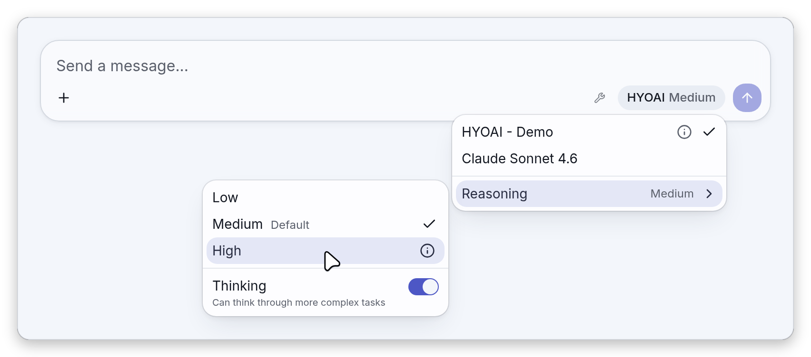
</picture>

### Local model

Run a model on your own hardware. The fastest path is **Ollama**, in two
commands:

```bash
docker run -d --name ollama -v ollama:/root/.ollama -p 11434:11434 \
    -e OLLAMA_ORIGINS='http://127.0.0.1:4117' ollama/ollama
docker exec -it ollama ollama run llama3.2:1b   # small, CPU-friendly (alt: qwen2.5:0.5b)
```

Then add this to `public/config.json` (already present in
`config.example.json`):

```json
{
    "id": "ollama",
    "name": "Ollama (local)",
    "baseUrl": "http://127.0.0.1:11434/v1",
    "type": "openai",
    "model": "llama3.2:1b",
    "streaming": true
}
```

`OLLAMA_ORIGINS` must allow the page origin (here the dev server,
`http://127.0.0.1:4117`) so the browser may call Ollama — use `*` for quick
tests only.

**llama.cpp** and **vLLM** work the same way: start the server with the front-end origin allowed, then add an
entry that points at it (`"type": "llama.cpp"` or `"type": "vllm"`). All three backends are pre-wired in
`config.example.json` (the vLLM entry ships with `"disabled": true`; remove that line to use it); the exact
commands and entries are in [docs/models.md](docs/models.md), and the [CORS](#cors) section lists the
per-backend origin flags.

### Remote model

Point HYOAI at a hosted API instead. Browsers can only call APIs that send CORS
headers. **[OpenRouter](https://openrouter.ai)** does, so it works directly from
a static deployment:

```json
{
    "id": "openrouter",
    "name": "OpenRouter",
    "baseUrl": "https://openrouter.ai/api/v1",
    "type": "openai",
    "model": "openai/gpt-4o-mini",
    "apiKey": "sk-or-xxxxxxxx",
    "streaming": true
}
```

The **OpenAI** API does not allow direct browser calls (no CORS); reach it
through a same-origin reverse proxy (a relative `baseUrl`, see
[CORS](#cors)) or a small local proxy. Note that any `apiKey` in `config.json`
ships to the browser, so only use keys you are comfortable exposing on that
origin, or front the endpoint with a proxy that injects the key.

**Anthropic** is reachable straight from the browser through a per-model `headers` opt-in; that entry, and the
other providers, are in [docs/models.md](docs/models.md).

## Quick start (the app)

```bash
npm install
cp public/config.example.json public/config.json   # then edit to taste
npm run dev                                         # http://127.0.0.1:4117
```

| Script           | Description                                    |
| ---------------- | ---------------------------------------------- |
| `npm run dev`    | Dev server on `http://127.0.0.1:4117`          |
| `npm run build`  | Production build (static export to `out/`)     |
| `npm run start`  | Serves `out/` on port 4118                     |
| `npm run check`  | `tsc --noEmit` + ESLint + Prettier (read-only) |
| `npm run test`   | Unit tests (Vitest), not run by `check`        |
| `npm run format` | Prettier + ESLint in write mode                |

`npm run build` produces a fully static `out/` directory. Deploy it to any
static host; `config.json` sits at the site root and can be edited without a
rebuild.

## Documentation

The sections below give the essentials. The guides in [docs/](docs/) go further, with a walkthrough of the
interface and the reference for every option:

| Guide                                       | What it covers                                                                                                                       |
| ------------------------------------------- | ------------------------------------------------------------------------------------------------------------------------------------ |
| [Models](docs/models.md)                    | Adding a model (Ollama, llama.cpp, vLLM, OpenRouter, OpenAI, Anthropic), every `config.json` key, the Config tab, reasoning controls |
| [Tool calling](docs/tools.md)               | Letting a model call tools: approvals, the flow, server flags, safety limits, the Tools settings                                     |
| [MCP servers](docs/mcp.md)                  | Plugging MCP servers in: the catalog, states, scope per model, CORS, reverse proxy, secrets                                          |
| [Compare and availability](docs/compare.md) | Side-by-side panes, and what happens when a model's server stops answering                                                           |
| [Using HYOAI](docs/features.md)             | A tour of conversations, quoting, branches, attachments, search, export, math and mobile                                             |
| [Embedding](docs/embed.md)                  | The iframe widget and its `postMessage` bridge                                                                                       |
| [Plugins](plugins/README.md)                | Build-time plugins for backends with their own protocol                                                                              |

## Model configuration: `config.json`

`config.json` is the source of truth for the model list: on startup the
application loads a `config.json` file served next to it (in dev:
`public/config.json`; in prod: dropped at the site root, editable without a
rebuild). Each entry describes a model and the endpoint serving it. The in-app
**Config** tab (Settings) edits the same fields as local overrides, stored in
`localStorage` on top of the deployed file and revertable from the Reset dialog.

<picture>
    <source media="(prefers-color-scheme: dark)" srcset="docs/images/config-dark.png">
    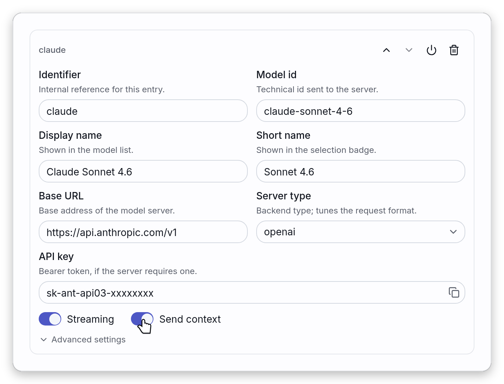
</picture>

`public/config.json` is gitignored (it holds deployment-specific endpoints):
copy `public/config.example.json` to `public/config.json` to get started. The
example covers the two on-ramps above plus the different `type`s, a minimal
entry (booleans have defaults), a disabled entry, an API key, and a relative URL
behind a reverse proxy.

An optional root `appName` key sets the deployment name shown on the empty chat
screen (`Chat with <appName> models`); when omitted it falls back to a generic
localized word (`AI` / `IA`). The other root keys (`defaultModel`, `embedOrigins`, `mcp`,
`integrations` and the top-level `thinking` and `effort`) are in
[docs/models.md](docs/models.md#root-keys).

An entry needs an `id` and a `baseUrl`. A `type` (`vllm`, `llama.cpp`, `openai`, or a [plugin](#plugins) type;
default: `vllm`) selects the transport and the sampling-parameter mapping, and `model` pins the upstream model
(optional for the built-in types, which list their models; a [plugin](#plugins) type that does not list its models
needs it, or the entry is disabled). The other keys are optional: `name`, `shortName`, `apiKey`, custom `headers`,
`streaming`, `sendContext`, `modalities`, `thinking`, `effort`, `supportsThinking`, `runtimeProps`, `disabled`, the
per-model options of [tool calling](#tool-calling) (`tools`, `parallelToolCalls`, `recoverToolCalls`,
`supportsToolChoice`) and the `mcpServers` scope of [MCP servers](#mcp-servers). The full key table, how the
model lists and the `/props` probes work, and what the browser remembers are in [docs/models.md](docs/models.md).

## Reasoning: `thinking` and `effort`

A model that exposes a reasoning knob (Qwen3, gpt-oss, ...) can declare how to
drive it from the model menu. Both keys live either at the top level (applied to
every model) or on a `models` entry (which overrides the top-level default), and
both merge a backend-specific fragment into the request body — so the same UI
adapts to any server. The Thinking switch appears when `supportsThinking`
resolves to true (by default when a `thinking` config with an `on` or `off`
fragment is present, or when a plugin type declares that it reasons by default;
overridable per entry); the levels appear when `effort` has levels. Each compare
pane keeps its own choice (otherwise the global setting applies).

`thinking` is an on/off toggle. Its `on`/`off` fragments are sent when the
Thinking switch is on or off; a missing side sends nothing, leaving the model's
own default:

```json
{
    "thinking": {
        "on": { "chat_template_kwargs": { "enable_thinking": true } },
        "off": { "chat_template_kwargs": { "enable_thinking": false } }
    }
}
```

`effort` is a level picker. `levels` is an ordered list shown as a submenu of the
model menu (flat in the bottom drawer when the menu is a drawer: a window under
768 px or a device whose primary pointer is coarse); the active level's `body` is
merged into the request (a level without a `body` sends its `id` as
`reasoning_effort`, unless the request already carries a `reasoning_effort`, for
example from the `thinking` fragment) and `default` is the id used until the user
picks another (without a valid `default`, the first level applies):

```json
{
    "effort": {
        "default": "medium",
        "levels": [
            { "id": "low", "label": "Low", "body": { "reasoning_effort": "low" } },
            { "id": "high", "label": "High", "body": { "reasoning_effort": "high" } }
        ]
    }
}
```

Typical knobs: `chat_template_kwargs` with `enable_thinking` (Qwen3),
`reasoning_effort` (gpt-oss), or `reasoning_budget` (`0` disables thinking on
some llama.cpp Qwen3 builds).

A model whose chat template supports it can also get the reasoning of earlier turns back (`preserve_thinking`, an
opt-in): see [docs/models.md](docs/models.md).

## Tool calling

The model can call tools while it answers. A tool is a function a provider exposes (the app ships
a harmless `clock` tool that returns the time in an IANA time zone; [plugins](#plugins) can add
others). Tools are off by default: turn them on per conversation from the wrench button in the
composer, whose panel also lists the providers with how many tools each offers, or for new
conversations in Settings → Tools. The wrench is greyed out when the model cannot take tools. A
conversation that used tools and has them switched off shows a notice above the composer with a
button to switch them back on, when the current model can take tools.

For each step the model asks for a call, the app shows the tool and its full arguments, waits for
your decision (allow once, always allow this tool, or deny) unless the tool is already set to
Always allow (it runs at once) or Disabled (the tool is not offered to the model), runs it, and
sends the result back so the model can answer or call again. Calls run one after the other, an
answer stops after 10 steps by default (then **Continue** or **Answer without tools**), and a
stopped or reloaded flow can be continued the same way. The calls show as cards above the answer,
each with its arguments and result; regenerating, branching and deleting act on the whole flow.

<picture>
    <source media="(prefers-color-scheme: dark)" srcset="docs/images/tool-approval-dark.png">
    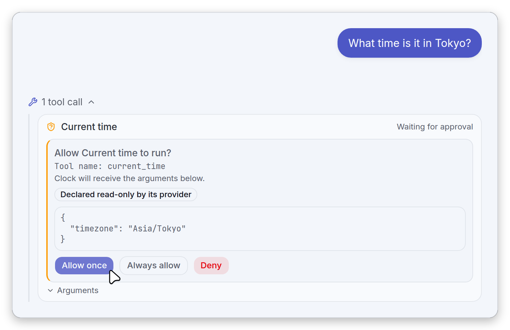
</picture>

The server has to support it, and some need a flag:

- **llama.cpp**: start `llama-server` with `--jinja`. Without it the server refuses the tools and
  the error says so. With `runtimeProps`, the app reads the chat template from `GET /props` and
  turns tools on by itself when the template handles them; set `"tools": false` on the entry when
  that detection is wrong.
- **vLLM**: start it with `--enable-auto-tool-choice --tool-call-parser <parser>` (for example
  `hermes`), and set `"tools": true` on the entry.
- **Ollama and other OpenAI-compatible servers**: use `"type": "openai"` and `"tools": true`. These
  servers may reject `tool_choice`, which is why `supportsToolChoice` is off for that type.
- A model whose chat template does not support tools keeps working: when the request offers no
  tools, the results of earlier calls stay in the context as text added to the message they
  answer (or as a message of their own when the model wrote text before the call or the question carries
  attachments), and the calls
  themselves are not written out, so the model does not imitate them.

How a step that ends badly is reported, how to recover a call a server leaks as text (`recoverToolCalls`) and the
Tools settings screen are in [docs/tools.md](docs/tools.md).

Security defaults:

- Every tool asks before it runs. "Always allow" applies to one tool, never to a whole provider,
  and Settings → Tools lists the decisions and can reset them. Setting the default to "always
  allow" is a deliberate choice and shows a warning. Approvals are never imported from an export.
- A result is capped at 20,000 characters by default (the Result size limit setting), shown as
  plain text (never rendered as Markdown or HTML), and a call is cut after 60 seconds. Nothing the
  model writes after a tool result on the same branch, and no summary, loads a remote image (the
  image appears as a link, `Image not loaded: {url}`), so an injected instruction cannot send data
  out through an image address.
- Tools are never offered in an embed (see
  [what the widget leaves out](docs/embed.md#what-the-widget-leaves-out)). A tool provider is code
  running in the page: see [Plugins](#plugins).

An export in the HYOAI format that contains tool calls imports into this app without loss. The
llama.cpp webui format brings the calls back with every result as "Done", and the OpenAI
(JSONL) and Markdown exports cannot be imported (see [Export](docs/tools.md#export)). Older builds
of the app, and the llama.cpp web interface, may drop or flatten them.

### MCP servers

An [MCP](https://modelcontextprotocol.io) server gives the models more tools. The app is an MCP
client that runs in the browser and plugs the server's tools into the same loop as the others (see
[Tool calling](#tool-calling)): the model sees them, every call shows its arguments and waits for
your decision, and the result is capped and shown as plain text. Nothing is run without your
approval unless you allow the tool yourself, and no MCP tool is ever offered in an embed (see
[what the widget leaves out](docs/embed.md#what-the-widget-leaves-out)).

The catalog of servers is the `mcp.servers` list of `config.json`:

```json
{
    "mcp": {
        "servers": [
            {
                "id": "docs",
                "label": "Product docs",
                "url": "/mcp/docs",
                "transport": "auto",
                "headers": { "Authorization": "Bearer xxxxxxxx" },
                "enabled": true
            }
        ]
    }
}
```

A server that is not valid is skipped with a warning in the browser console; the other servers and the models
are not affected. Settings → Tools shows one card per server: its state (off, not connected, connecting, connected,
authentication refused (401 or 403), address not found, no answer, unreachable, blocked by CORS or by the local
network permission, or a protocol error), its address, an on/off switch, and the tools it lists, each with its own
approval (Ask each time, Always allow or Disabled; the default is Ask each time). The wrench panel in the composer lists the servers too, and
`mcpServers` on a model entry narrows which of them that model sees.

<picture>
    <source media="(prefers-color-scheme: dark)" srcset="docs/images/mcp-servers-short-dark.png">
    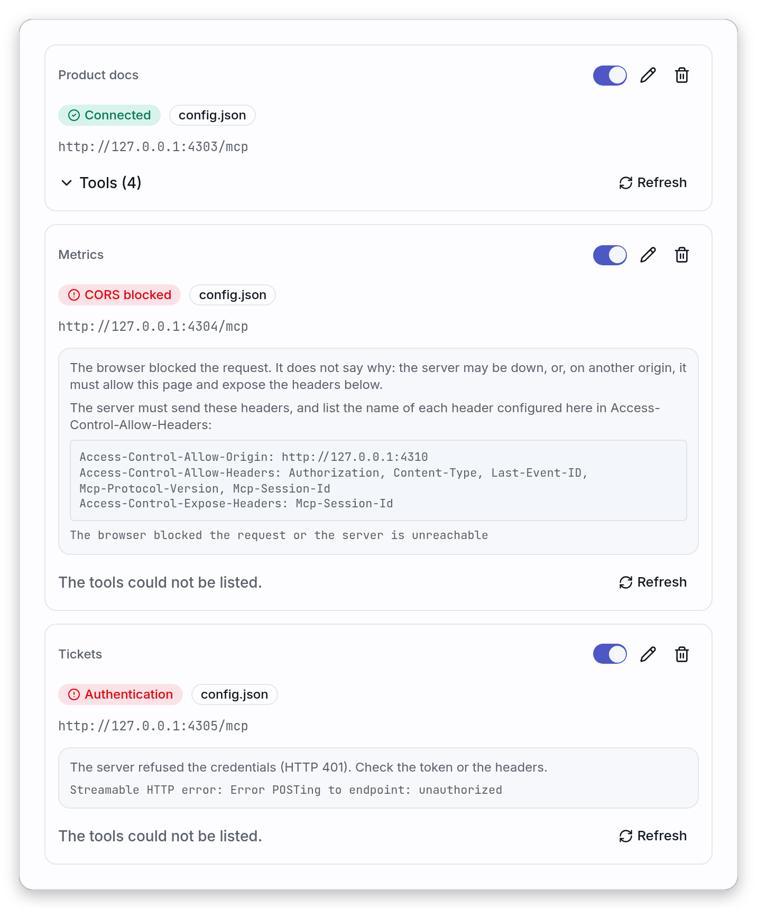
</picture>

The key table, the CORS headers a server must send, the reverse-proxy recipes (Caddy, nginx), how secrets are
stored and what is not supported are in [docs/mcp.md](docs/mcp.md).

## Integrations

`config.json` may declare an optional `integrations` array to wire UI actions to
external HTTP endpoints without code changes — adding another endpoint is a pure
config edit. Each entry targets some model entries (`models`, or all when
omitted) and fires a JSON `POST`:

```json
{
    "integrations": [
        {
            "id": "feedback",
            "kind": "feedback",
            "url": "https://collector.example.com/feedback",
            "headers": { "Authorization": "Bearer xxxxxxxx" },
            "models": ["local"]
        }
    ]
}
```

| Key       | Type              | Description                                                            |
| --------- | ----------------- | ---------------------------------------------------------------------- |
| `id`      | string (required) | Stable identifier                                                      |
| `kind`    | `feedback`        | Built-in kind; `feedback` adds thumb up/down buttons under each answer |
| `url`     | string (required) | Endpoint called when the action fires                                  |
| `method`  | string            | HTTP method (default: `POST`)                                          |
| `headers` | object            | Extra request headers (e.g. an `Authorization` bearer)                 |
| `models`  | string[]          | `models` entry ids it applies to; omit for all                         |

An entry is matched through its pinned `model`, so an entry without `model` (one
that discovers its models) is not matched when `models` is set: the entry whose
`id` is `local` has to pin a `model`.

The `feedback` kind POSTs `{ question, answer, rating, comment, thinking_active,
effort }`, where `rating` is `"up"` or `"down"` and `effort` is only present when
a level is set. An unknown or malformed entry is dropped rather than failing the
whole config. As with `apiKey`, any token in `headers` ships to the browser, so
keep these endpoints internal or front them with a proxy.

## Plugins

A plugin adds a server type for a backend with its own protocol, without touching the core. Plugins
are found at build time in the git-ignored `plugins/` folder: drop a folder there, restart
`npm run dev` or run `npm run build`, and `"type": "<id>"` works in `config.json`. Without any plugin
the app builds and runs as usual. The contract, the events a transport can emit (steps, citations,
stage timings), the hook that upgrades the messages it stored, the tool providers a plugin can add,
and a complete example are in [plugins/README.md](plugins/README.md). Plugins are trusted code,
bundled into the app: only install ones you wrote or audited.

## Embed

The same static build doubles as an embeddable widget: loaded in an iframe with
`?embed=1`, it renders a compact chat surface instead of the full application —
no second bundle, still no server side.

```html
<iframe
    src="https://chat.example.com/?embed=1&model=local&lock=1&intro=1"
    style="width: 380px; height: 560px; border: 0"
></iframe>
```

The URL carries the look, the locale and the forced model; a `postMessage`
bridge lets the host page set the system prompt, inject a turn, follow the
generation state or run a headless completion in a hidden iframe. The widget
only accepts messages from its own origin and from the origins listed in
`embedOrigins`.

See **[docs/embed.md](docs/embed.md)** for the parameter list, the message
contract, the storage isolation rules and
[what the widget leaves out](docs/embed.md#what-the-widget-leaves-out) (tools, the Tools and Config
tabs, Compare models, the global shortcuts and the availability watcher).

## CORS

The app is served from a different origin than the inference endpoints, so each
endpoint must allow the front-end origin:

- **llama.cpp**: `--http-cors-origin http://127.0.0.1:4117`
- **vLLM**: `--allowed-origins '["http://127.0.0.1:4117"]'`
- **Ollama**: `OLLAMA_ORIGINS=http://127.0.0.1:4117`

Without it, the browser blocks the requests and the UI reports a network error.

**Public APIs:** some send CORS headers and work directly (e.g. OpenRouter);
others (e.g. OpenAI) do not and cannot be called straight from a browser.

**CORS-free alternative:** serve the app behind a reverse proxy that also
exposes the inference endpoint, and use a relative `baseUrl` (`/llm`). Requests
then stay on the same origin and no CORS configuration is needed. A `./llm`
`baseUrl` resolves against the page directory (useful under a sub-path).

## Related projects

HYOAI's niche is the **pure-client, static** end of the spectrum: no backend, no
container required, multi-backend, with reasoning controls and a compare mode.
Other good projects, grouped by architecture:

- **Client-only / static (closest peers):**
  [Hollama](https://github.com/fmaclen/hollama),
  [BetterChatGPT](https://github.com/ztjhz/BetterChatGPT),
  [WebLLM Chat](https://github.com/mlc-ai/web-llm-chat) (runs models in-browser
  via WebGPU), [TypingMind](https://www.typingmind.com) (proprietary).
- **Server-based (richer, need a backend):**
  [Open WebUI](https://github.com/open-webui/open-webui),
  [NextChat](https://github.com/ChatGPTNextWeb/NextChat),
  [LibreChat](https://github.com/danny-avila/LibreChat),
  [Lobe Chat](https://github.com/lobehub/lobe-chat),
  [AnythingLLM](https://github.com/Mintplex-Labs/anything-llm),
  [Hugging Face chat-ui](https://github.com/huggingface/chat-ui).
- **Desktop apps:** [Jan](https://github.com/janhq/jan),
  [LM Studio](https://lmstudio.ai),
  [GPT4All](https://github.com/nomic-ai/gpt4all).

## Stack

- Next.js (App Router, static export in production), React 19, strict TypeScript
- Tailwind CSS v4, shadcn/ui (Radix primitives via the unified `radix-ui` package)
- next-themes (light/dark/system) + six switchable skins (`soft`, `flat`, `contrast`, `warm`, `forest`,
  `dim`)
- next-intl (FR/EN, no routing)
- react-markdown + remark-gfm + rehype-highlight (Markdown and code rendering)
- remark-math + rehype-katex (math) and mermaid (diagrams)
- lz-string (conversation compression in localStorage)

## Structure

```
app/            layout (fonts, anti-FOUC script), single page, globals.css (tokens), appearance/ (skins)
components/     chat/ (view, message, composer, dialogs), settings/ (tabs, fields,
                editors, dialogs, mcp), layout/ (shells, header, sidebar), compare/,
                markdown/, common/ (cross-domain), ui/ (shadcn)
hooks/          useStore (useSyncExternalStore + selectors), useActiveChat, useConversations
lib/            api/ (SSE, params mapping), plugins/ (registry, SDK), tools/ (catalog, runner),
                mcp/ (MCP client and server registry), storage/ (compressed
                localStorage, quota), stores/ (settings, models, conversations, chat),
                chat/ (chat instances, panes, availability), tree, actions
messages/       next-intl catalogs fr.json / en.json
plugins/        build-time plugins (git-ignored, see plugins/README.md)
docs/           guides (models, tools, MCP, compare, features, embed) and images/ (their screenshots)
public/         config.example.json (sample) and config.json (your models, git-ignored)
types/          shared types (chat, server, settings, api, storage, tools, mcp, plugin)
```

## Features

The interface features are walked through, with more screenshots, in [Using HYOAI](docs/features.md);
compare and availability, tool calling and MCP, and the model and reasoning options have their own guides:
[Compare and availability](docs/compare.md), [Tool calling](docs/tools.md), [MCP servers](docs/mcp.md) and
[Models](docs/models.md).

- Local conversations: lightweight index + one localStorage key per
  conversation, debounced writes while streaming, usage gauge, JSON
  export/import (native or llama.cpp web UI format) and export as Markdown or
  OpenAI-format JSONL

<picture>
  <source media="(prefers-color-scheme: dark)" srcset="docs/images/sidebar-dark.png">
  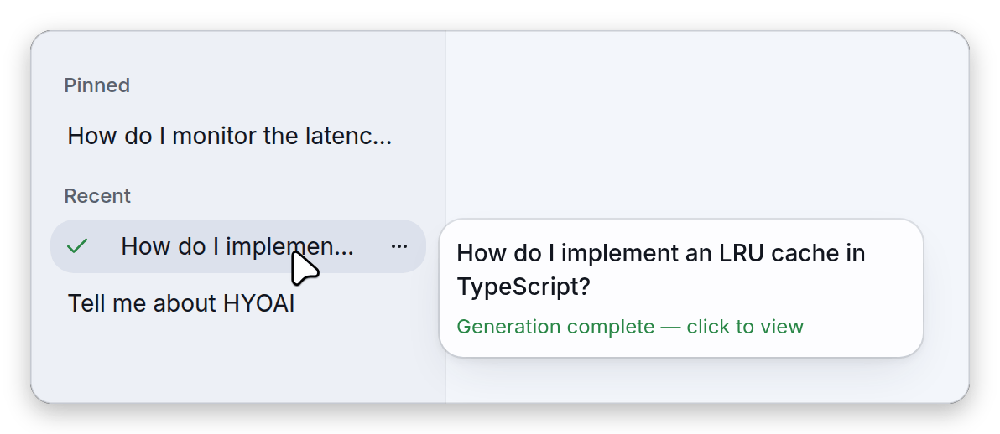
</picture>

- Branches: editing a message or regenerating a reply creates a navigable
  alternative version (a 1/2 indicator on each message that has alternatives)
- Quote & reply: quote a whole answer or just a text selection of it to anchor
  the next question on it

<picture>
  <source media="(prefers-color-scheme: dark)" srcset="docs/images/reply-dark.png">
  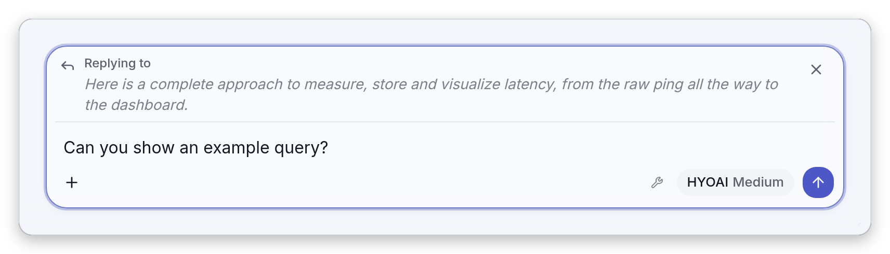
</picture>

- Reasoning (`reasoning_content`) shown in a collapsible block, per-message
  stats (tokens, tok/s, duration); a thinking toggle and effort level in the
  model menu when declared in `config.json` (see above), per pane in compare mode

<picture>
  <source media="(prefers-color-scheme: dark)" srcset="docs/images/thinking-dark.png">
  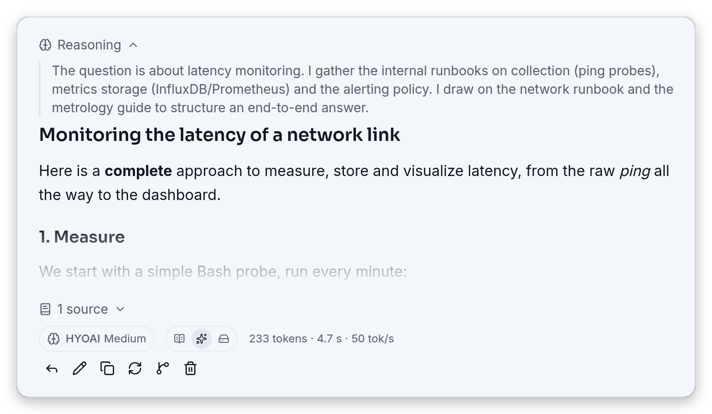
</picture>

- Compare mode: run the same prompt against up to four models side by side, each
  pane keeping its own model and reasoning choice. Closing a pane keeps its
  conversation and lets a running answer finish in the background (it stays in
  the sidebar); closing down to one pane returns to the single chat on that
  conversation without interrupting it. The text typed in the composer follows
  you in and out of the compare (see [docs/compare.md](docs/compare.md)).

<picture>
  <source media="(prefers-color-scheme: dark)" srcset="docs/images/compare-dark.png">
  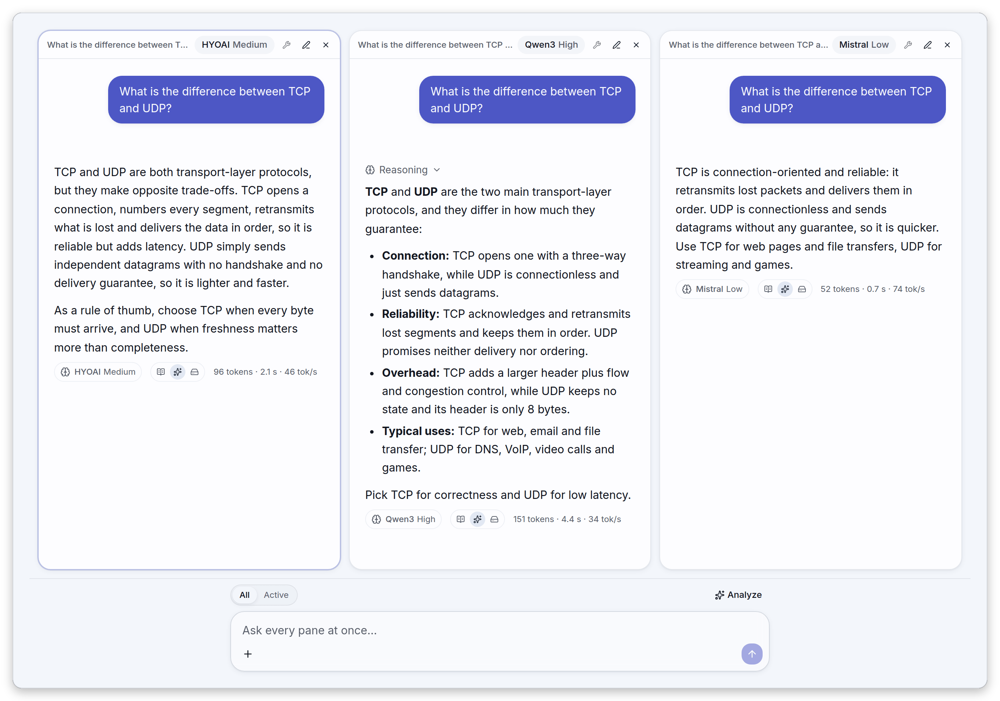
</picture>

- Model availability: when a model's server stops answering, the model is greyed
  out as unavailable in the menus, the single-chat composer is blocked with the
  reason and a Retry button, and a compare pane is greyed and skipped by the
  shared send ("Sending to 2 panes of 3"). It comes back on its own once the
  server answers again. A server counts as down only on a network error, a
  timeout or a gateway 502/503/504, and a slow server that still answers is never
  cut off. The "Automatically disable unavailable models" setting turns this off:
  the model then stays selectable and the error shows on send. A model removed or
  disabled in the configuration is never replaced by another one (see
  [docs/compare.md](docs/compare.md#model-availability)).

<picture>
  <source media="(prefers-color-scheme: dark)" srcset="docs/images/unavailable-dark.png">
  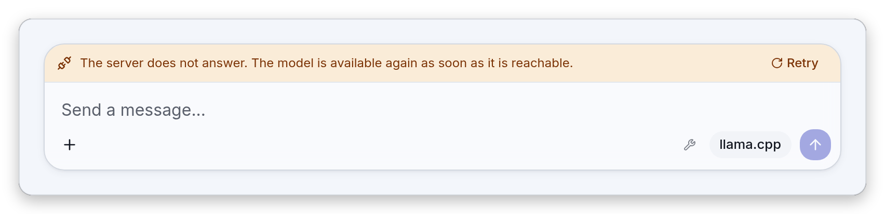
</picture>

- Tool calling: the model can call tools during an answer, with the arguments shown and your
  approval asked before each call (see [Tool calling](#tool-calling)); calls and their results
  appear as cards above the answer and stay in the conversation; [MCP servers](#mcp-servers) plug
  their tools into the same loop

- Markdown & sources: tables, code highlighting and blockquotes render inline;
  answers can carry source citations and a trace of the backend's steps
  alongside the per-message stats
- Math & diagrams: KaTeX renders `$...$`, `$$...$$`, `\(...\)` and `\[...\]`
  formulas, and `mermaid` code blocks render as diagrams with a copy button for
  the source and an SVG download

- Images: paste/drag-and-drop, resized client-side before sending (OpenAI
  vision format)

<picture>
  <source media="(prefers-color-scheme: dark)" srcset="docs/images/attachments-dark.png">
  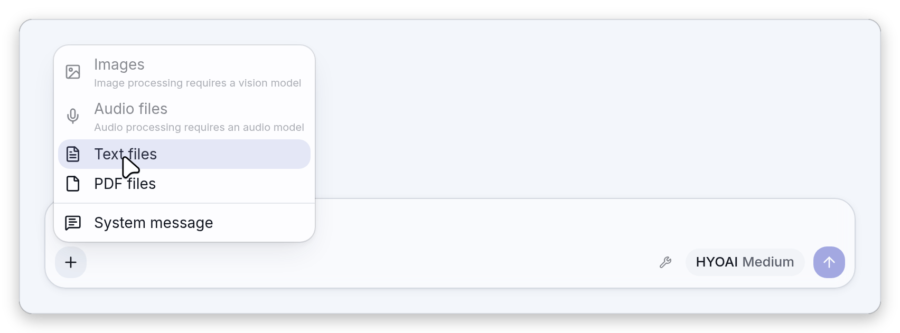
</picture>

- Sampling and penalty settings: an empty field is not sent (the endpoint
  applies its own defaults); parameter names are adapted to the endpoint `type`
  (`repetition_penalty` for vLLM, `repeat_penalty` and `dry_*` for llama.cpp)
- Shortcuts: Ctrl/Cmd+K (palette), Ctrl/Cmd+B (sidebar), Ctrl/Cmd+Shift+O
  (new conversation)
- Responsive, touch-first on mobile: when the window is under the `md` breakpoint
  (768 px) or the primary pointer is coarse (a touch-first device), the model and
  conversation menus open as bottom drawers (drag handle, swipe-to-dismiss,
  safe-area padding); the header More menu exists only below `md`, where it is a
  drawer too; message actions open as a sheet on a long-press with touch or pen,
  at any width, so long menus stay thumb-reachable; the media-query hook is
  SSR-safe, so the static export hydrates cleanly

<picture>
  <source media="(prefers-color-scheme: dark)" srcset="docs/images/responsive-dark.png">
  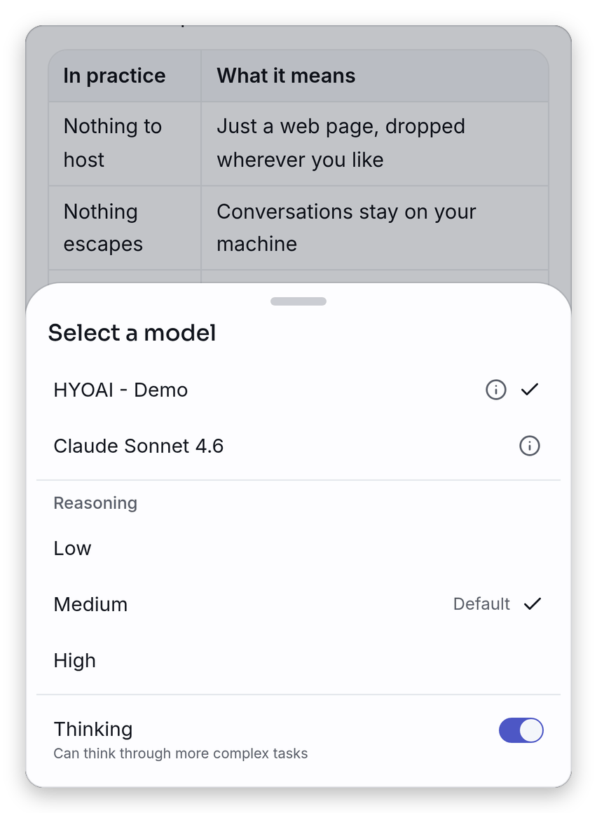
</picture>

- Accessible: icon-only controls carry `aria-label`s and decorative glyphs are
  `aria-hidden`; drawers and dialogs keep a title (visually hidden when not
  shown), and menu focus returns to its trigger or is handed off on dismiss —
  keyboard-operable throughout via the underlying Radix primitives

## License

Licensed under the [Apache License 2.0](LICENSE). Copyright 2026 Zenetys — see
[NOTICE](NOTICE).
