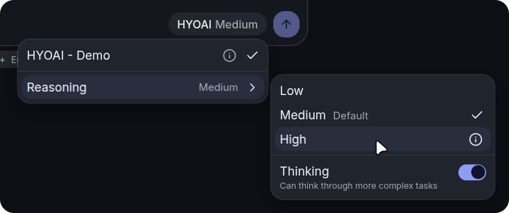
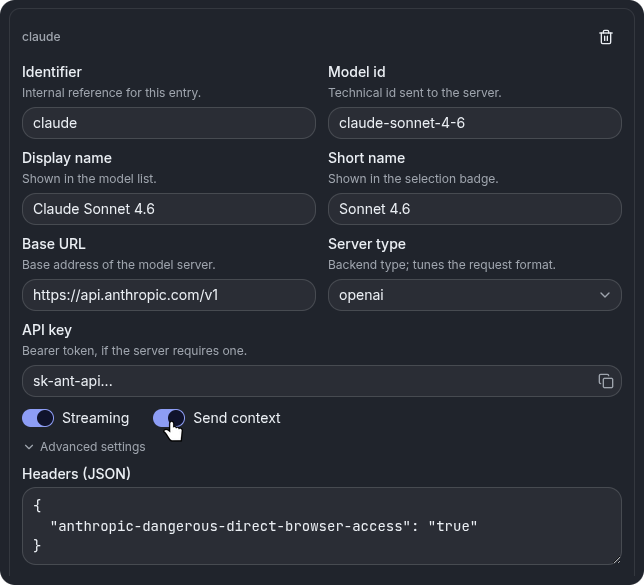
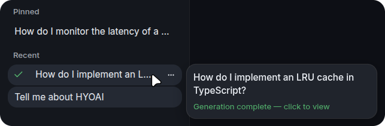
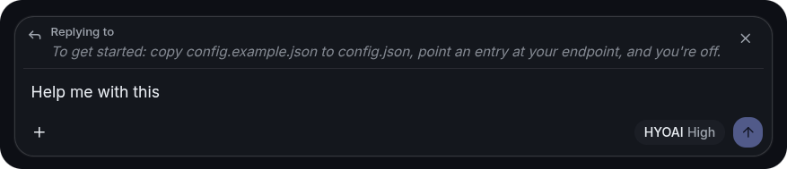
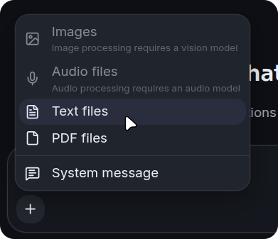
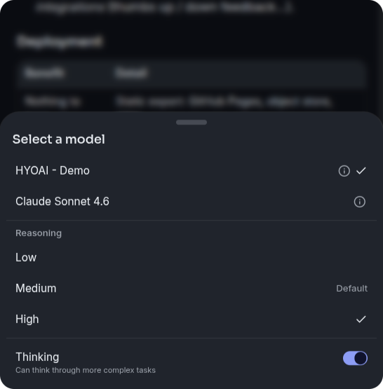

# HYOAI

> **Host Your Own AI** — a server-less, browser-only chat UI for any
> OpenAI-compatible LLM.

HYOAI is a 100% static front-end: no backend of its own, nothing to deploy or
secure. The browser talks **directly** to your inference server's API
(llama.cpp, vLLM, Ollama, or any OpenAI-compatible endpoint, including public
ones). Conversations never leave the browser — they live in `localStorage`
(compressed). Drop the build anywhere static files are served: an object store,
a CDN, or right next to your inference server.

> **HYOAI ships no model.** You bring your own LLM. The
> [Bring your own LLM](#bring-your-own-llm) section gets one running in a couple
> of minutes.

## Why we built it

HYOAI is built and open-sourced by **[Zenetys](https://www.zenetys.com)**, an IT
services company specialized in the **observability** and **operational
maintenance** of network and security infrastructures.

Evaluating, comparing and benchmarking LLMs is part of how we assess technical
choices — for ourselves and for our clients. We wanted a dependency-free way to:

- **test and benchmark** LLM endpoints quickly, from any machine, with no setup;
- **verify OpenAI-API compatibility** across backends (llama.cpp, vLLM, Ollama,
  public APIs) from a single client;
- have a **self-sufficient, portable** chat client with nothing to host, no
  database, and no data leaving the browser.

It started life as a replacement for llama.cpp's bundled web UI and grew into a
general-purpose, multi-backend client.

## Bring your own LLM

HYOAI needs an LLM endpoint to talk to. You point it at a **local** server you
run yourself, or at a **remote** API — or both, and switch between them from the
model menu, where a reasoning level and thinking toggle also live when the model
declares them (see [Reasoning](#reasoning-thinking-and-effort)).



### Local model

Run a model on your own hardware. The fastest path is **Ollama**, in two
commands:

```bash
docker run -d --name ollama -v ollama:/root/.ollama -p 11434:11434 \
    -e OLLAMA_ORIGINS='http://127.0.0.1:4117' ollama/ollama
docker exec -it ollama ollama run llama3.2:1b   # small, CPU-friendly (alt: qwen2.5:0.5b)
```

Then add this to `public/config.json` (already present in
`config.example.json`):

```json
{
    "id": "ollama",
    "name": "Ollama (local)",
    "baseUrl": "http://127.0.0.1:11434/v1",
    "type": "openai",
    "model": "llama3.2:1b",
    "streaming": true
}
```

`OLLAMA_ORIGINS` must allow the page origin (here the dev server,
`http://127.0.0.1:4117`) so the browser may call Ollama — use `*` for quick
tests only.

**llama.cpp** works the same way — run `llama-server` with a CORS origin, then
point an entry at it (no `model`, so every model the server lists becomes
selectable):

```bash
llama-server -hf ggml-org/gpt-oss-20b-GGUF \
    --host 0.0.0.0 --port 8080 --http-cors-origin http://127.0.0.1:4117
```

```json
{
    "id": "llamacpp",
    "name": "Local llama.cpp",
    "baseUrl": "http://127.0.0.1:8080",
    "type": "llama.cpp",
    "streaming": true
}
```

**vLLM** likewise — serve a model with the front-end origin allowed:

```bash
vllm serve Qwen/Qwen2.5-7B-Instruct \
    --host 0.0.0.0 --port 8000 --allowed-origins '["http://127.0.0.1:4117"]'
```

```json
{
    "id": "vllm",
    "name": "vLLM server",
    "baseUrl": "http://127.0.0.1:8000/v1",
    "type": "vllm",
    "model": "Qwen/Qwen2.5-7B-Instruct"
}
```

All three are pre-wired in `config.example.json`; the [CORS](#cors) section
lists the per-backend origin flags.

### Remote model

Point HYOAI at a hosted API instead. Browsers can only call APIs that send CORS
headers. **[OpenRouter](https://openrouter.ai)** does, so it works directly from
a static deployment:

```json
{
    "id": "openrouter",
    "name": "OpenRouter",
    "baseUrl": "https://openrouter.ai/api/v1",
    "type": "openai",
    "model": "openai/gpt-4o-mini",
    "apiKey": "sk-or-xxxxxxxx",
    "streaming": true
}
```

The **OpenAI** API does not allow direct browser calls (no CORS); reach it
through a same-origin reverse proxy (a relative `baseUrl`, see
[CORS](#cors)) or a small local proxy. Note that any `apiKey` in `config.json`
ships to the browser, so only use keys you are comfortable exposing on that
origin, or front the endpoint with a proxy that injects the key.

**Anthropic** can be reached directly from the browser by declaring its opt-in
through the per-model `headers` field:

```json
{
    "id": "claude",
    "name": "Claude (Anthropic)",
    "baseUrl": "https://api.anthropic.com/v1",
    "type": "openai",
    "model": "claude-sonnet-4-6",
    "apiKey": "sk-ant-xxxxxxxx",
    "headers": { "anthropic-dangerous-direct-browser-access": "true" }
}
```

## Quick start (the app)

```bash
npm install
cp public/config.example.json public/config.json   # then edit to taste
npm run dev                                         # http://127.0.0.1:4117
```

| Script           | Description                                    |
| ---------------- | ---------------------------------------------- |
| `npm run dev`    | Dev server on `http://127.0.0.1:4117`          |
| `npm run build`  | Production build (static export to `out/`)     |
| `npm run start`  | Serves `out/` on port 4118                     |
| `npm run check`  | `tsc --noEmit` + ESLint + Prettier (read-only) |
| `npm run format` | Prettier + ESLint in write mode                |

`npm run build` produces a fully static `out/` directory. Deploy it to any
static host; `config.json` sits at the site root and can be edited without a
rebuild.

## Model configuration: `config.json`

`config.json` is the source of truth for the model list: on startup the
application loads a `config.json` file served next to it (in dev:
`public/config.json`; in prod: dropped at the site root, editable without a
rebuild). Each entry describes a model and the endpoint serving it. The in-app
**Config** tab (Settings) edits the same fields as local overrides, stored in
`localStorage` on top of the deployed file and revertable from the Reset dialog.



`public/config.json` is gitignored (it holds deployment-specific endpoints):
copy `public/config.example.json` to `public/config.json` to get started. The
example covers the two on-ramps above plus the different `type`s, a minimal
entry (booleans have defaults), a disabled entry, an API key, and a relative URL
behind a reverse proxy.

An optional root `appName` key sets the deployment name shown on the empty chat
screen (`Chat with <appName> models`); when omitted it falls back to a generic
localized word (`AI` / `IA`).

Keys of a `models` entry:

| Key                  | Type                                               | Description                                                                                                                                                                                                                                                  |
| -------------------- | -------------------------------------------------- | ------------------------------------------------------------------------------------------------------------------------------------------------------------------------------------------------------------------------------------------------------------ |
| `id`                 | string (required)                                  | Stable identifier, referenced by `defaultModel` and local preferences                                                                                                                                                                                        |
| `name`               | string                                             | Name shown in the selector (default: `id`)                                                                                                                                                                                                                   |
| `baseUrl`            | string (required)                                  | Endpoint base URL, with or without `/v1`; absolute, or relative to the site (`/llm`, `./llm`)                                                                                                                                                                |
| `model`              | string                                             | Pins the upstream model sent to the API; when absent, every model listed by the endpoint's `GET /v1/models` becomes selectable (llama.cpp, llama-swap)                                                                                                       |
| `type`               | `vllm` \| `llama.cpp` \| `openai` \| a plugin type | Selects the transport: OpenAI-compatible (`vllm`/`llama.cpp`/`openai`) or a type added by an installed [plugin](#plugins); also drives the sampling-parameter mapping (default: `vllm`). An entry whose type no installed plugin serves is kept but disabled |
| `apiKey`             | string                                             | Optional; sent as `Authorization: Bearer` when present                                                                                                                                                                                                       |
| `streaming`          | boolean                                            | `true`: token-by-token SSE; `false`: single JSON response (default: `true`)                                                                                                                                                                                  |
| `sendContext`        | boolean                                            | `true`: full branch history; `false`: last message only (default: `true`)                                                                                                                                                                                    |
| `disabled`           | boolean                                            | `true`: keep the entry in the file but hide it from the model selector (default: `false`)                                                                                                                                                                    |
| `modalities`         | `{ image?, audio? }`                               | Attachment capabilities; a `false` flag disables that attachment menu entry. Off by default unless the endpoint is probed (`runtimeProps`, e.g. llama.cpp `/props`); overridable                                                                             |
| `supportsThinking`   | boolean                                            | Whether the reasoning toggle is offered. Defaults from `type` and from the presence of a `thinking` config, overridable                                                                                                                                      |
| `tools`              | boolean                                            | Tool calling for this entry; off unless the config says `true` or a llama.cpp server reports a chat template that handles tools. `false` forces it off. See [Tool calling](#tool-calling)                                                                    |
| `parallelToolCalls`  | boolean                                            | Lets the model call several tools in one step (sent as `parallel_tool_calls`; default: not sent)                                                                                                                                                             |
| `mcpServers`         | string[]                                           | Which servers of the [MCP catalog](#mcp-servers) this entry may use: absent means every enabled server, a list means only those, `[]` means none. Only matters when tools are on for the entry                                                               |
| `supportsToolChoice` | boolean                                            | Whether the server accepts the `tool_choice` field. Defaults from `type` (`false` for `openai`, which covers Ollama), overridable                                                                                                                            |
| `runtimeProps`       | boolean                                            | Whether the endpoint exposes a llama.cpp-style `GET /props` (context size, modalities, model info). Defaults from `type`, overridable                                                                                                                        |

An optional `headers` object adds custom request headers to every call to the
endpoint (merged after the `apiKey` bearer) — use it for provider opt-ins such
as Anthropic's `anthropic-dangerous-direct-browser-access`.

Only the active choice (entry and picked model) is remembered in localStorage;
the file remains the source of truth for the list. Discovered lists refresh at
startup and whenever the model selector opens, and `runtimeProps` endpoints are
also probed through `GET /props` for their context size, modalities (image and
audio attachments are gated on them) and the model information dialog. Other
entries, such as vLLM or SGLang servers, are probed for their context size
through `GET /get_model_info`, `GET /get_server_info` and `GET /props`, each
request being cut off after five seconds.

## Reasoning: `thinking` and `effort`

A model that exposes a reasoning knob (Qwen3, gpt-oss, ...) can declare how to
drive it from the model menu. Both keys live either at the top level (applied to
every model) or on a `models` entry (which overrides the top-level default), and
both merge a backend-specific fragment into the request body — so the same UI
adapts to any server. The controls only appear where the keys are present, and
each compare pane keeps its own choice (otherwise the global setting applies).

`thinking` is an on/off toggle. Its `on`/`off` fragments are sent when the
Reasoning switch is on or off; a missing side sends nothing, leaving the model's
own default:

```json
{
    "thinking": {
        "on": { "chat_template_kwargs": { "enable_thinking": true } },
        "off": { "chat_template_kwargs": { "enable_thinking": false } }
    }
}
```

`effort` is a level picker. `levels` is an ordered list shown as a submenu; the
active level's `body` is merged into the request and `default` is the id used
until the user picks another:

```json
{
    "effort": {
        "default": "medium",
        "levels": [
            { "id": "low", "label": "Low", "body": { "reasoning_effort": "low" } },
            { "id": "high", "label": "High", "body": { "reasoning_effort": "high" } }
        ]
    }
}
```

Typical knobs: `chat_template_kwargs` with `enable_thinking` (Qwen3),
`reasoning_effort` (gpt-oss), or `reasoning_budget` (`0` disables thinking on
some llama.cpp Qwen3 builds).

The reasoning of earlier turns is never sent back by default. To send it back as
`reasoning_content` to a model whose chat template supports it, opt in with
`chat_template_kwargs.preserve_thinking` set to the boolean `true`, in the `on`
fragment or in the `body` of an effort level. The saved reasoning then counts
toward the context estimate, and it goes along with the tool calls of the
assistant messages that made them:

```json
{
    "thinking": {
        "on": {
            "chat_template_kwargs": { "enable_thinking": true, "preserve_thinking": true }
        }
    }
}
```

## Tool calling

The model can call tools while it answers. A tool is a function a provider exposes (the app ships
a harmless `clock` tool that returns the time in an IANA time zone; [plugins](#plugins) can add
others). Tools are off by default: turn them on per conversation from the wrench button in the
composer, whose panel also lists the providers and their tools, or for new conversations in
Settings → Tools. The wrench is greyed out when the model cannot take tools. A conversation that
used tools and has them switched off shows a notice above the composer with a button to switch them
back on.

For each step the model asks for a call, the app shows the tool and its full arguments, waits for
your decision (allow once, always allow this tool, or deny), runs it, and sends the result back so
the model can answer or call again. Calls run one after the other, an answer stops after 10 steps
by default (then **Continue** or **Answer without tools**), and a stopped or reloaded flow can be
continued the same way. The calls show as cards above the answer, each with its arguments and
result; regenerating, branching and deleting act on the whole flow.

The server has to support it, and some need a flag:

- **llama.cpp**: start `llama-server` with `--jinja`. Without it the server refuses the tools and
  the error says so. With `runtimeProps`, the app reads the chat template from `GET /props` and
  turns tools on by itself when the template handles them; set `"tools": false` on the entry when
  that detection is wrong.
- **vLLM**: start it with `--enable-auto-tool-choice --tool-call-parser <parser>` (for example
  `hermes`), and set `"tools": true` on the entry.
- **Ollama and other OpenAI-compatible servers**: use `"type": "openai"` and `"tools": true`. These
  servers may reject `tool_choice`, which is why `supportsToolChoice` is off for that type.
- A model whose chat template does not support tools keeps working: when the request offers no
  tools, the results of earlier calls stay in the context as text added to the message they
  answer, and the calls themselves are not written out, so the model does not imitate them.

Security defaults:

- Every tool asks before it runs. "Always allow" applies to one tool, never to a whole provider,
  and Settings → Tools lists the decisions and can reset them. Setting the default to "always
  allow" is a deliberate choice and shows a warning. Approvals are never imported from an export.
- A result is capped at 20,000 characters, shown as plain text (never rendered as Markdown or
  HTML), and a call is cut after 60 seconds. What the model writes after a result loads no remote
  image, so an injected instruction cannot send data out through an image address.
- Tools are never offered in an embed. A tool provider is code running in the page: see
  [Plugins](#plugins).

An export that contains tool calls imports into this app without loss. Older builds of the app, and
the llama.cpp web interface, may drop or flatten them.

### MCP servers

An [MCP](https://modelcontextprotocol.io) server gives the models more tools. The app is an MCP
client that runs in the browser and plugs the server's tools into the same loop as the others (see
[Tool calling](#tool-calling)): the model sees them, every call shows its arguments and waits for
your decision, and the result is capped and shown as plain text. Nothing is run without your
approval unless you allow the tool yourself, and no MCP tool is ever offered in an embed.

The catalog of servers is the `mcp.servers` list of `config.json`:

```json
{
    "mcp": {
        "servers": [
            {
                "id": "docs",
                "label": "Product docs",
                "url": "/mcp/docs",
                "transport": "auto",
                "headers": { "Authorization": "Bearer xxxxxxxx" },
                "enabled": true
            }
        ]
    }
}
```

| Key         | Type                      | Description                                                                                                                             |
| ----------- | ------------------------- | --------------------------------------------------------------------------------------------------------------------------------------- |
| `id`        | string (required)         | 1 to 30 letters, digits, `-` or `_`; unique. It names the server in the approvals table and in a model's `mcpServers` list              |
| `url`       | string (required)         | The MCP endpoint: an `http(s)` URL, or a path resolved against the page (`/mcp/docs`, `./mcp`), which suits a same-origin reverse proxy |
| `label`     | string                    | Name shown in Settings (default: `id`)                                                                                                  |
| `transport` | `auto` \| `http` \| `sse` | `http` is Streamable HTTP, `sse` the older HTTP+SSE. `auto` tries Streamable HTTP and falls back to SSE (default: `auto`)               |
| `headers`   | object of strings         | Sent with every request, for example `Authorization`                                                                                    |
| `enabled`   | boolean                   | `false` keeps the entry in the file but does not connect it nor offer its tools (default: `true`)                                       |

A server that is not valid (bad `id`, missing or unusable `url`, headers that are not strings, an `id`
already used) is skipped with a warning in the browser console; the other servers and the models
are not affected. The Config tab edits the same fields as local overrides, so a server of
`config.json` can be changed, removed and reset like a model entry.

Settings → Tools shows one card per server: its state, its address, an on/off switch, and the tools
it lists, each with its own approval (ask, allow or deny; the default is to ask). The state tells you
what to fix: connected, authentication refused (401 or 403), address not found, no answer, server
unreachable, blocked by CORS, or blocked by the local network permission. The server connects the
first time its tools are needed (or when the Tools tab shows it), the tool list is kept for 30
seconds, and **Refresh** lists again or reconnects.

**Which models see which servers.** With tools on, a model gets every enabled server. Set
`mcpServers` on a `models` entry to narrow that down (`"mcpServers": ["docs"]`, or `[]` for none);
the Config tab has the same choice in the model's advanced options. A list that is not an array of
strings counts as `[]`, never as "all". Tools still have to be on for the model (see
[Tool calling](#tool-calling)).

**Behaviour.** The connection is kept for the whole page life and recovers from an expired session
by connecting again once. A connection attempt is cut after 15 seconds and listing the tools after
10 seconds; a call is cut after 60 seconds like any tool. A tool a server announces twice, or without
a name, is ignored. Text results are used as they are; images, audio and links become a short note
for the model. The server's tool annotations (read-only, destructive) are shown as "not verified"
and never relax an approval.

**CORS.** The browser talks to the server directly, so a server on another origin has to allow this
page, as for [the models](#cors). On top of the usual `Access-Control-Allow-Origin`, MCP needs:

```
Access-Control-Allow-Origin: https://chat.example.com
Access-Control-Allow-Headers: Authorization, Content-Type, Last-Event-ID, Mcp-Protocol-Version, Mcp-Session-Id
Access-Control-Expose-Headers: Mcp-Session-Id
```

Without `Access-Control-Expose-Headers: Mcp-Session-Id` the page cannot read the session id, and the
server either refuses the next request or loses the session. A browser never says why a cross-origin
request failed, so a server that is simply down also shows as "CORS blocked"; check the address first.
Reaching a server on a local address from a public page may also need the browser's local network
permission, which Settings explains when it applies.

**Behind a reverse proxy.** Serving the MCP endpoint under the app's own origin avoids CORS
altogether, and lets the proxy hold the credentials so none reaches the browser. The prefix the proxy
removes must be the one it matched: with Caddy, `handle_path` strips the matched path, so the
configuration below sends `/mcps/docs/mcp` to `/mcp` upstream. Turn buffering off, because the
responses can be event streams:

```
chat.example.com {
    handle_path /mcps/docs/* {
        reverse_proxy https://mcp.example.com {
            header_up Host {upstream_hostport}
            header_up Authorization "Bearer xxxxxxxx"
            flush_interval -1
        }
    }
}
```

Set `"url": "/mcps/docs/mcp"` for it. Do not combine `handle` with `uri strip_prefix` on a different
path: the prefix is then not removed and the server answers 404, which shows as "Not found". With
nginx, the trailing slash of `proxy_pass` does the stripping:

```
location /mcps/docs/ {
    proxy_pass https://mcp.example.com/;
    proxy_set_header Host mcp.example.com;
    proxy_ssl_server_name on;
    proxy_buffering off;
}
```

**Secrets.** `headers` (and the bearer token field of the form) are kept in the browser exactly like
a model `apiKey`: they sit in `config.json`, which anyone who can open the page can fetch, and in
the local overrides in `localStorage`. They are sent to the server on every request. Use a token
that can only do what the tools need, or let a reverse proxy add the credential as above. Settings
exports never contain the servers or their headers.

**Not supported.** OAuth (a server that needs a browser sign-in cannot be used; give it a static
token or put it behind a proxy), resources, prompts and sampling (only tools are used), and servers
that need a local process (stdio): the server must be reachable over HTTP.

## Integrations

`config.json` may declare an optional `integrations` array to wire UI actions to
external HTTP endpoints without code changes — adding another endpoint is a pure
config edit. Each entry targets some model entries (`models`, or all when
omitted) and fires a JSON `POST`:

```json
{
    "integrations": [
        {
            "id": "feedback",
            "kind": "feedback",
            "url": "https://collector.example.com/feedback",
            "headers": { "Authorization": "Bearer xxxxxxxx" },
            "models": ["local"]
        }
    ]
}
```

| Key       | Type              | Description                                                            |
| --------- | ----------------- | ---------------------------------------------------------------------- |
| `id`      | string (required) | Stable identifier                                                      |
| `kind`    | `feedback`        | Built-in kind; `feedback` adds thumb up/down buttons under each answer |
| `url`     | string (required) | Endpoint called when the action fires                                  |
| `method`  | string            | HTTP method (default: `POST`)                                          |
| `headers` | object            | Extra request headers (e.g. an `Authorization` bearer)                 |
| `models`  | string[]          | `models` entry ids it applies to; omit for all                         |

The `feedback` kind POSTs `{ rating, integrationId, model, conversationId,
messageId, content }`. An unknown or malformed entry is dropped rather than
failing the whole config. As with `apiKey`, any token in `headers` ships to the
browser, so keep these endpoints internal or front them with a proxy.

## Plugins

A plugin adds a server type for a backend with its own protocol, without touching the core. Plugins
are found at build time in the git-ignored `plugins/` folder: drop a folder there, restart
`npm run dev` or run `npm run build`, and `"type": "<id>"` works in `config.json`. Without any plugin
the app builds and runs as usual. The contract, the events a transport can emit (steps, citations,
stage timings), the hook that upgrades the messages it stored, the tool providers a plugin can add,
and a complete example are in [plugins/README.md](plugins/README.md). Plugins are trusted code,
bundled into the app: only install ones you wrote or audited.

## Embed

The same static build doubles as an embeddable widget: loaded in an iframe with
`?embed=1`, it renders a compact chat surface instead of the full application —
no second bundle, still no server side.

```html
<iframe
    src="https://chat.example.com/?embed=1&model=local&lock=1&intro=1"
    title="Assistant"
    style="width: 380px; height: 560px; border: 0"
></iframe>
```

The URL carries the look, the locale and the forced model; a `postMessage`
bridge lets the host page set the system prompt, inject a turn, follow the
generation state or run a headless completion in a hidden iframe. The widget
only accepts messages from the origins listed in `embedOrigins`.

See **[docs/embed.md](docs/embed.md)** for the parameter list, the message
contract and the storage isolation rules.

## CORS

The app is served from a different origin than the inference endpoints, so each
endpoint must allow the front-end origin:

- **llama.cpp**: `--http-cors-origin http://127.0.0.1:4117`
- **vLLM**: `--allowed-origins '["http://127.0.0.1:4117"]'`
- **Ollama**: `OLLAMA_ORIGINS=http://127.0.0.1:4117`

Without it, the browser blocks the requests and the UI reports a network error.

**Public APIs:** some send CORS headers and work directly (e.g. OpenRouter);
others (e.g. OpenAI) do not and cannot be called straight from a browser.

**CORS-free alternative:** serve the app behind a reverse proxy that also
exposes the inference endpoint, and use a relative `baseUrl` (`/llm`). Requests
then stay on the same origin and no CORS configuration is needed. A `./llm`
`baseUrl` resolves against the page directory (useful under a sub-path).

## Related projects

HYOAI's niche is the **pure-client, static** end of the spectrum: no backend, no
container required, multi-backend, with reasoning controls and a compare mode.
Other good projects, grouped by architecture:

- **Client-only / static (closest peers):**
  [Hollama](https://github.com/fmaclen/hollama),
  [BetterChatGPT](https://github.com/ztjhz/BetterChatGPT),
  [WebLLM Chat](https://github.com/mlc-ai/web-llm-chat) (runs models in-browser
  via WebGPU), [TypingMind](https://www.typingmind.com) (proprietary).
- **Server-based (richer, need a backend):**
  [Open WebUI](https://github.com/open-webui/open-webui),
  [NextChat](https://github.com/ChatGPTNextWeb/NextChat),
  [LibreChat](https://github.com/danny-avila/LibreChat),
  [Lobe Chat](https://github.com/lobehub/lobe-chat),
  [AnythingLLM](https://github.com/Mintplex-Labs/anything-llm),
  [Hugging Face chat-ui](https://github.com/huggingface/chat-ui).
- **Desktop apps:** [Jan](https://github.com/janhq/jan),
  [LM Studio](https://lmstudio.ai),
  [GPT4All](https://github.com/nomic-ai/gpt4all).

## Stack

- Next.js (App Router, static export in production), React 19, strict TypeScript
- Tailwind CSS v4, shadcn/ui (Radix primitives via the unified `radix-ui` package)
- next-themes (light/dark/system) + two switchable skins (`soft`, `flat`)
- next-intl (FR/EN, no routing)
- react-markdown + remark-gfm + rehype-highlight (Markdown and code rendering)
- remark-math + rehype-katex (math) and mermaid (diagrams)
- lz-string (conversation compression in localStorage)

## Structure

```
app/            layout (fonts, anti-FOUC script), single page, globals.css (tokens + skins)
components/     chat/ (view, message, composer, dialogs), settings/ (tabs, fields,
                editors, dialogs), layout/ (shells, header, sidebar), compare/,
                markdown/, common/ (cross-domain), ui/ (shadcn)
hooks/          useStore (useSyncExternalStore + selectors), useActiveChat, useConversations
lib/            api/ (SSE, params mapping), plugins/ (registry, SDK), tools/ (catalog, runner),
                mcp/ (MCP client and server registry), storage/ (compressed
                localStorage, quota), stores/ (settings, models, conversations, chat),
                messageTree, chatActions
messages/       next-intl catalogs fr.json / en.json
plugins/        build-time plugins (git-ignored, see plugins/README.md)
docs/           embed.md (widget parameters, postMessage bridge)
public/         config.json (models), assets
types/          shared types (chat, server, settings, api, storage)
```

## Features

- Local conversations: lightweight index + one localStorage key per
  conversation, debounced writes while streaming, usage gauge, JSON
  export/import (native or llama.cpp web UI format) and export as Markdown or
  OpenAI-format JSONL

    

- Branches: editing a message or regenerating a reply creates a navigable
  alternative version (1/2 indicator on each message)
- Quote & reply: quote a whole message or just a text selection to anchor the
  next question on it

    

- Reasoning (`reasoning_content`) shown in a collapsible block, per-message
  stats (tokens, tok/s, duration); a thinking toggle and effort level in the
  model menu when declared in `config.json` (see above), per pane in compare mode

- Compare mode: run the same prompt against up to four models side by side, each
  pane keeping its own model and reasoning choice. Closing a pane keeps its
  conversation and lets a running answer finish in the background (it stays in
  the sidebar); closing down to one pane returns to the single chat on that
  conversation without interrupting it. The text typed in the composer follows
  you in and out of the compare.

- Model availability: when a model's server stops answering, the model is greyed
  out as unavailable in the menus, the single-chat composer is blocked with the
  reason and a Retry button, and a compare pane is greyed and skipped by the
  shared send ("Sending to 2 panes of 3"). It comes back on its own once the
  server answers again. A server counts as down only on a network error, a
  timeout or a gateway 502/503/504, and a slow server that still answers is never
  cut off. The "Disable unavailable models automatically" setting turns this off:
  the model then stays selectable and the error shows on send. A model removed or
  disabled in the configuration is never replaced by another one.

- Tool calling: the model can call tools during an answer, with the arguments shown and your
  approval asked before each call (see [Tool calling](#tool-calling)); calls and their results
  appear as cards above the answer and stay in the conversation; [MCP servers](#mcp-servers) plug
  their tools into the same loop

- Markdown & sources: tables, code highlighting and blockquotes render inline;
  answers can carry source citations and a trace of the backend's steps
  alongside the per-message stats
- Math & diagrams: KaTeX renders `$...$`, `$$...$$`, `\(...\)` and `\[...\]`
  formulas, and `mermaid` code blocks render as diagrams with a copy button for
  the source and an SVG download

- Images: paste/drag-and-drop, resized client-side before sending (OpenAI
  vision format)

    

- Sampling and penalty settings: an empty field is not sent (the endpoint
  applies its own defaults); parameter names are adapted to the endpoint `type`
  (`repetition_penalty` for vLLM, `repeat_penalty` and `dry_*` for llama.cpp)
- Shortcuts: Ctrl/Cmd+K (palette), Ctrl/Cmd+B (sidebar), Ctrl/Cmd+Shift+O
  (new conversation)
- Responsive, touch-first on mobile: below the `md` breakpoint the model and
  conversation menus open as bottom drawers (drag handle, swipe-to-dismiss,
  safe-area padding) and message actions as a sheet, so long menus stay
  thumb-reachable; the media-query hook is SSR-safe, so the static export
  hydrates cleanly

    

- Accessible: icon-only controls carry `aria-label`s and decorative glyphs are
  `aria-hidden`; drawers and dialogs keep a title (visually hidden when not
  shown), and menu focus returns to its trigger or is handed off on dismiss —
  keyboard-operable throughout via the underlying Radix primitives

## License

Licensed under the [Apache License 2.0](LICENSE). Copyright 2026 Zenetys — see
[NOTICE](NOTICE).
