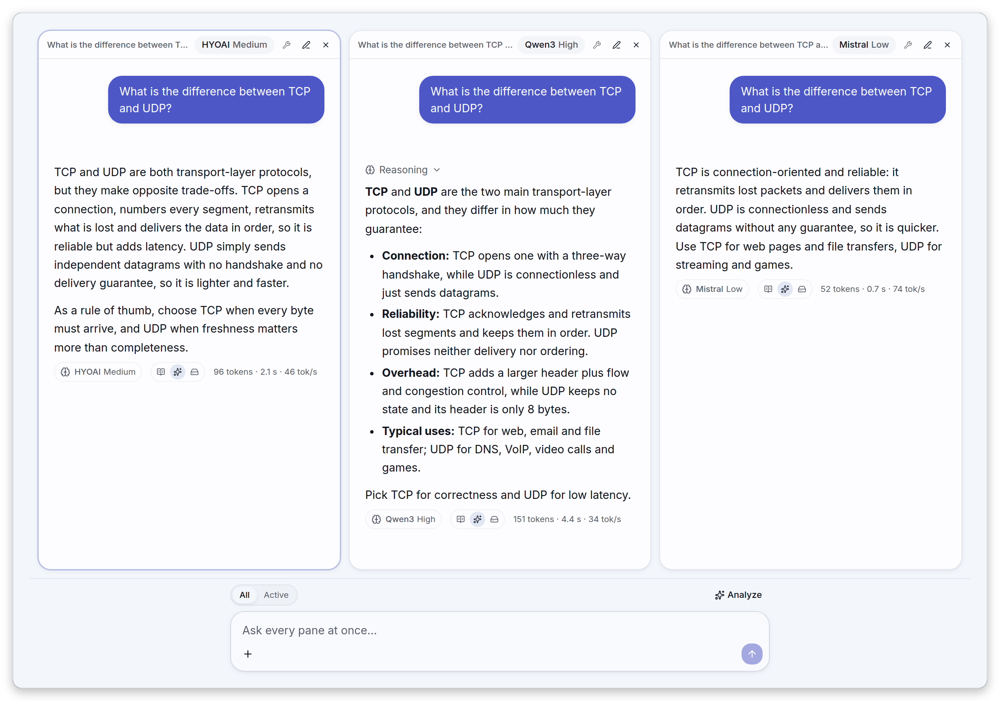
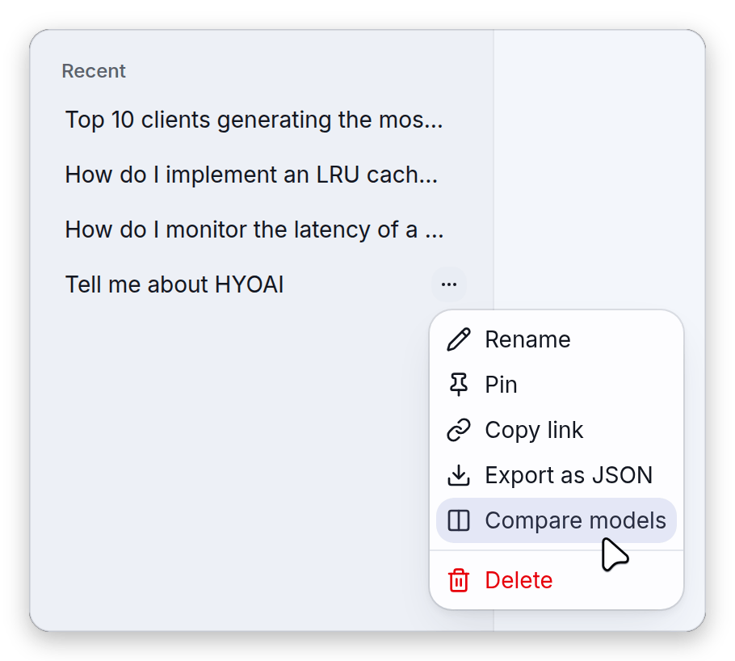
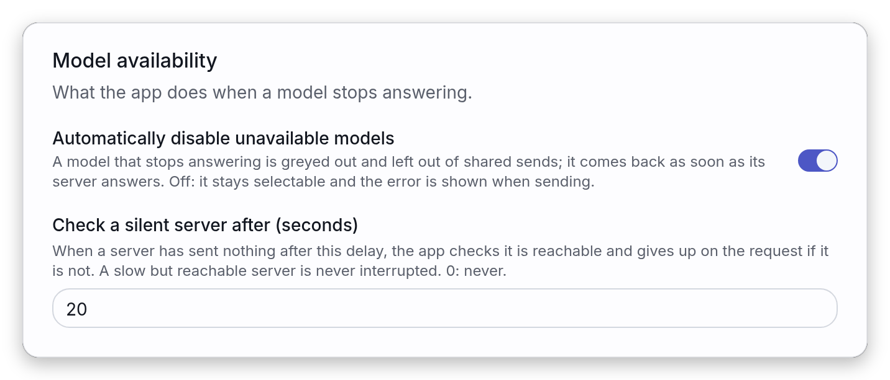
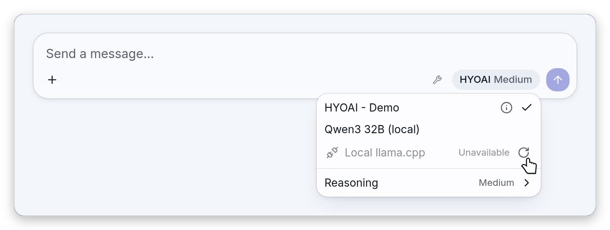
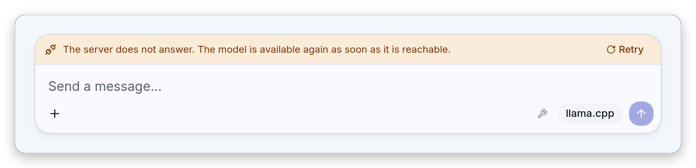
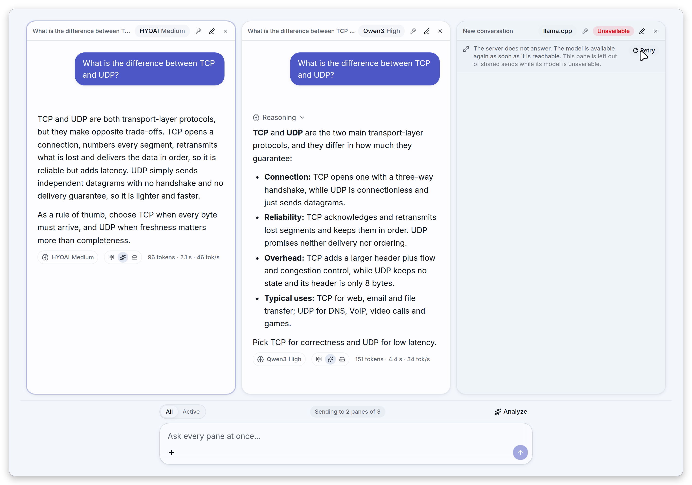

# Compare mode and model availability

Compare mode runs the same prompt against up to four models side by side: each model answers in its
own pane, with its own conversation and its own reasoning choice, and one shared composer writes to
all of them. Model availability is what the app does when a model's server stops answering: the
model is greyed out instead of letting you send into the void, and it comes back on its own once the
server answers again.

This page expands the "Compare mode" and "Model availability" items of the
[Features](../README.md#features) section of the README. Back to the [README](../README.md). The
model entries themselves are described in [models.md](models.md), and the rest of the interface in
[features.md](features.md).

- [Compare mode](#compare-mode): entering it, the panes, the shared composer, closing a pane, the
  draft, what is shared, and phones.
- [Model availability](#model-availability): the two settings, how a server is judged down and up
  again, what each screen shows, and what happens when the automatic disabling is off.

## Compare mode

A compare is a grid of panes over a single composer. Each pane is a complete conversation rendered
like the single chat, pinned to its own model. The composer at the bottom sends the same message to
every pane (each one using its own model, except the panes whose model cannot answer, see
[The shared composer](#the-shared-composer)) or only to the focused pane, so you read the answers
next to each other, with each answer's own stats footer.

<picture>
    <source media="(prefers-color-scheme: dark)" srcset="images/dark/compare.png">
    
</picture>

In the screenshot, three panes answer "What is the difference between TCP and UDP?". The model
button of each pane shows the model name followed by its reasoning level (HYOAI Medium, Qwen3 High,
Mistral Low), the first pane carries the focus ring, and the Qwen3 pane has a collapsed
**Reasoning** block. Under each answer sits that pane's own model chip and stats (tokens, time,
tokens per second). The bar under the panes holds the **All** / **Active** toggle, the **Analyze**
button and the shared composer ("Ask every pane at once...").

### Entering the compare

There are three ways in.

| Way in                | Where                                                                                                                                                                                                                                             | What you get                                                                                                                                                                                                    |
| --------------------- | ------------------------------------------------------------------------------------------------------------------------------------------------------------------------------------------------------------------------------------------------- | --------------------------------------------------------------------------------------------------------------------------------------------------------------------------------------------------------------- |
| The header toggle     | The **Compare** button on the left of the header, after the sidebar button (and the **New conversation** button when the sidebar is closed). It reads **Single conversation** while the compare is on. Hidden below the `md` breakpoint (768 px). | With no saved panes, the conversation you are in becomes the first pane and a second, empty pane is added next to it. If you left a compare earlier with this toggle, its panes come back as they were instead. |
| The conversation menu | **Compare models** in the "..." menu of a conversation row in the sidebar. Not offered in an [embed](embed.md#what-the-widget-leaves-out).                                                                                                        | That conversation goes in a pane next to a new one, or is added to the compare that is already open.                                                                                                            |
| A link                | A URL with a `?compare=` parameter, see [A link with `?compare=`](#a-link-with-compare).                                                                                                                                                          | The exact comparison the link describes.                                                                                                                                                                        |

<picture>
    <source media="(prefers-color-scheme: dark)" srcset="images/dark/compare-enter.png">
    
</picture>

The row menu above is the one that opens from the "..." button of a conversation in the sidebar:
**Compare models** sits between **Export as JSON** and **Delete**.

Both entries start from what is on screen, so nothing is interrupted:

- **From the header toggle.** With no saved panes, the first pane takes over the live single-chat
  conversation, with its model, thinking and effort; a stream in progress keeps running in it. A
  single chat that is still empty (nothing stored, nothing generating) gives an empty first pane on
  the global model. The second pane is empty and starts on the first enabled model that the first
  pane does not use (disabled entries are skipped), so a fresh comparison is not model X against
  model X whenever another enabled model exists; when none does, the second pane starts on the same
  model as the first. The first pane is focused.
- **From the conversation menu, compare off.** The conversation goes in the first pane, an empty
  pane is added as the second one and the second pane is focused. The first pane's model is the one
  the conversation is running on if it is live (open, or still generating in the background),
  otherwise the model the conversation was last answered with when the configuration still offers it
  (and the entry is enabled), otherwise the current global model.
- **From the conversation menu, compare already on.** If a pane already shows that conversation, it
  is focused. Otherwise, while there are fewer than four panes, the conversation is added as a new
  pane (on the model it was last answered with, when that model is still offered). With four panes
  it is loaded into the focused pane.

The layout of the compare (its panes, which one is focused, and the **All** / **Active** target) is
saved in the browser, so a reload brings the same compare back.

#### A link with `?compare=`

While the compare is on, the address bar carries a `?compare=` parameter that mirrors it (it is kept
up to date without adding history entries, and removed when the compare is closed). The header's
**Copy link** button copies the current address, so it shares the layout; below the `md` breakpoint
that button is hidden and the **Copy link** entry at the bottom of the **More** menu does the same.
The value is URL-safe base64 (no padding) of a JSON object:

| Key | Meaning                                                               |
| --- | --------------------------------------------------------------------- |
| `p` | The panes, in order. At most four are kept.                           |
| `t` | The composer target, `"all"` or `"active"`. Anything else is `"all"`. |

Each pane of `p` takes optional keys:

| Key  | Meaning                                              |
| ---- | ---------------------------------------------------- |
| `c`  | Conversation id shown in the pane                    |
| `e`  | Id of the `config.json` model entry backing the pane |
| `m`  | Upstream model id, within that entry                 |
| `tk` | Thinking on (`true`) or off (`false`) for the pane   |
| `ef` | Effort level id for the pane                         |

For example, two panes (the second one on a given upstream model with thinking on and the `high`
effort level) and the target `all`. The ids and values below are illustrative:

```json
{
    "p": [{ "e": "ollama" }, { "e": "llamacpp", "m": "qwen3-32b", "tk": true, "ef": "high" }],
    "t": "all"
}
```

encodes to

```
?compare=eyJwIjpbeyJlIjoib2xsYW1hIn0seyJlIjoibGxhbWFjcHAiLCJtIjoicXdlbjMtMzJiIiwidGsiOnRydWUsImVmIjoiaGlnaCJ9XSwidCI6ImFsbCJ9
```

When the page loads with this parameter, the compare is enabled with exactly these panes, replacing
the saved layout. Fresh pane ids are generated, and a conversation is opened in its pane when the
pane appears. Conversations are kept in the browser only, so a conversation id that this browser
does not hold simply gives an empty pane: the models and the reasoning choices travel with the link,
the conversations do not. A pane that names an entry the configuration does not contain is shown as
unavailable ("This model is no longer in the configuration. Pick another one."). A conversation is
kept in a single pane: a later pane that repeats it starts empty. A value that cannot be decoded is
ignored, as if the parameter was absent. When a URL also carries `?chat=`, `?compare=` wins; a link
with only `?chat=` opens that conversation alone, whatever compare layout was saved. The **Copy
link** entry of a conversation's row menu drops `compare`, so it always opens that conversation
alone.

### The panes

**Adding a pane.** While the compare is on, a **+** button (**Add a pane**) appears in the header
next to the compare toggle. A compare holds at most four panes: at four the button is disabled. The
new pane is empty, pinned to the first enabled model that no other pane uses (every discovered model
of an entry counts as one, and disabled entries are skipped), and focused. When every model is
already taken, it starts on the current global model.

**The grid.** The panes are laid out by their count and by the window width:

| Panes | Window under 768 px (below `md`) | From `md` up                                       | From `xl` up             |
| ----- | -------------------------------- | -------------------------------------------------- | ------------------------ |
| 1     | One column                       | One column                                         | One column               |
| 2     | Two rows                         | Two columns side by side                           | Two columns side by side |
| 3     | One column                       | Two columns, the third pane spanning the whole row | Three columns across     |
| 4     | One column                       | A 2 x 2 grid                                       | A 2 x 2 grid             |

**The header of a pane.** Each pane is a card with its own header, from left to right:

- the name of its conversation, or **New conversation** while it is empty;
- its model button (**Select a model**), which opens the same model menu as the composer (except the
  model information icon, which only the single chat's menu has), including the **Reasoning**
  submenu when the pane's model declares reasoning controls, and writes the choice to this pane
  only; the button shows the effort level after the model name when the model declares effort
  levels;
- its wrench, for the tools of this pane's conversation only (see [tools.md](tools.md)); it is
  greyed out with the tooltip "This model does not support tools." when the pane's model cannot take
  tools, and otherwise always there, since the built-in `clock` provider is always registered;
- while an over-context analysis (the chapter pipeline, set up by **Over-context input chunking** in
  [features.md](features.md#sampling-and-penalty-settings)) runs in this pane, a dropdown for its
  strategy after the wrench (its button shows **Map-reduce** or **Rolling**, and its menu also
  offers **Relaunch analysis**);
- a status badge when the model cannot answer: **Unavailable**, **Checking…**, **Unreachable** or
  **Loading...** (see [Model availability](#model-availability));
- a shield icon ("A tool call needs your approval in this pane") when a tool call of this pane waits
  for your decision;
- **Stop generation**, a square button shown only while this pane's conversation is generating,
  which includes the time a tool call waits for your approval and the time a tool runs;
- **New conversation**, a pencil that starts a fresh conversation in this pane; the previous one
  keeps running in the background if it was generating;
- **Close pane**, an X.

**The focused pane.** One pane is focused at a time and carries a ring around its card. Pressing the
mouse anywhere in a pane except its **Close pane** button focuses it; adding a pane focuses the new
one; opening a conversation that is already shown in a pane focuses that pane. The focused pane is
the target of the **Active** composer target, the pane whose conversation continues in the single
chat when you leave the compare, and the pane in which a conversation chosen in the sidebar or in
the command palette opens. When the focused pane is closed, the focus goes to the pane that took its
slot (the previous one when the last pane was closed).

**Model and reasoning of a pane.** A pane is pinned to its own model (an entry and, for a server
that lists several models, an upstream model), so changing the global model never moves it. The
pane's model menu is the one described in [models.md](models.md), with the same **Reasoning**
controls (offered when the pane's model declares them): the Thinking switch and the effort levels
apply to this pane only. A pane follows the global thinking and effort only while it has none of its
own. The first pane of a compare opened with the header toggle starts with the thinking and effort
the single chat was using, and so does the first pane opened with **Compare models** when that
conversation is live; the Analyze pane starts with those of the pane it copies. Such values do not
follow later changes of the global setting. The second pane, the panes added with **+**, the panes
of a link without `tk` or `ef`, and the first pane opened with **Compare models** on a conversation
that is not live and whose last model is still offered have none until you make a choice there, so
they follow the global setting. A pane keeps showing the model it was given even when the
configuration no longer offers it; it is then reported as unavailable (see below), never swapped for
another one. When you open a conversation in a pane, the pane's model wins: an idle conversation
takes the pane's model, while one that is still generating keeps the model it is running on.

**One conversation per pane.** A conversation lives in a single pane at a time, so two panes never
edit the same stored conversation. Opening a conversation that is already in a pane just focuses
that pane. Deleting a conversation that a pane shows gives that pane a fresh empty conversation (and
aborts the run, if any).

### The shared composer

The bar under the panes is a composer of its own. Above it:

- the **All** / **Active** toggle (group label **Message target**). **All** sends to every pane
  (placeholder "Ask every pane at once..."); **Active** sends to the focused pane only (placeholder
  "Write in the active pane...");
- a "Sending to 2 panes of 3" chip, described below;
- the **Analyze** button.

**Sending.** The message goes to each target pane's conversation, and each pane answers with its own
model, thinking and effort. Attachments added in the shared composer are sent to every pane that
receives the message. The attachment menu greys out images (or audio) when every pane that would
receive the message is ready and has a model that cannot take them (a pane that is only unreachable
and still tried keeps the entry enabled); the menu is described in
[Attachments](features.md#attachments), and the `modalities` of a model in the
[key table](models.md#keys-of-a-models-entry) of models.md. The shared composer has no system
message entry: that one belongs to the single chat (see [features.md](features.md)). Nothing is sent
while no model is configured.

**Who receives it.** Before each send the app plans the targets, pane by pane:

- a pane whose model can answer receives the message;
- a pane whose model cannot answer is skipped, and nothing is sent in its place (see
  [Model availability](#model-availability)), unless the pane is merely unreachable and automatic
  disabling is off: it is then tried, and reports its own error (see
  [When automatic disabling is off](#when-automatic-disabling-is-off));
- a pane that has no conversation instance yet, or whose model is not known yet (the configuration
  or a model list is still loading), makes the send wait rather than be skipped: the send button is
  disabled with the tooltip "Loading";
- when no pane can receive the message, the send button is disabled with the tooltip "No pane can
  receive this message right now.".

When some panes are skipped, a chip reads "Sending to 2 panes of 3" (the singular is "Sending to 1
pane of 3"): the first number is the panes that receive the message, the second the panes the target
points at (all of them for **All**, one for **Active**). Hover the chip to see the skipped ones,
named by position: "Skipped: Pane 3". The chip is not shown when nobody is skipped, so the omission
is never silent but never noisy either.

**Stopping.** While a pane that would receive the message is still generating, the send button
becomes a stop button that aborts those panes. Only the panes that receive the message count as
busy, so a hung pane that is skipped never blocks the others. A pane's own **Stop generation**
button aborts that pane alone.

**Analyze.** **Analyze** opens a new pane in which a model compares the answers of the existing
panes.

- It is enabled when at least two panes show a stored conversation, there is a free slot (so at most
  three panes), a model is configured and nothing that would receive a message is generating.
  Otherwise its tooltip reads "Needs at least 2 panes with an answer and a free slot.".
- On click, only the panes whose active branch holds a non-empty answer are included. If fewer than
  two do, or the compare is full, the same text appears as a toast.
- The prompt is "Compare the panes' answers below. For each, give the key differences, strengths and
  weaknesses, then say which one is best and why.", followed by one block per included pane: a
  heading `## Pane N (model)`, where N is the position of the pane on screen (so included panes can
  read Pane 1 and Pane 3) and `model` is the base name of the upstream model id recorded by the
  first answer of that branch that records one (the last path segment cut before its size token, so
  `Qwen3.6-35B-A3B-UD-Q4_K_M.gguf` gives `Qwen3.6`); the parenthesis is left out when no answer of
  that branch records a model. Then comes its active branch as plain `Q:` and `A:` turns, the blocks
  being separated by `---`. The prompt and the word "Pane" follow the interface language (in French,
  "Panneau" and the French wording of the prompt). The panes you compare are not modified.
- The new pane starts on a fresh conversation and sends the prompt at once. It takes the model,
  thinking and effort of the focused pane when that pane is one of the compared panes and can
  answer, otherwise of the first compared pane that can answer, otherwise of the first compared
  pane. It becomes the focused pane.

### Closing a pane and leaving the compare

**Closing a pane.** **Close pane** removes the pane, never its conversation: the conversation stays
stored and in the sidebar. A running answer is not interrupted: it finishes in the background, and a
toast says so: "The answer keeps generating in the background. You will find it in the sidebar.". If
the pane was waiting for your approval of a tool call, the toast is "This answer is waiting for your
approval of a tool call. Open it from the sidebar to decide." and the conversation waits in the
sidebar.

**Closing down to one pane.** When a closed pane leaves a single pane, the compare ends on that
pane: you are back in the single chat on that pane's conversation, with no reload and without
interrupting it, and the saved layout is cleared.

**Leaving with the toggle.** The header toggle (**Single conversation**, or the same entry at the
top of the **More** menu on a phone) closes the compare and keeps its panes for the next time. The
focused pane's conversation carries on in the single chat, live and without interruption, and its
model, thinking and effort become the global selection. Only the model can be left out: when it is
disabled or no longer in the configuration, the single chat keeps its own model, while the pane's
own thinking and effort (the ones it has pinned) are still applied. The other panes are released: an
idle one is simply dropped (its conversation is on disk), a generating one carries on in the
background.

**Starting over.** **New conversation** (the sidebar button, or the header button when the sidebar
is closed, Ctrl/Cmd+Shift+O or the command palette) leaves the compare, clears the saved panes and
the `?compare=` parameter and opens an empty single chat. Running panes carry on in the background.

### The draft and the attachments follow you

The text typed in the composer follows you in and out of the compare, and so do the attachments you
added to it. When the compare opens or closes (the header toggle, **Compare models**, or closing
down to one pane), the composer on screen hands its unsent draft to the one that replaces it. The
draft is held in memory only and is never saved: a reload loses it. It is consumed once by the
composer that takes it, and an empty draft hands over nothing. Only the single chat's composer and
the compare's composer take part in this handover, so switching from one conversation to another
never carries a draft along.

### What is shared and what is per pane

| Per pane                                                                                                         | Shared by every pane                                                                                                |
| ---------------------------------------------------------------------------------------------------------------- | ------------------------------------------------------------------------------------------------------------------- |
| The conversation: history, branches, its own stored copy and its own name                                        | The composer at the bottom: the draft, the attachments and the **All** / **Active** target                          |
| The model: entry and upstream model, pinned                                                                      | The settings: sampling and penalties, the global system prompt (unless the conversation has its own system message) |
| The reasoning: Thinking switch and effort level, following the global setting while the pane has none of its own | The list of conversations in the sidebar                                                                            |
| The tools switch (wrench), see [tools.md](tools.md)                                                              | The layout and its `?compare=` link                                                                                 |
| The status: generating, awaiting approval, unavailable                                                           |                                                                                                                     |

### On a phone

- The header **Compare** toggle is hidden below the `md` breakpoint, but compare mode still works:
  **Compare models** is in the conversation menu (open the sidebar with the menu button), and a link
  with `?compare=` opens it.
- While the compare is on, **Add a pane** stays in the header, and the **More** menu offers **Single
  conversation** at its top.
- The header **Copy link** button is hidden too: the **Copy link** entry at the bottom of the
  **More** menu copies the same address, so a compare link can be shared from a phone.
- The panes stack in a single column (two panes in two rows). This follows the window width (below
  `md`, under 768 px), not the device: a narrow desktop window stacks them too, while a phone in
  landscape at 768 px or more, or a wide touch tablet, does not.
- A pane's model menu opens as a bottom drawer, like the composer's, with the reasoning controls
  flattened inline. This compact layout is not tied to phones: it is used on a phone, on any device
  whose primary pointer is coarse (a wide tablet in landscape included; a touch-screen laptop whose
  primary pointer is a mouse keeps the dropdown) and in any window narrower than 768 px, a narrow
  desktop window included. Below, "the compact layout" means this one.

## Model availability

Chatting with a server that is down only produces an error, so HYOAI watches the servers you use.
When a model's server stops answering, the model is greyed out as **Unavailable** in the menus, the
single-chat composer is blocked with the reason and a **Retry** button, and a compare pane is greyed
and skipped by the shared send ("Sending to 2 panes of 3"). It comes back on its own once the server
answers again.

The probe that tells whether a server answers is deliberately conservative: it counts a server as
down only on a network error, a timeout or a gateway 502/503/504, and a slow server is never cut off
as long as it still answers the probe within 10 seconds. Besides a down server, a model can be
greyed out when its model list cannot be loaded (see
[How a server is judged down, and up again](#how-a-server-is-judged-down-and-up-again)) or for one
of the configuration reasons listed in [What you see](#what-you-see).

### The settings

Both settings live at the top of **Settings → Models**, in the **Model availability** group, under the description "What the
app does when a model stops answering."

<picture>
    <source media="(prefers-color-scheme: dark)" srcset="images/dark/unavailable-settings.png">
    
</picture>

| Setting                                      | Default | Range             | Effect                                                                                                                                                                                                                                                                               |
| -------------------------------------------- | ------- | ----------------- | ------------------------------------------------------------------------------------------------------------------------------------------------------------------------------------------------------------------------------------------------------------------------------------ |
| **Automatically disable unavailable models** | On      | On or off         | A model whose server stops answering is greyed out as "Unavailable" in the menus; sending is blocked with the reason in a single chat; in compare the pane is greyed out and left out of shared sends. Off: see [When automatic disabling is off](#when-automatic-disabling-is-off). |
| **Check a silent server after (seconds)**    | 20      | 0 to 600 (step 1) | When a server has sent nothing after this delay, the app checks it is reachable and gives up on the request if it is not. A slow server that still answers that check within 10 seconds is never interrupted. 0: never.                                                              |

A value outside the range of the delay is brought back to it (a negative value to 0, a value above
600 to 600). The delay works on its own, whatever the state of the switch.

### How a server is judged down, and up again

**The probe.** To know whether a server answers, the app sends a `GET /v1/models` to it (the same
endpoint that lists the models), with the entry's API key (as `Authorization: Bearer <key>`) and
headers and a timeout of 10 seconds. The server is down when:

- the request fails with a network error (reason "unreachable");
- nothing answers within the 10 seconds (reason "timeout");
- the answer is an HTTP 502, 503 or 504, as a gateway in front of a stopped server returns (reason
  "unreachable").

Any other answer, errors and authorization failures included (a 401, a 404, a 500...), proves that
something is listening, so the check finds the server up.

**Which servers can be probed.** Only server types that list their models (the `listModels`
capability: `llama.cpp`, `vllm` and `openai` in the app, and the types a
[plugin](../plugins/README.md) declares with that capability) are probed. A type that does not is
never marked down by a check, only by what an actual request reports, and that observation is
forgotten after one minute.

**When it is checked.** The first three points below are the work of a watcher that only the full
app runs: an [embed](embed.md#what-the-widget-leaves-out) has none, so there a server is judged only
from the requests that fail, **Retry** and the silent-server watch.

- The app keeps the servers in use fresh: the one of the active model and, while the compare is on,
  those of the panes. Disabled entries are not probed.
- An unknown server is probed at once. Then a down server is checked every 15 seconds and a
  reachable one every 2 minutes (the watcher looks every 5 seconds for what is due).
- A check also runs when the window regains focus, when the browser goes back online and when the
  tab becomes visible again: a down server immediately, a reachable one only if its last check is
  older than 30 seconds. These periodic and wake-up checks are paused while the page is hidden; the
  probes that a failed chat request, **Retry** or the silent-server watch trigger still run.
- A chat request reports what it saw. Receiving the first event of the answer proves the server is
  up. A network failure or a 502/503/504 triggers a probe right away. Any other failure (an
  authorization error, a bad request...) says nothing about reachability.
- For an entry that does not pin a `model`, a model list that could not be loaded, and is still
  empty, also makes the model unavailable, with the reason "The server does not answer. The model is
  available again as soon as it is reachable." and a **Retry**. The failure can be any: a network
  error, but also an authorization error, a 404 or a 500, an invalid answer, or a list with no model
  in it. The check above would still find such a server up.
- When a server is seen up again after having been down (or after a failed model list), the model
  list of an entry that does not pin a `model` is reloaded, so a pane greyed by a failed list
  recovers on its own.
- Changing an entry's endpoint, type, model, API key, headers or disabled state makes the app forget
  what it knew about it.

**Coming back.** There is nothing to do: the next successful check clears the state and the model is
selectable again. **Retry** (in the model menu, in the composer strip and in a pane's banner) asks
for the check right now. Once that check finds the server answering, it also reloads the model list
of an entry that does not pin a `model`, which settles a "The server no longer offers this model."
message; while the server is still down, **Retry** reloads nothing. Opening the model menu also
reloads the model lists. For a type that cannot be probed it only forgets the failure, so that the
next send tries the server.

**The silent server.** While an answer is being generated, the app counts the time since the last
event of the stream. When it reaches the delay (20 seconds by default), it probes the server. If the
probe finds the server down, the request is cut and the answer ends with "The server did not start
answering in time and looks unreachable.". If the server answers, the app waits another full delay
and checks again, so a CPU llama.cpp working through a long prompt is never interrupted as long as
it still answers the probe within its 10 seconds; a server so busy that it does not is judged down
(reason "timeout") and the request is cut. A server that cannot be probed is never cut either. With
a delay of 0 the watch is off.

### What you see

**Why a model cannot answer.** The app tells six reasons apart. The first three come from the
configuration and last until it changes. "No longer listed" comes from the server's model list and
goes away once a reloaded list offers the model again. The last two are about reachability and clear
when the server answers. The message of each reason is the one shown in the composer strip (which
reads **Checking…** instead while a check runs) and in the pane banner. The model menu shows the two
reachability messages (as the tooltip of an **Unavailable** row) and, for an unsupported entry, its
message; a disabled entry reads "Model disabled" there, and a removed entry has no row (see below).

| Reason                   | Message                                                                                                                      | Retry offered |
| ------------------------ | ---------------------------------------------------------------------------------------------------------------------------- | ------------- |
| Unsupported entry        | No installed plugin handles the type "{type}". Or: This server type does not list its models: set the entry's "model" field. | No            |
| Removed from the config  | This model is no longer in the configuration. Pick another one.                                                              | No            |
| Disabled                 | This model is disabled in the configuration.                                                                                 | No            |
| No longer listed         | The server no longer offers this model.                                                                                      | Yes           |
| Server does not answer   | The server does not answer. The model is available again as soon as it is reachable.                                         | Yes           |
| Server too slow to start | The server did not start answering in time.                                                                                  | Yes           |

The two messages of an unsupported entry are the two kinds of entries that cannot be used as written
(see [models.md](models.md)).

**In the model menu.** The **Unavailable** row is for reachability problems. The entry is greyed out
and cannot be picked. Its row shows a plug icon, its name, **Unavailable** (or **Checking…** while a
check runs) and a retry button, which is disabled and spins during the check. Hovering the row shows
the reason; in the compact layout (a phone, any device whose primary pointer is coarse or a window
narrower than 768 px, see [On a phone](#on-a-phone)) there is no hover and the reason is written
under the row. The whole entry is judged, so every model that a server lists is greyed together. The
model menu is the same in the composer and in each compare pane, except for the model information
icon, which only the single chat's menu has.

An entry that is disabled or unsupported in the configuration is greyed out too, but with a ban icon
and its name only: no **Unavailable** tag and no retry button. Its reason is a tooltip, and is
written on the row in the compact layout: **Model disabled** for an entry disabled in the
configuration, or the message of an unsupported entry from the table above. An entry removed from
the configuration is not in the menu at all.

<picture>
    <source media="(prefers-color-scheme: dark)" srcset="images/dark/unavailable-menu.png">
    
</picture>

In the screenshot, HYOAI - Demo is the selected model and Qwen3 32B (local) can be picked, while
Local llama.cpp is greyed with its plug icon, the **Unavailable** tag and the retry icon under the
pointer.

**In the composer (single chat).** When the model the chat would use cannot answer, a strip appears
at the top of the composer card and sending is blocked, with the reason as the tooltip of the send
button, except when the chat has no model to send to yet: the tooltip then reads "Loading" while the
model list loads, and "Model unreachable: check that its endpoint is running and that CORS allows
this origin." after a failed model list. The strip is amber while the server may come back, neutral
with **Checking…** (instead of the reason) while a check runs, and red when the model is gone for
good (a **Retry** there only when the model list may have changed). The model is never swapped for
another one.

<picture>
    <source media="(prefers-color-scheme: dark)" srcset="images/dark/unavailable.png">
    
</picture>

The strip in the screenshot reads "The server does not answer. The model is available again as soon
as it is reachable." with **Retry** on its right, above the "Send a message..." input; the model
button underneath reads llama.cpp.

**In a compare pane.** The pane's body is greyed (faded and in grayscale, on a muted card) but its
header stays usable: you can close the pane or give it another model from its model button. The
header shows a red **Unavailable** badge (**Checking…** with a spinner while a check runs), and a
banner under the header gives the reason, then "This pane is left out of shared sends while its
model is unavailable.", with a **Retry** button when checking again can help (the retry is in the
banner, not in the header). The shared send skips the pane and the composer says "Sending to 2 panes
of 3". A pane comes back into the sends by itself when its server answers again.

<picture>
    <source media="(prefers-color-scheme: dark)" srcset="images/dark/compare-unavailable.png">
    
</picture>

In the screenshot, the first two panes (HYOAI Medium and Qwen3 High) answered the question, and the
third pane, on llama.cpp, is empty and greyed: its header carries the **Unavailable** badge, the
banner under it holds the reason and **Retry** (with the pointer on it), and the bar under the panes
says "Sending to 2 panes of 3".

### When automatic disabling is off

With **Automatically disable unavailable models** turned off, a model whose server merely does not
answer is no longer greyed out or skipped:

- in the model menu, the entry stays selectable and, when it has a single model row, is flagged with
  a red warning icon whose tooltip says "Model unreachable: check that its endpoint is running and
  that CORS allows this origin.", with the reason under it (in the compact layout, tap the icon to
  show it). An entry that lists several models stays selectable without the icon;
- in the single chat, the composer is not blocked and shows no strip: you send, and the error shows
  on the answer, for instance "Could not reach the model. Check that its endpoint is running and
  that CORS allows this origin.". This holds when the entry pins a `model` or its model list is
  already loaded; with a model list that failed and is still empty and no pinned `model`, there is
  no model to send to, and the send button stays disabled with the tooltip "Model unreachable: check
  that its endpoint is running and that CORS allows this origin.";
- in the compare, the pane keeps its body. Its badge turns into an amber, outlined **Unreachable**
  and its banner reads "Auto-disable is off: this model still receives messages.", still with
  **Retry**. The shared send tries the pane and the pane reports its own error.

This applies to reachability problems only. A model whose problem is in the configuration (removed,
disabled, unsupported) stays greyed out and skipped whatever the setting says, and so does a model
that the server no longer lists.

### Models removed or disabled in the configuration

A model removed or disabled in the configuration is never replaced by another one. A compare pane
pinned to it keeps its choice and says why it cannot answer ("This model is no longer in the
configuration. Pick another one." or "This model is disabled in the configuration."), and a pane
pinned to an upstream model that its server stopped listing says "The server no longer offers this
model.". You decide what to do: pick another model in the pane's menu, or fix the configuration.
Nothing is sent to a different model in the meantime.

The single chat follows the global model selection, which the app restores at startup (and when the
configuration is applied): the stored choice if it is still enabled, otherwise the `defaultModel` of
`config.json`, otherwise the first enabled entry. That is a choice of the starting model, not a
replacement of a model a conversation was pinned to.
