# Using HYOAI

A guided tour of the interface features that are not about models or tools: how conversations are
stored, searched, branched, quoted and exported, what an answer can contain, what you can attach to
a message, which settings shape a request, and how the application behaves on a keyboard, on a phone
and with assistive technology. Conversations are kept in the browser only, as the empty screen says:
"Your conversations stay in your browser. Pick a model to get started."

This page expands the [Features](../README.md#features) section of the README. Back to the
[README](../README.md).

| Topic                                                  | Page                                                                                       |
| ------------------------------------------------------ | ------------------------------------------------------------------------------------------ |
| Choosing a server, the model menu, reasoning controls  | [models.md](models.md)                                                                     |
| Running one prompt on several models side by side      | [compare.md](compare.md)                                                                   |
| Tool calling, approvals and the tool settings          | [tools.md](tools.md)                                                                       |
| MCP servers                                            | [mcp.md](mcp.md)                                                                           |
| The embeddable widget                                  | [embed.md](embed.md)                                                                       |
| Plugins (extra server types, backend steps, citations) | [../README.md#plugins](../README.md#plugins), [../plugins/README.md](../plugins/README.md) |

On this page:

- [The screen at a glance](#the-screen-at-a-glance)
- [Conversations and the sidebar](#conversations-and-the-sidebar)
- [Storage, export and import](#storage-export-and-import)
- [Messages](#messages)
- [Reading an answer](#reading-an-answer)
- [Writing a message](#writing-a-message)
- [Model availability](#model-availability)
- [Sampling and penalty settings](#sampling-and-penalty-settings)
- [Keyboard shortcuts](#keyboard-shortcuts)
- [Appearance and display](#appearance-and-display)
- [Responsive and touch behaviour](#responsive-and-touch-behaviour)
- [Accessibility](#accessibility)

## The screen at a glance

The full application is a collapsible conversation sidebar on the left, a header, the chat column
with its composer at the bottom, and a few global dialogs (Settings, the command palette, the model
information dialog and the system message editor). The header, from left to right:

| Control                               | What it does                                                                                                                                                                                                                                                                                                                                                                                                                                                                                                                     |
| ------------------------------------- | -------------------------------------------------------------------------------------------------------------------------------------------------------------------------------------------------------------------------------------------------------------------------------------------------------------------------------------------------------------------------------------------------------------------------------------------------------------------------------------------------------------------------------- |
| **Toggle sidebar**                    | Collapses or opens the docked conversation list (Ctrl/Cmd+B, from 768 px up). On a phone the same label belongs to a menu button that opens the sidebar as a sheet, and the shortcut has no visible effect there.                                                                                                                                                                                                                                                                                                                |
| **Search** (touch devices only)       | Opens the [command palette](#command-palette). Shown only when the primary pointer is coarse, since the keyboard shortcut is out of reach there.                                                                                                                                                                                                                                                                                                                                                                                 |
| **New conversation**                  | Starts an empty conversation (Ctrl/Cmd+Shift+O). On desktop this header button only shows while the sidebar is collapsed, since the sidebar has its own button. In compare mode this leaves compare mode and returns to a single empty conversation.                                                                                                                                                                                                                                                                             |
| **Compare** / **Single conversation** | Switches [compare mode](compare.md) on and off. Hidden below the `md` breakpoint, where **Single conversation** is the first entry of the **More** menu while compare is on.                                                                                                                                                                                                                                                                                                                                                     |
| **Add a pane** (compare mode only)    | A **+** button that adds a pane to the comparison. It is disabled once the maximum of four panes is reached (see [compare.md](compare.md#the-panes)).                                                                                                                                                                                                                                                                                                                                                                            |
| The conversation title                | When the conversation is in a [project](#projects), its name leads the title: "Project / Conversation". Click the title to rename the conversation in place (Enter confirms, Escape cancels), once the conversation exists: a new empty chat has nothing to rename yet and shows "New conversation" as plain text. It is not shown in compare mode, where no single conversation is in focus. When the project has instructions, its name opens them in a read-only popover (see [Project instructions](#project-instructions)). |
| **Copy link**                         | Copies the address of the page as it is, including the open conversation (see [Where conversations are stored](#where-conversations-are-stored)). On wide screens (768 px and above); on a phone it is in the **More** menu.                                                                                                                                                                                                                                                                                                     |
| **Style**, **Theme**, **Language**    | The skin, colour theme and interface language switchers (see [Appearance and display](#appearance-and-display)). On a phone they move into the **More** menu.                                                                                                                                                                                                                                                                                                                                                                    |
| **Settings**                          | Opens the Settings dialog.                                                                                                                                                                                                                                                                                                                                                                                                                                                                                                       |

The **More** menu (a vertical-dots button next to **Settings**) exists only below the `md`
breakpoint (768 px). From 768 px up the switchers and **Copy link** stay in the header, a landscape
touch tablet included.

The Settings dialog is one dialog with a navigation on the left and one page at a time on the
right. The navigation has ten pages in five groups: **Appearance** and **Behavior**; **Models**,
**MCP servers** and **Tools**; **Data** and **Configuration**; **Sampling** and **Chunking**; and
**Changelog**, pinned at the foot of the list. Each setting is a row of its page. A search box above the navigation filters the settings by name or by
explanation; choosing a result opens its page and puts the focus on its control. On a phone the
navigation and the page are two screens, and a back arrow leads from the page to the navigation. The
pages hold:

- **Appearance**: theme, skin, language, chat width, compact input, animations, message statistics and the
  **Expand after the answer** switches (see [Appearance and display](#appearance-and-display)).
- **Behavior**: the system prompt, **Send on Enter**, **PDF as images** and **Max image size (px)**.
- **Models**: the model list, with a detail page per model (see [models.md](models.md)), and, at the
  top, the model availability settings.
- **MCP servers**: the servers and their tools (see [mcp.md](mcp.md)).
- **Tools**: the global settings of the tool loop (see [tools.md](tools.md)).
- **Data**: export, import and the storage gauge.
- **Configuration**: the global settings of the configuration (app name, default model, thinking,
  integrations), the generated JSON and **Reset** (see [models.md](models.md)).
- **Sampling**: the sampling parameters and the **Penalties** group.
- **Chunking**: the chunking of oversized inputs and the **Conversation compaction** group.
- **Changelog**: the release notes of every version, newest first, with the version of the build at
  the end of its row in the navigation (see [The changelog](#the-changelog)).

The full application shows all ten. The [embedded widget](embed.md#what-the-widget-leaves-out)
hides **Models**, **MCP servers**, **Tools**, **Configuration** and **Changelog**, and also **Data**
unless its sidebar variant is on.

While Settings is open, the address bar carries `?settings=<page>` (`appearance`, `behavior`,
`models`, `servers`, `tools`, `data`, `config`, `sampling`, `chunking` or `changelog`) and closing
the dialog removes it. It names the page on screen, so opening Settings from the header or the command palette
gives `?settings=appearance` on a wide screen. On a phone, where the first screen is the list of
pages, the address carries a bare `?settings` until a page is picked. A link with the parameter
opens Settings on that page: use it to send someone straight to the **Models** page, say. A bare
`?settings` opens Settings on its first screen. An unknown value is ignored, and a page the view
hides (the widget has no **Models**) opens on **Appearance** on a wide screen and on the list of
pages on a phone.

### The changelog

The **Changelog** page lists the release notes of every version, newest first, each with its date.
The installed version is marked and open. The older ones show the text that introduces the release,
and a button opens its titled sections. **All releases on GitHub** opens the releases page. The
version of the build, the one in `package.json` when the application is built, is shown at the end
of the row of the page in the navigation.

The notes are the ones published on GitHub, without their screenshots, and they are in English
whatever the language of the interface. They come from `CHANGELOG.md`, which
`scripts/changelog.mjs` writes from the published releases (see the README). The same script turns
that file into `data/changelog.json`, which is not kept in Git, before `npm run dev`, `npm run build`
and `npm run check`. The page is loaded when it is opened.

## Conversations and the sidebar

### Where conversations are stored

HYOAI has no backend of its own: conversations live in the browser's `localStorage`, under keys
prefixed `lc:`. The layout is deliberately split in two:

| Key            | Content                                                                                                                                                                  |
| -------------- | ------------------------------------------------------------------------------------------------------------------------------------------------------------------------ |
| `lc:convs`     | The lightweight index: one small record per conversation (id, title, pinned flag, creation and last-modification dates, last model, system message, tools flag, project) |
| `lc:projects`  | The list of [projects](#projects): id, name, creation date, and the optional instructions, default model and [context](#project-context) options                         |
| `lc:conv:<id>` | One key per conversation holding its whole message tree (every branch), compressed with lz-string                                                                        |

The text of the documents of the [projects](#project-context) is too large for `localStorage`: it
lives in an IndexedDB database named `lc-documents`.

Listing, pinning and renaming only read and write the index; only a content search loads the message
trees (see [Search](#search)). Writes are debounced: while an answer streams, the conversation is
written 500 ms after the last change, and at the latest every 2 seconds if changes keep coming,
rather than on every token. Pending writes are flushed as soon as the tab is hidden or closed, so
nothing waits in memory when you leave.

A new conversation is not stored until its first message is sent (or until you save a system message
for it). At that point it enters the index and the sidebar, and is named after the first message:
its first non-empty line, cut at the first sentence if that fits in 80 characters, otherwise at a
word boundary at 80 characters. Rename it at any time. A conversation also remembers the model it
was last used with and restores it when you reopen it, as long as that model is still in the
configuration.

The open conversation is mirrored in the address bar as `?chat=<id>`, updated in place without
adding history entries, so a reload lands on the same conversation. Since the data is in the
browser, such a link opens the conversation only in a browser that holds it; anywhere else a fresh
conversation opens. Two tabs of the same origin follow each other: a conversation written by one tab
is reloaded by the other when it is idle, and the projects follow the same way.

### The sidebar

The top of the sidebar has the **New conversation** button and a search field (placeholder
**Search...**). Hovering or focusing them reveals the shortcut that does the same thing
(Ctrl/Cmd+Shift+O and Ctrl/Cmd+K), except on touch devices and in the embedded widget, where the
hints are not shown. Below, the list is split into **Pinned** at the top, then one collapsible
section per [project](#projects), then the conversations that belong to no project, in a last group
named **Other conversations**. While you have no project, that group reads **Recent** and holds every
conversation, newest first. With no conversation the list reads **No conversations**.

<picture>
    <source media="(prefers-color-scheme: dark)" srcset="images/dark/sidebar.png">
    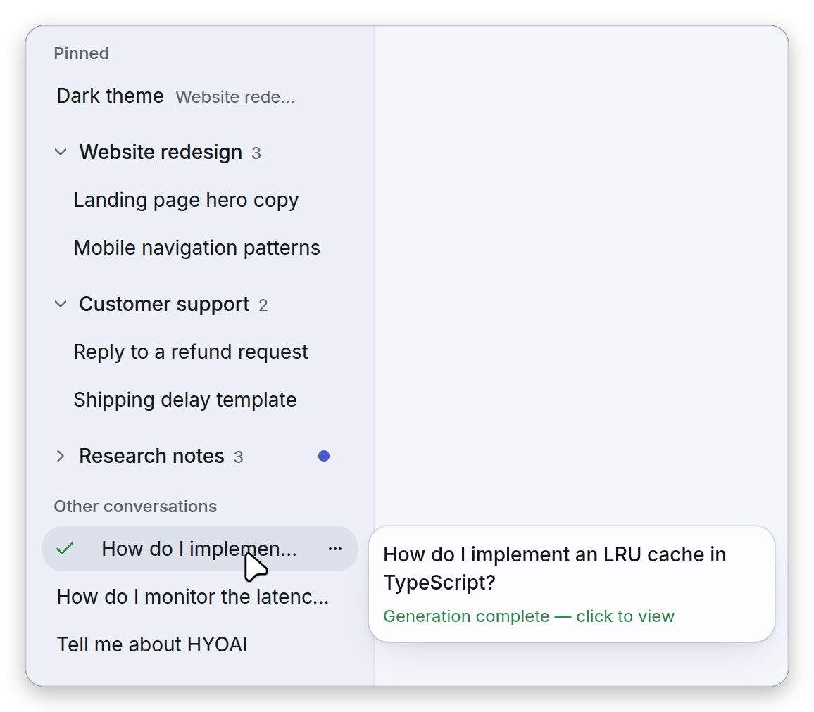
</picture>

Hovering a row for a moment opens a card to its right with the title (up to two lines) and,
depending on the state of the conversation, one of:

- the live tail of the answer being written, or **Generating…** before the first token;
- **Running a tool…** while a tool call runs, or **Waiting for your approval** while one waits for
  you (see [tools.md](tools.md));
- **Generation complete — click to view** once a background answer has finished;
- otherwise **Modified** followed by the date.

### Generating in the background

Leaving a conversation while it answers does not stop it. Opening another conversation or starting a
new one demotes the running one to the background; it keeps streaming, and its final state is saved
like any other. The sidebar row tells you where it stands:

- a square **Stop generation** button appears on the row while it generates;
- an amber shield with **Waiting for your approval** appears when a tool call needs your decision;
- a green check with **Generation complete — click to view** appears when it has finished cleanly.
  The check stays until you open the conversation, then fades out.

Closing a pane in [compare mode](compare.md) also lets a running answer finish in the background; it
stays in the sidebar.

### Row menu

Each row has a **…** button (shown on hover or focus, and always on touch devices). A right click on
the title or a long press on the row opens the same menu. It opens:

<picture>
    <source media="(prefers-color-scheme: dark)" srcset="images/dark/compare-enter.png">
    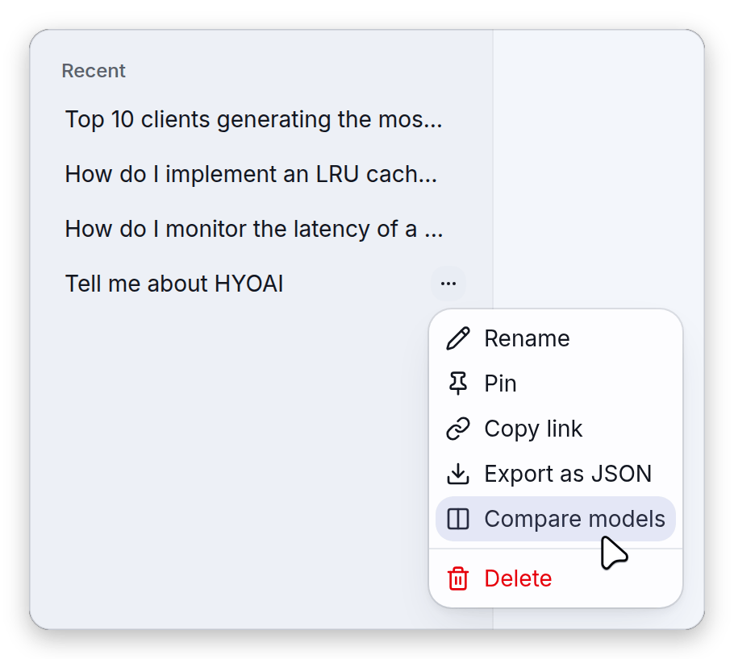
</picture>

| Entry                 | Effect                                                                                                                                                                                                                                                                                                                                                                     |
| --------------------- | -------------------------------------------------------------------------------------------------------------------------------------------------------------------------------------------------------------------------------------------------------------------------------------------------------------------------------------------------------------------------- |
| **Rename**            | Turns the row into an input; Enter or leaving the field confirms, Escape cancels.                                                                                                                                                                                                                                                                                          |
| **Pin** / **Unpin**   | Moves the conversation to or from the **Pinned** group.                                                                                                                                                                                                                                                                                                                    |
| **Move to a project** | Puts the conversation in a [project](#projects), or takes it out of every project. On desktop it opens a searchable picker; on touch devices and in a narrow window the entry is named **Move to** and the menu itself shows the list. Not offered in an [embed](embed.md#what-the-widget-leaves-out).                                                                     |
| **Copy link**         | Copies a link to this conversation alone, in the single-chat view (`?chat=<id>`, any comparison is dropped from the address).                                                                                                                                                                                                                                              |
| **Export as JSON**    | Downloads this conversation as a native HYOAI file named `hyoai-<first 8 characters of the id>.json`, without settings.                                                                                                                                                                                                                                                    |
| **Compare models**    | When compare is off, opens [compare mode](compare.md) with this conversation in the first pane and a second, empty pane. When compare is already on, the pane that holds the conversation is focused; otherwise the conversation is added as a new pane if there is room, or loaded into the focused pane. Not offered in an [embed](embed.md#what-the-widget-leaves-out). |
| **Delete**            | Asks "Delete conversation": "This conversation and all its branches will be permanently deleted." Shift-click on the entry skips the confirmation. A running answer is aborted first.                                                                                                                                                                                      |

If the deleted conversation was the open one, the view resets to a fresh conversation.

### Projects

A project groups conversations that share instructions and a model. It has a name, optional
instructions and an optional default model, nothing more: there is no icon or colour. Projects are
kept in the browser, like conversations, and listed in the order they were created.

<picture>
    <source media="(prefers-color-scheme: dark)" srcset="images/dark/project.png">
    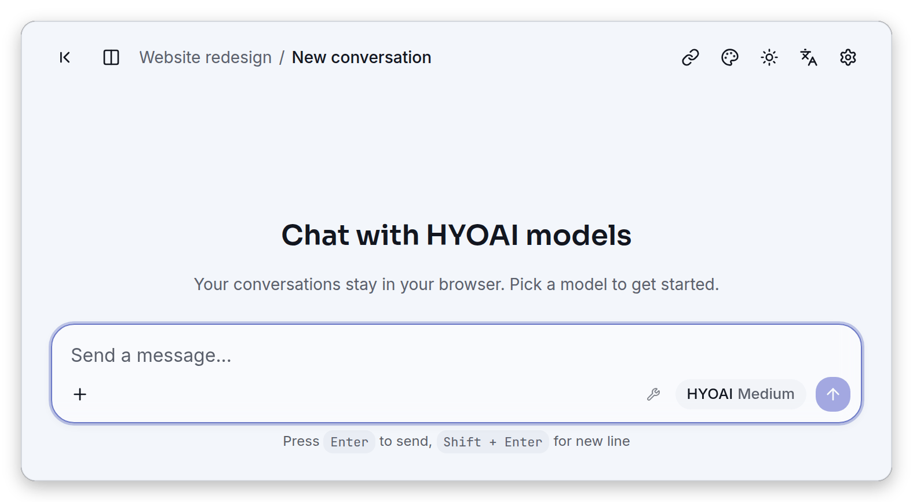
</picture>

#### Creating and organising

A first project appears from a conversation: **Move to a project** offers **New project**, which
creates a project with that name and moves the conversation into it. While you have conversations
but no project yet, the sidebar also shows a box that says so, with a **Create a project** button
that only creates an empty project named **New project**. Rename the project afterwards, or open
its settings.

Each project is a section of the sidebar, headed by its name and the number of conversations it
holds:

- Click the header to fold or unfold the section. The folds are kept for the session only, not in
  storage, so a reload unfolds every section. A folded section shows a dot while one of its
  unpinned conversations generates (pulsing) or waits for your approval (amber).
- A section lists its first five conversations that are not pinned, newest first, then **See all
  ({count})** and **See less**. Pinned conversations stay at the top of the sidebar under
  **Pinned**, whatever their project, and show the name of their project next to the title. A
  project whose conversations are all pinned says "Its pinned conversations are at the top of the
  list."
- An empty project reads "This project has no conversation yet." with a **New conversation** link.
- The **+** button of the header, shown on hover or focus and not on touch devices, starts a
  conversation in the project, like the first entry of its menu.

The **…** button of the header opens the project menu, always visible on touch devices where it is a
bottom drawer:

| Entry                                | Effect                                                                                                                                                                                                                                                                                  |
| ------------------------------------ | --------------------------------------------------------------------------------------------------------------------------------------------------------------------------------------------------------------------------------------------------------------------------------------- |
| **New conversation in this project** | Starts an empty conversation that is indexed in the project on its first message. It starts on the default model of the project when there is one.                                                                                                                                      |
| **Search in this project**           | Limits the sidebar search to the project, see [Search](#search).                                                                                                                                                                                                                        |
| **Project settings**                 | Opens the settings dialog: **Name**, **Project instructions**, **Default model**, a **Context** entry that opens the [context pages](#project-context), and a **Danger zone** with **Delete project**. **Save** applies the draft, closing discards it.                                 |
| **Rename**                           | Turns the header into an input; Enter or leaving the field confirms, Escape cancels. A blank name is ignored.                                                                                                                                                                           |
| **Delete project**                   | Asks "Delete "{name}"?" and what becomes of the conversations: **Keep the conversations** (they leave the project and become loose), **Delete everything** (they go with it, a running answer is aborted) or **Cancel**. A project without conversation has a single **Delete** button. |

A conversation of a project keeps it when you [fork](#forking) it. A conversation whose project no
longer exists reads as having none.

<picture>
    <source media="(prefers-color-scheme: dark)" srcset="images/dark/project-menu.png">
    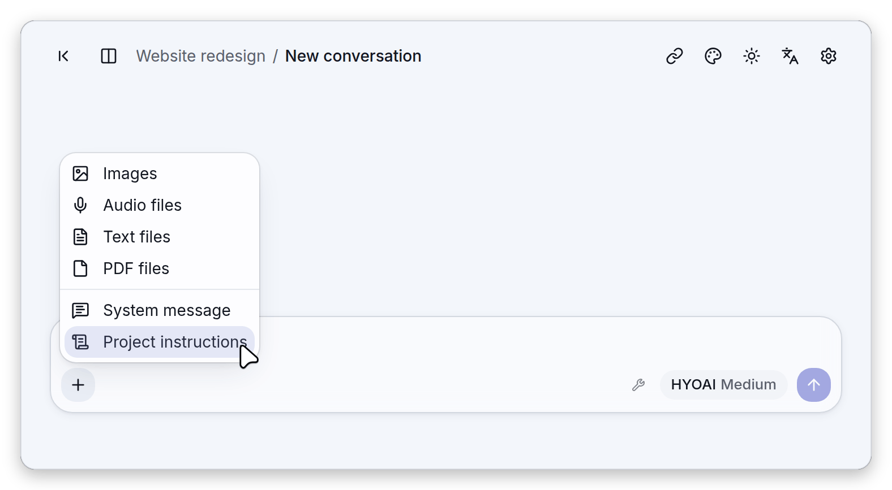
</picture>

#### Project instructions

The instructions of a project are a system prompt for its conversations. The system prompt of a
request is chosen in this order, and the first one that is not blank wins:

1. the system message of the conversation itself (see [System message](#system-message));
2. the instructions of its project;
3. the global **System prompt** of **Settings → Behavior**.

So the instructions of a project replace the global system prompt for its conversations, and a
conversation with its own system message still wins over both. They are read when each request is
built: editing them in the project settings applies to the next message of the existing
conversations, nothing is copied into them.

To check what a project adds, the **+** menu of the composer has a **Project instructions** entry,
under **System message**, that opens them in a read-only dialog. Clicking the project name in the
header, before the conversation title, opens the same text in a read-only popover. Both exist only
when the project of the open conversation has instructions, and a conversation that is not saved
yet already shows the project it was started in. Editing is done in the project settings.

#### The default model

A conversation started in a project (from its menu or **+** button, from the empty section, or from
**New conversation** while the search is limited to it) starts on the **Default model** of the
project, chosen among the entries of `config.json`. The model is ignored when it is disabled or no
longer in the configuration. Without a default model the conversation starts on the model currently selected. Moving an existing
conversation to a project never changes its model.

#### Project context

Besides its instructions, a project can carry documents: text files that the model should know in
every conversation of the project, such as a style guide, a price list or a product FAQ. The
**Context** entry of the project settings opens the context pages. They replace the dialog while
they are open, and fill the whole screen on a phone; the breadcrumb at the top goes back, one level
at a time.

<picture>
    <source media="(prefers-color-scheme: dark)" srcset="images/dark/project-context.png">
    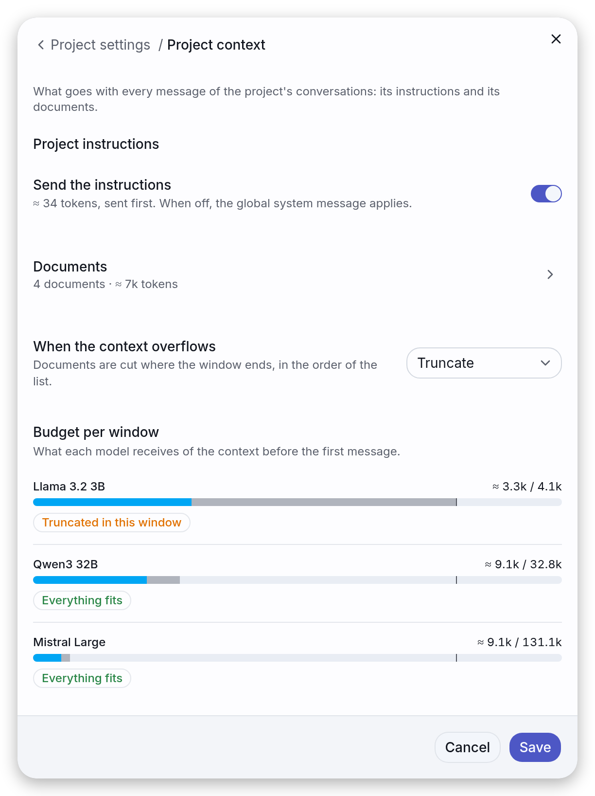
</picture>

The **Context** page holds, from top to bottom:

- **Send the instructions**, a switch, on by default. Off, the project sends no instructions: the
  global system prompt applies to its conversations as if the project had none, and the header and
  the composer stop offering them. It is greyed out while the project has no instructions.
- **Documents**, which opens the documents page.
- **When the context overflows**, the choice of **Truncate** or **Exclude** (see below).
- **Budget per window**, one gauge for each enabled model: the context of the project (blue), the
  conversation (here empty, so the budget is the one of a new conversation) and the room kept for the
  answer, with a tick where a request stops being allowed to grow. A badge says whether everything
  fits, or whether the window truncates the documents or sends none. A model whose server does not
  tell its context window shows "Not computed" instead of a gauge, in this page and in the model menu.

The instructions switch and the overflow choice belong to the draft of the project settings: they
apply when you press **Save** on the settings or the context page, and closing the dialog discards
them. The gauges follow the draft, so you see the effect before saving. The documents are the
exception: they are written as soon as they are added or removed.

<picture>
    <source media="(prefers-color-scheme: dark)" srcset="images/dark/project-documents.png">
    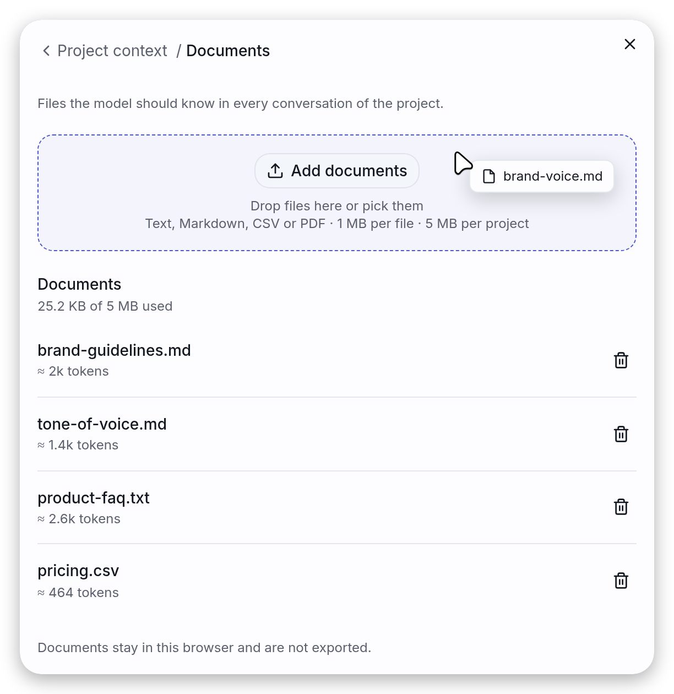
</picture>

##### Adding documents

The documents page has an **Add documents** button and accepts files dropped on the framed area. Text
(`.txt`), Markdown (`.md`, `.markdown`), CSV (`.csv`) and PDF files are read once, when they are
added, and only their text is kept: a PDF goes through the same reader as the PDF
[attachments](#attachments), and a scanned one with no text layer is refused. The files are read one
after the other. A refused file explains why, under the drop zone, and does not stop the others:

| Message                                          | Cause                                                                           |
| ------------------------------------------------ | ------------------------------------------------------------------------------- |
| "is not an accepted type"                        | Anything else than the formats above                                            |
| "is larger than 1 MB"                            | A file above 1 MB, before any reading                                           |
| "does not look like a text file"                 | A file with binary content under a text name                                    |
| "has no text to read"                            | An empty file, or a PDF without text                                            |
| "The project cannot hold more than 5 MB of text" | The text of the documents of the project would pass 5 MB, counted in characters |
| "The browser has no room left"                   | The browser refused the write: free some space or remove a document             |

Each document shows its name and its size in estimated tokens, at four characters per token, like
every other count of the application; the heading shows how much of the 5 MB the project uses. The
trash button removes a document at once. Documents are sent in the order they were added, oldest
first.

##### How a request carries them

The documents are added to the system message of the request, after the instructions, behind a
short introduction that says they are reference documents shared by the conversations of the
project, each one under its name. Nothing is stored in the conversation: like the instructions, they
are read when each request is built, so adding or removing a document applies to the next message of
the existing conversations.

The documents are fitted to the window of the model that answers, after the compaction of the
conversation, which never counts them: the room they get is the part of the window a request may
fill (the compaction threshold, or the safety fraction of the chunking settings when compaction is
off), less the room kept for the answer and the conversation as it will be sent. The instructions
are always sent, even when they alone exceed the window. When the documents do not all fit, the
**When the context overflows** choice decides:

- **Truncate** (the default) sends the documents in order, whole, until the room runs out, cuts the
  one that crosses the limit at the end of a line when one is close, with a note that its end was
  removed, and sends none of the following ones.
- **Exclude** sends no document at all when they do not all fit, so the model never works from
  half a document.

The room is counted in steps of a thirty-second of the window, so the cut does not move at every
message of a growing conversation: a request that starts like the previous one lets a llama.cpp
server reuse what it already computed. The sizes are estimates. When the server still refuses a
request for exceeding its context, and the excess the server counts is no larger than what was sent
of the documents, the request is sent once more with the documents cut by that excess, before the
conversation is split into chapters or summarized, since the conversation is not the cause.

The documents are not sent in the embedded widget, with a model whose **Send context** (`sendContext`)
is off, or to the steps of the chapter-by-chapter analysis of a message too long for the window (see
[Sampling and penalty settings](#sampling-and-penalty-settings)).

##### The gauge of the model menu

A conversation of a project that has instructions or documents adds a **Project context** section to
the end of the model menu, after the list of models and the thinking and effort entry, with the same
gauges as the context page, this time measured with the conversation as it stands. It tells which
model takes the whole context and which one truncates it, before you pick one. In a
[compare](compare.md#compare-mode) pane, the menu of the pane shows the conversation of that pane.
**Project context in the model menu**, in **Settings → Appearance**, turns the section off; the
context page keeps its gauges.

<picture>
    <source media="(prefers-color-scheme: dark)" srcset="images/dark/context-gauge.png">
    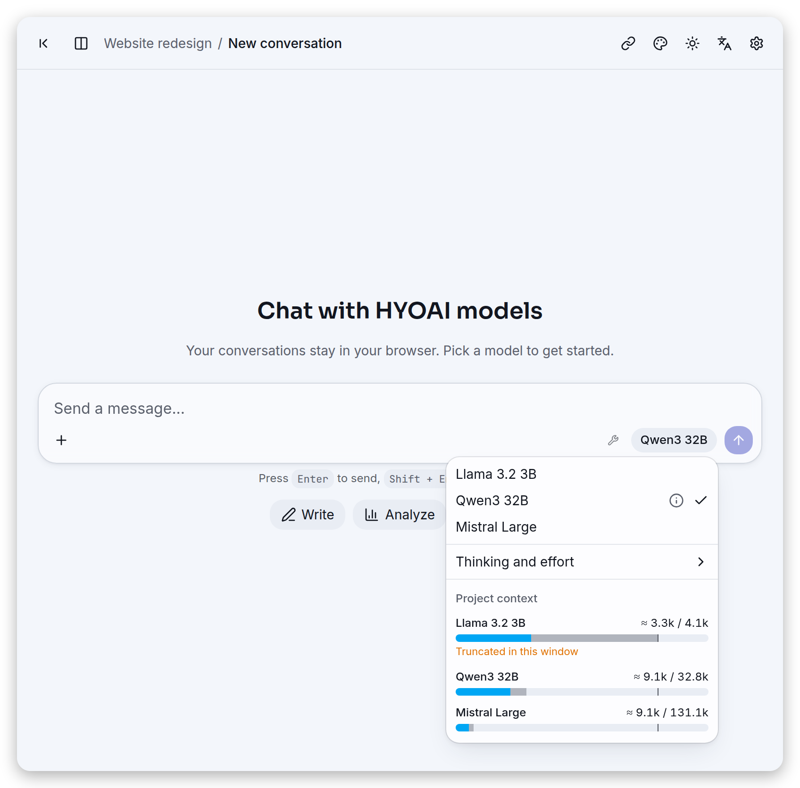
</picture>

##### Storage

The documents live in IndexedDB, in the `lc-documents` database, which has a quota of its own: they
are not counted in the localStorage gauge, and **Settings → Data** shows their size under it. The
other tabs follow the changes through a `BroadcastChannel`. A browser that refuses IndexedDB, as a
private window can, keeps the documents in memory until the tab closes, and the documents page says
so. Deleting a project deletes its documents, and so does **Clear all data**; a document left
behind by a project deleted in another tab is swept at the next start. Like the projects, the
documents are not exported.

#### Moving, storage and export

The projects live under the key `lc:projects`, written by the storage migration to schema version 3,
which only creates the empty list; a conversation points to its project by an optional id in its
index record. **Export** does not carry projects: the exported conversations have no project, so an
imported one lands outside every project, and the documents of a project stay in the browser.
**Settings → Data** says it under the export: "Projects are not exported: only conversations are,
without their project."

The [embedded widget](embed.md#what-the-widget-leaves-out) shows no project at all: no section, no
project name on the rows or in the header, no **Move to a project** entry, no **Project
instructions** entry and no note in the Data page. It sends neither the instructions nor the
documents of a project.

### Search

The sidebar search field filters as you type, in two ways at once:

- **Titles.** Conversations whose title contains the text, ignoring case, stay in **Pinned** and
  **Recent**.
- **Message content.** From two characters on, after a short pause, the bodies of all user and
  assistant messages are searched, ignoring case and accents. Matches appear in a **Messages**
  section: one row per conversation, showing its title and a short snippet with the match
  highlighted. A conversation already listed by its title is not repeated there, and the results are
  ordered by last modification. Fenced code blocks are not searched, and Markdown markup is
  flattened before matching. The content index is built the first time you search and kept up to
  date as conversations change, so that first search may take a moment on a large history.

Clicking a content match opens the conversation, moves to the branch holding the message if it is
not the displayed one, scrolls to it and flashes the matched word for about two seconds, or the
whole message when the exact word cannot be located. With no result the list reads **No results**.

While a search is typed, the list is flat (**Pinned**, **Recent**, **Messages**) and each row shows
the name of its project after the title, except in a search limited to a project.

**Searching in a project.** **Search in this project**, in the menu of a project section, limits the
search to that project: the field takes the focus and reads "Search in the project...", a chip
"Project: {name}" appears under it (click it to search every conversation again), and the list
shows only the conversations of the project, matching by title and by message content, even with
nothing typed. The **New conversation** button of the sidebar then starts a conversation in the
project and says "in {name}" on a second line. The limit is dropped when the project is deleted.
The command palette is not limited by it.

On touch devices the sidebar search field is a button that opens the [command palette](#command-palette)
instead of filtering the list, except while the search is limited to a project, which needs a real
field.

### Command palette

Ctrl/Cmd+K opens a palette from anywhere in the full application. On touch devices, where the
shortcut is out of reach, it also opens from the **Search** button of the header and from the search
field of the sidebar, which is then a button. The embedded widget has no palette.

<picture>
    <source media="(prefers-color-scheme: dark)" srcset="images/dark/palette.png">
    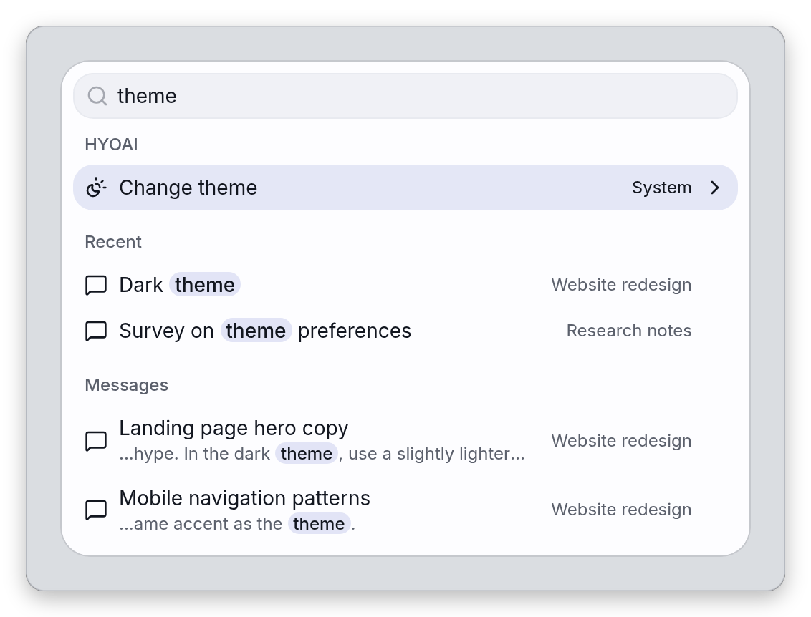
</picture>

With an empty field it offers three actions, **New conversation**, **Settings** and **Change
theme** (which shows the current theme), followed by every conversation under **Recent**. As soon
as you type, the actions whose name matches stay, ignoring case and accents (typing "theme" keeps
**Change theme**), and the palette shows the same two kinds of result as the sidebar, with the same
rules: matching titles under **Recent**, matching messages under **Messages**. The searched word is
highlighted in the titles as well as in the message excerpts, and a conversation that belongs to a
project shows its name on its row, at the right of the title or, on a phone, under it. The palette
always searches every conversation, whatever the limit of the sidebar search. Choose a result with
the arrow keys and Enter, or click it; Escape closes the palette. In [compare mode](compare.md) a
conversation that is already in a pane focuses that pane; otherwise it opens in the focused pane.

- **Change theme** replaces the list with a page: **Back**, then **Light**, **Dark** and
  **System**, with a check on the current one. Choosing a theme applies it and leaves the palette
  open. The page shows while the field is empty.
- When nothing matches, the palette says "No results for "{query}"" and offers **Start a
  conversation about "{query}"**. It opens a new conversation with the typed text in the composer,
  which takes the focus. Nothing is sent: read the text, complete it, then send it or not.

<picture>
    <source media="(prefers-color-scheme: dark)" srcset="images/dark/palette-phone.png">
    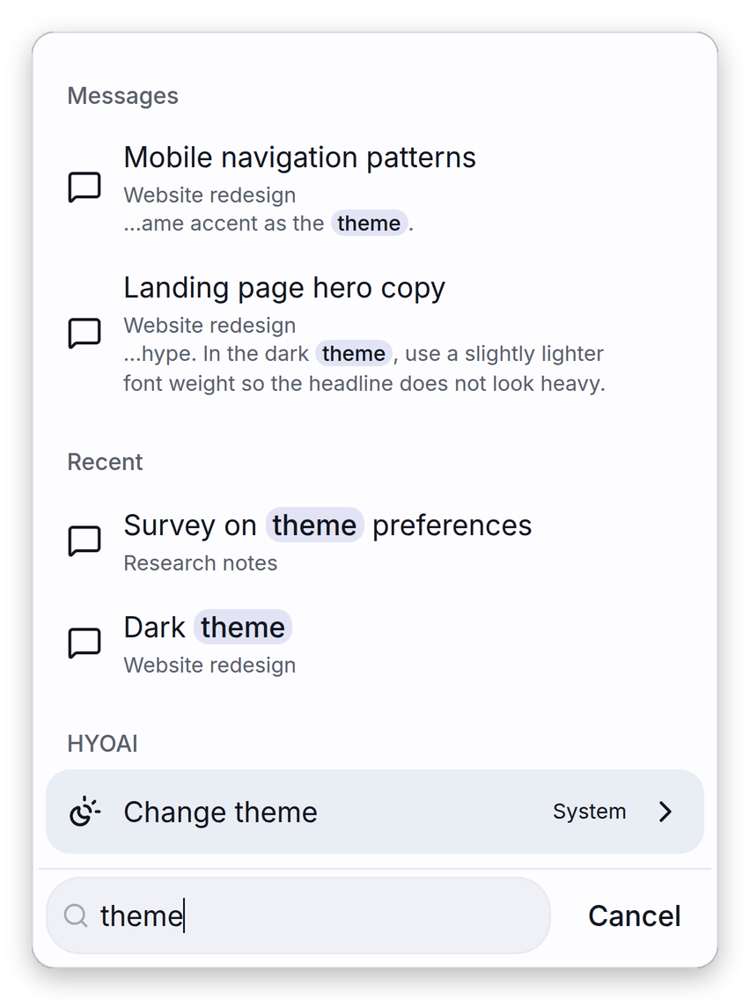
</picture>

Below the `md` breakpoint (768 px) the palette is a sheet that follows the visible area of the
screen, so the on-screen keyboard does not cover it. The list sits above the field, which is at the bottom
with a **Cancel** button, and it reads from the bottom up: the best match is the row closest to the
field and is the one selected, so Enter opens it. The rows are larger, with the project name under
the title.

## Storage, export and import

All of this lives in **Settings → Data**.

### The usage gauge

The **Local storage** section shows a gauge of what the application keeps in `localStorage`: "{used}
of {quota}", followed below by every conversation with its size, largest first, in a scrollable
list. Browsers offer no exact quota API, so the quota is assumed to be 5 MB per origin, and sizes
count keys and values at two bytes per UTF-16 character, which is how browsers account for them. The
hint under the list reads "Conversations are compressed in the browser localStorage."

- At 90 % of the quota the gauge text turns red and adds "almost full, export or delete
  conversations", and a toast warns once: "Local storage is {percent}% full — export or delete
  conversations to free space." Clicking the toast opens this page. The warning rearms once usage is
  back under 90 %.
- If a write is refused because the quota is exceeded, a toast says "Storage full: saving failed.
  Export your conversations then free up space.", also leading to this page. The write stays queued
  for a later retry.
- Images and files attached to messages are stored with the conversation, and images are downscaled
  before they are sent and saved (see [Attachments](#attachments)).
- A message's footer can also show the size of the conversation next to the total, see
  [Per-message stats](#per-message-stats).

**Clear everything** (with a confirmation, "Clear all data") removes every `lc:` key of this
browser, conversations and settings alike, and reloads the page.

### Export

**Export conversations** opens a dialog: pick the conversations (all are selected when it opens;
the header checkbox shows "{count}/{total} selected"), pick a **Format**, then press the **Export**
button, which shows the number of selected conversations, for example **Export (3)**.

<picture>
    <source media="(prefers-color-scheme: dark)" srcset="images/dark/export.png">
    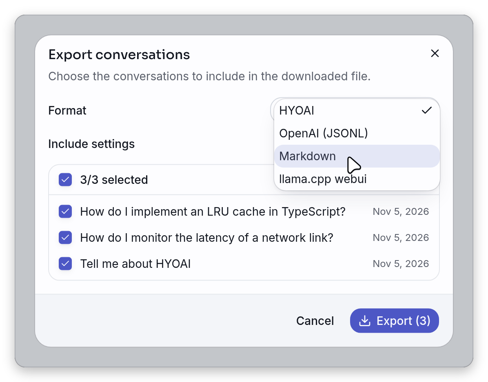
</picture>

| Format              | File name                                                                             |
| ------------------- | ------------------------------------------------------------------------------------- |
| **HYOAI**           | `hyoai-export.json`                                                                   |
| **OpenAI (JSONL)**  | The slugified title for a single conversation, otherwise `<date>_conversations.jsonl` |
| **Markdown**        | The slugified title for a single conversation, otherwise `<date>_conversations.md`    |
| **llama.cpp webui** | `<date>_conversations.json`                                                           |

For the OpenAI and Markdown formats, the title part of the name is cut at 60 characters, and the
`<date>_conversations.*` form is used as well when the title has no letter or digit once accents are
stripped (only `a` to `z` and `0` to `9` are kept in a name).

- **HYOAI** is the native format: whole message trees with every branch, reasoning, statistics and
  attachments. The **Include settings** switch (on by default, only available for this format) adds
  the application settings to the file.
- **OpenAI (JSONL)** writes one line per conversation, `{"messages": [...]}`, in the chat format of
  the OpenAI API: the messages of the displayed branch, the conversation's own system message when
  it has one, and attachments as multimodal content parts. The lines are ready to replay against a
  `/v1/chat/completions` endpoint or to feed a fine-tuning job. A conversation with no user or
  assistant message produces no line.
- **Markdown** writes a readable document of the displayed branch: a `#` heading with the title, an
  italic line with the date (`YYYY-MM-DD`) and the model, then one `##` section per message, headed
  with the speaker in the interface language (and the model name for an assistant message).
  Attachments become bracketed placeholders such as `[image: photo.png]`, and conversations are
  separated by a horizontal rule. Chapter analyses produced by the chunking of oversized inputs are
  left out.
- **llama.cpp webui** writes the format of the llama.cpp web UI, so the file imports into that
  interface. The whole tree is kept.

The Markdown and OpenAI formats keep only the branch shown on screen and leave out the model
reasoning; the dialog repeats it as "Only the displayed branch of each conversation is exported,
without the model reasoning." A toast confirms the export, for example "3 conversations exported". Projects are not part of the
file, which holds conversations only; the page notes it next to the button.

### Import

**Import a JSON file** accepts a native HYOAI file or a llama.cpp web UI conversations file, and
tries them in that order. Imported conversations merge with the existing ones: when an id already
exists, the conversation is imported as a copy with new ids and its title suffixed "(imported)". If
the file contains settings, they are applied. Import is deliberately forgiving: unknown fields are
ignored and slightly off values are repaired, so a hand-edited or older export still loads. Files
that are not valid JSON or not a recognisable export are refused with "Invalid file: {error}". The
Markdown and OpenAI formats are export-only.

## Messages

### Message actions

Hovering or focusing a message shows an action bar under it; on touch devices a long press opens the
same list as a bottom sheet (see [Responsive and touch behaviour](#responsive-and-touch-behaviour)).
The actions that apply to the message appear in this order:

| Action                                          | On                          | Effect                                                                                                                                                                                                                           |
| ----------------------------------------------- | --------------------------- | -------------------------------------------------------------------------------------------------------------------------------------------------------------------------------------------------------------------------------- |
| **Previous branch**, `1/2`, **Next branch**     | a message that has siblings | Moves between the alternative versions of the message (see [Branches](#branches)).                                                                                                                                               |
| **Reply**                                       | assistant messages          | Quotes the message, or the part you selected, into the composer (see [Quote and reply](#quote-and-reply)).                                                                                                                       |
| **Edit message**                                | user and assistant messages | Opens an inline editor. The steps inside a tool flow cannot be edited.                                                                                                                                                           |
| **Copy message**                                | every message               | Copies the text of the message.                                                                                                                                                                                                  |
| **Regenerate**                                  | assistant messages          | Asks for a new answer, kept as an alternative version.                                                                                                                                                                           |
| **Create a new conversation from this message** | every message               | Forks the conversation (see [Forking](#forking)).                                                                                                                                                                                |
| **Good response** / **Bad response**            | assistant messages          | Thumbs sent to your feedback endpoint. Only shown when a `feedback` integration applies to the model, see [Integrations](../README.md#integrations). A message can be rated once.                                                |
| **Delete this message and what follows**        | every message               | Removes the message and everything below it, including any branches that start from it, then shows the previous alternative at that point (or the next one if there is none, or the preceding message if it had no alternative). |

Branch arrows, edit, regenerate, fork and delete are disabled while an answer is being generated.

### Branches

Nothing is overwritten. **Editing a message** or **regenerating a reply** adds an alternative
version next to the original, and every message that has alternatives shows an indicator, `1/2` for
the first of two, between **Previous branch** and **Next branch** arrows. The indicator is part of
the message actions: it appears with the action bar when you hover or focus the message, and in the
action sheet (long press) on touch devices. Moving to another version follows that branch down to
its most recent end, so you land on the latest state of the alternative you picked. The arrows are
disabled at the first and last version.

<picture>
    <source media="(prefers-color-scheme: dark)" srcset="images/dark/branches.png">
    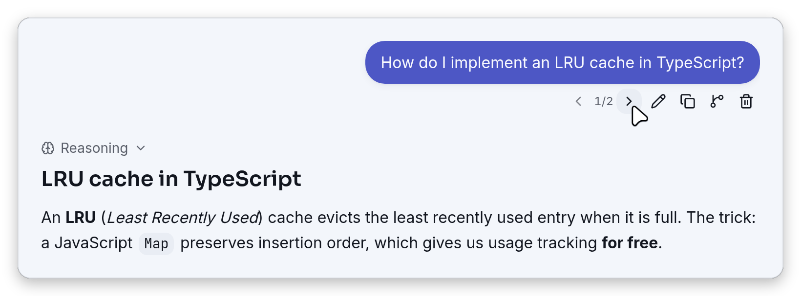
</picture>

Because a conversation is a tree, the old branch is kept whole, answers included. The tree is what
the native export and the llama.cpp export keep; the Markdown and OpenAI exports keep the displayed
branch only. When a message ends a tool flow, the indicator, regeneration and deletion act on the
whole flow (see [tools.md](tools.md)).

### Editing

- **A user message** opens in an inline editor with **Save and send** and **Cancel**. Saving adds a
  sibling message and asks for a fresh answer from there; the original branch stays reachable. The
  attachments can be edited too, with the same **+** menu, paste and drag-and-drop as the composer,
  and a message needs text, attachments or both. A quote attached to the message is kept. If the
  model no longer accepts some of the attachments, they are dropped with the notice "Attachments
  unsupported by the model were removed".
- **An assistant message** opens an editor with **Save** and **Cancel**. Saving adds an edited
  sibling version without asking the model anything.

In both editors Escape cancels and Ctrl/Cmd+Enter saves (see [Keyboard shortcuts](#keyboard-shortcuts)).

### Forking

**Create a new conversation from this message** copies the branch that leads to that message, and
only that branch, into a new conversation titled "{title} (fork)". The copy keeps the content,
attachments, statistics and dates of each message, the model, the system message and the
[project](#projects), opens right away, and a toast says "New conversation created from this message". The original is untouched. Use
it to try a different direction without cluttering the first conversation with branches.

### Quote and reply

You can anchor the next question on something the model said, either a whole message or just a text
selection.

- **A whole message:** click **Reply** in the action bar of an assistant message.
- **A selection:** select text inside a single answer, with the mouse or the keyboard, and a
  floating **Reply** button appears above the spot where you released the mouse (or above the end of
  a keyboard selection); Escape or scrolling hides it. If a selection lies inside the message when
  you click **Reply** in the action bar, only the selection is quoted. The floating button is shown
  in the single chat, but not with a coarse pointer (touch): selecting text is unreliable there, so
  use the action sheet.

<picture>
    <source media="(prefers-color-scheme: dark)" srcset="images/dark/reply.png">
    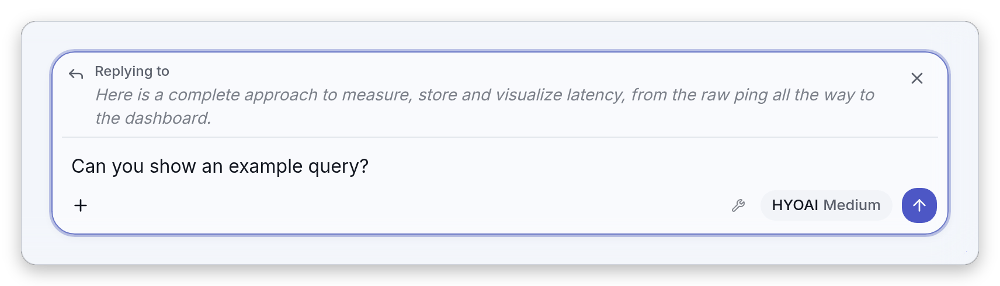
</picture>

The excerpt waits above the input in a strip headed **Replying to**, with a **Remove quote** button
to drop it. Type your question and send as usual. The quote is saved with your message and shown
above its text in the bubble, as a muted excerpt with a left border, clamped to three lines (it is
italic only in the **Replying to** strip above the composer). What the model receives is your
message first, then the sentence "In reply to this passage:" (in the interface language) and the
excerpt as a Markdown blockquote, so the instruction leads and the quote does not bury it.

## Reading an answer

### Reasoning

When the server streams reasoning (the `reasoning_content` field, or `reasoning`), it is shown in a
collapsible block above the answer, as plain text. While the model reasons the block is labelled
**Thinking** with a pulsing brain icon and opens by itself; when the answer starts it collapses and
reads **Reasoning**, unless **Expand reasoning** is on (**Settings → Appearance → Expand after the
answer**: "Keep the thinking block open once the answer is done."). Click the label to open or close
it at any time.

The **Thinking** switch and the effort levels, under **Thinking and effort**, in the model menu
appear when the model supports them, whether they are declared on the model's own `config.json` entry, at the top level of
`config.json` (applied to every model), or, for the switch, through the default reasoning support of
the server type; see [Reasoning: thinking and effort](../README.md#reasoning-thinking-and-effort)
and [models.md](models.md). In compare mode each pane keeps its own choice
([compare.md](compare.md)). The model chip under the answer shows a brain icon when thinking was on
for that answer, the model's short name (without one, the base name taken from the upstream model
id) and the effort level used, when an effort level was sent.

<picture>
    <source media="(prefers-color-scheme: dark)" srcset="images/dark/thinking.png">
    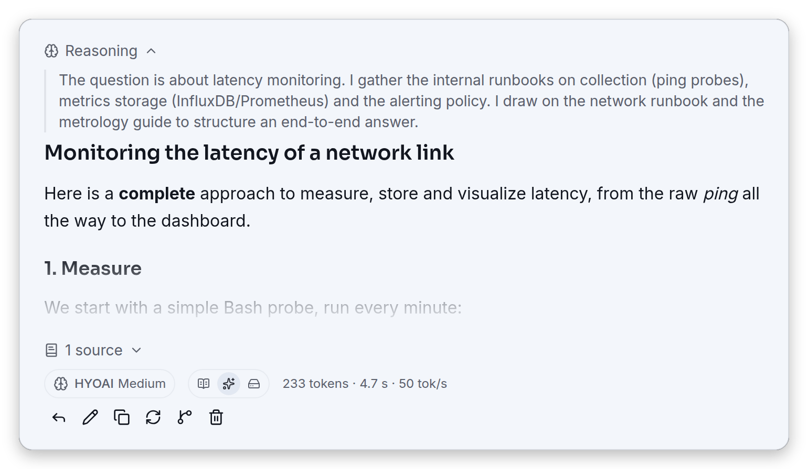
</picture>

### Per-message stats

Under a finished answer, a footer holds the model chip (when the model is known) and, unless
**Message statistics** is turned off in **Settings → Appearance** ("Tokens, speed and duration under
each answer."), a small group of toggle buttons. Each one swaps the figures shown next to it:

| Toggle                                  | Figures                                                                                                                                                                                                         |
| --------------------------------------- | --------------------------------------------------------------------------------------------------------------------------------------------------------------------------------------------------------------- |
| **Reading (prompt processing)**         | Prompt tokens, time and speed, when the server reports them                                                                                                                                                     |
| **Generation (token output)**           | Output tokens, duration and `tok/s`, for example "233 tokens · 4.7 s · 50 tok/s"                                                                                                                                |
| **Steps (time per step)**               | The time of each stage reported by a backend (see [plugins](../plugins/README.md)); for a tool flow, one line per model request ("Step 1", "Step 2", ...) and per tool call that ran (see [tools.md](tools.md)) |
| **Storage (this conversation · total)** | The storage taken by this conversation, then the total used out of the quota                                                                                                                                    |

A toggle only appears when it has something to show. When the model that wrote the answer is still
in the configuration, the chip is a button that opens its model information dialog.

### The context bar

Once an answer has reported its usage, a thin bar just above the composer shows how full the context
window is. It is visible live while an answer streams and otherwise only while the mouse is over the
composer zone. Hovering the bar (or tapping it on touch) opens a card with "Context: {used}/{total}
({percent}%)", "Output: {count}/{max}" (`∞` when no maximum is set) and the generation speed in
`t/s`; when the context size of the model is not known it says "Context not computed with this
model". The bar turns red once the context reaches the compaction trigger threshold, a fraction of
the window that is 0.8 by default. That threshold is the **Trigger threshold** field of the
**Conversation compaction** group in **Settings → Chunking** (0.1 to 0.95), next to **Enable
automatic compaction** and **Recent turns kept**. The card also holds the actions of conversation
compaction: **Compact conversation** when at least two messages older than the **Recent turns kept**
can be summarised, and **Free storage** once a summary exists. With a summary but nothing more to
compact, a **Compacted** label stands in for the **Compact conversation** button, and with neither
there is no action at all. Compaction needs at least two messages to summarise and always leaves the
latest turns untouched: the number set by **Recent turns kept**, and at least the last turn while it
is still open (it ends on a tool call or a tool result, so the model has not answered yet), even
when **Recent turns kept** is 0. The larger of the two applies, they do not add up.

### Markdown and code

Answers are rendered as GitHub-flavoured Markdown: tables, blockquotes, lists and links render
inline, and links open in a new tab. Fenced code blocks are syntax-highlighted and framed with a
header showing the language and a **Copy** button for the raw code. A fence with nothing in it
renders nothing, so the stray closing fence some models leave does not open an empty box.

Images written in an answer load normally, except in text written after a tool result: a tool result
can contain instructions that steer the model, so there an image is shown as a link ("Image not
loaded: {url}") instead of being fetched (see [tools.md](tools.md)).

### Sources and citations

When the backend sends citations, a collapsible row under the answer reads "{count} source" or
"{count} sources". Opened, it lists them numbered: a clickable title (plain text when the citation
has no usable `http(s)` URL), the relevance score with two decimals when the backend gave one
(tooltip **Relevance score**), and a preview clamped to two lines. The same page cited twice is
listed once.

When the backend sends no citations, the row falls back to the external links the answer itself
contains, whether written as Markdown links or as bare URLs, ignoring fenced code, images and inline
code other than a lone URL, each labelled with its link text or its host name. The row starts
collapsed unless **Expand sources** is on (**Settings → Appearance → Expand after the answer**).

### Backend steps

A backend that reports what it did while answering (the queries it ran, the documents each step
found) gets a collapsible trace above the answer: **Search** (**Searching...** while streaming) when
searching is involved, **Steps** (**Working...** while streaming) otherwise, and a count of tool
calls (**3 tool calls**, or **1 tool call** for a single one) when it only holds tool calls. It
opens by itself while the answer streams, stays open while a call waits for approval, and collapses
afterwards unless **Expand search and tool activity** is on. The documents found by a step are
listed, collapsed, under that step's label; the final sources are recapped by the row below the
answer. Steps, citations and backend stage timings come from a backend
[plugin](../README.md#plugins) (see [../plugins/README.md](../plugins/README.md)); tool calls, and
the timing of each model request and of each tool call that ran in a flow, are described in
[tools.md](tools.md).

### Math and diagrams

KaTeX renders formulas written as `$...$`, `$$...$$`, `\(...\)` and `\[...\]`. Models that write the
bracket forms are accepted as they are; they are rewritten to the dollar forms before rendering,
code spans and fences are left untouched, and a formula written with `$$...$$` or `\[...\]` alone on
its line is shown as a centred display block, whereas `$...$` and `\(...\)` stay inline even when
they are alone on a line. Prices are not mistaken for maths: in "$5 and $10" both dollar signs stay
text.

A `mermaid` code block renders as a diagram instead of being highlighted.

<picture>
    <source media="(prefers-color-scheme: dark)" srcset="images/dark/math.png">
    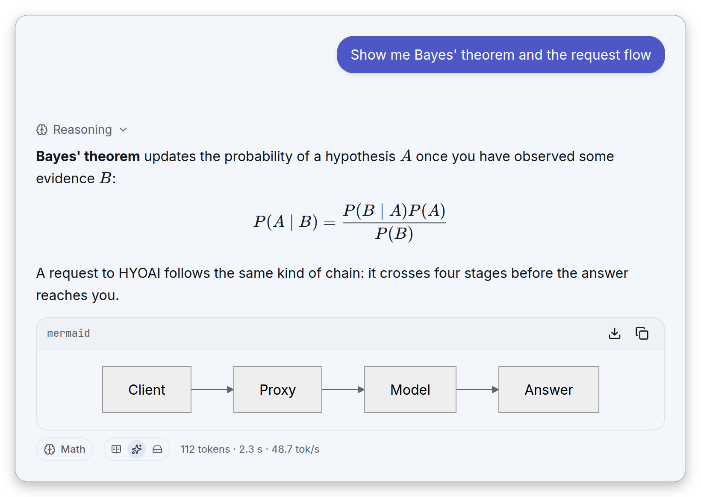
</picture>

The diagram has the same frame as a code block, headed `mermaid`, with a **Copy** button for the
source and, once the diagram is drawn, a **Download SVG** button for the picture. The download is a
standalone file named `diagram.svg`, with a background matching the current theme and the natural
size of the diagram. The diagram library is loaded only when the first diagram appears, and the
drawing follows the light or dark theme. While the source is still streaming, rendering waits for
250 ms of quiet, and the last good drawing stays visible for a moment if the half-written source
stops parsing; a diagram that cannot be rendered falls back to its source as plain text.

## Writing a message

### Sending

The composer grows with the text. **Send** (an arrow) becomes **Stop generation** (a square) while
an answer is being produced. When the model cannot answer, the button is disabled and its tooltip
gives the reason, for example "No model available (config.json)". Details and shortcuts:

- Enter sends and Shift+Enter inserts a new line; the **Send on Enter** setting (on by default)
  turns the first off. Enter does nothing special while an input method composition is in progress.
  The hint "Press Enter to send, Shift + Enter for new line" shows under the composer when **Send on
  Enter** is on, on screens at least 768 px wide, and can be hidden with **Show the hint under the
  composer**.
- With the input empty, the up arrow recalls the messages you sent on the displayed branch, newest
  first, and the down arrow moves back towards the newest and finally to an empty field. Once the
  field has text and you are not browsing, the arrows move the cursor as usual.
- In the single chat the composer focuses itself, except with a coarse pointer (touch), so the
  on-screen keyboard does not pop up unasked.
- **Compact input** (Settings → Appearance) puts the **+** button, the field and the controls on a
  single line until the message wraps.

### Starter suggestions

A deployment can list a few starter prompts in its `config.json`, under `suggestions`, so that an
empty conversation does not start from a blank field. They show under the message box as one pill
per entry, a category or a direct suggestion, only while the conversation is empty and the field has no text: they disappear as soon
as you type, while an answer is being produced, in a [compare](compare.md#compare-mode) view and in
the embedded widget, which offers only the ones its host page sends, see
[Starter suggestions](embed.md#starter-suggestions) of the embed. They also show in the empty conversation of a project. Without the key, or
with no usable entry for the language, nothing is shown.

<picture>
    <source media="(prefers-color-scheme: dark)" srcset="images/dark/suggestions.png">
    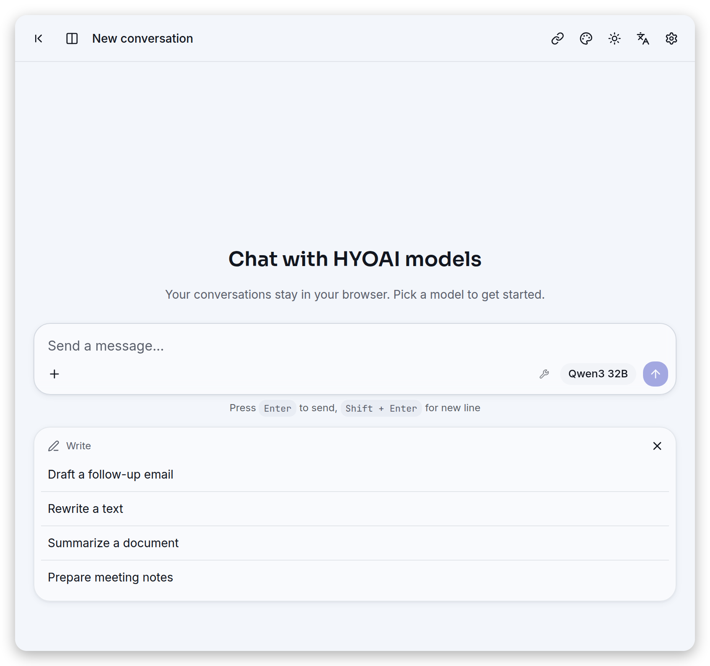
</picture>

A pill opens its suggestions in place of the pills, with the name of the category and a button that
closes them (Escape does too, and puts the focus back on the pill). Pointing at a suggestion, or
focusing it with the keyboard, previews its prompt in the field in grey, so you can read what would
be sent; choosing it sends the prompt, with the files already attached to the field, and does not
touch what you had typed. The previews are for a mouse and the keyboard: on a touch screen, a tap
sends.

A suggestion the deployment marks with `"send": false` is a prompt to complete, such as "Translate
this text:". Choosing it writes the prompt in the field, with the caret after it, and sends
nothing, on a touch screen too; a small text cursor in place of the arrow tells these apart.

An entry of the list that has a `title` and no `items` is not a category but a suggestion of its own:
a pill, among the category pills, that is chosen at once, sending its prompt or writing it in the
field when it is marked `"send": false`, with the same preview. It may name an `icon`, drawn after
its title. Opening a category replaces all the pills, the direct ones too. A category with a single
item still opens its panel.

The categories, direct suggestions, their `icon` and their `items` are described in the
[root keys](models.md#root-keys) of the configuration. The list of the interface language is shown,
else English, else the first language written, so a French reader of a deployment that wrote both
sees the French one.

### Attachments

The **+** button (**Add files or a system message**) opens the attachment menu above the composer.

<picture>
    <source media="(prefers-color-scheme: dark)" srcset="images/dark/attachments.png">
    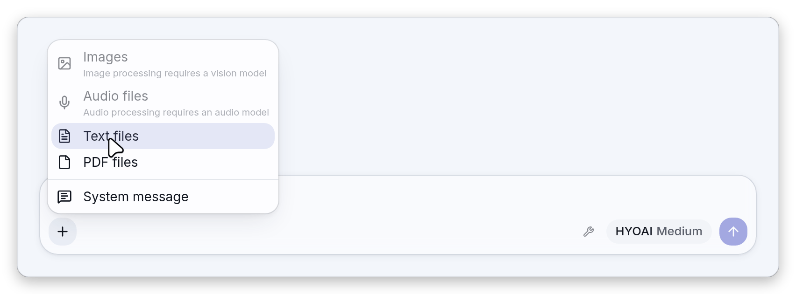
</picture>

You can also paste files into the field or drop them on the composer; each file is routed by its
type, and files of several kinds can go together. Attachments show as a strip above the input,
images as thumbnails and other files as a chip with the file name, each with a **Remove attachment**
button. After sending they appear above your message.

| Entry           | Accepts                   |
| --------------- | ------------------------- |
| **Images**      | Any image                 |
| **Audio files** | mp3 or wav, up to 3 MB    |
| **Text files**  | Any text file, up to 1 MB |
| **PDF files**   | PDF                       |

After a separator, the menu offers **System message** and, when the project of the conversation has
instructions, **Project instructions**: a read-only view of them (see
[Project instructions](#project-instructions)).

- **Images** are resized in the browser, before they are sent and before they are stored, so that
  the longest side fits **Max image size (px)** (1024 by default, 256 at least). They are never
  upscaled; a PNG stays PNG and everything else becomes a JPEG at 0.85 quality. They go out in the
  OpenAI vision format, as an inline `image_url`.
- **Audio files** go out inline as an `input_audio` part.
- **Text files** are read as text and sent as a `File: <name>` block ahead of your message. A file
  that contains NUL bytes is refused as binary. At send time, redundant whitespace is trimmed and a
  clean delimited table (tab, semicolon or comma) loses its empty rows and its empty columns; the
  stored text is left untouched.
- **PDF files** have the text of each page extracted in the browser into one attachment (the PDF
  library is loaded only when you attach a PDF). With **PDF as images** on, the pages are rendered
  instead, up to 25 of them, as JPEG images scaled to **Max image size (px)** and named
  `<file> (page N)`. A scanned PDF has no text to extract, so use **PDF as images** for those.

In the request, the text of file attachments comes first, then your message, then images and audio.

**Images** and **Audio files** are greyed out with the reason "Image processing requires a vision
model" or "Audio processing requires an audio model" when the model does not accept them; attaching
one anyway, by paste or drop, shows the same text as an error. A model accepts images or audio only
when its `modalities` entry says so or when a probed endpoint advertises it, and a `false` always
wins (see the `modalities` row of the [key table](models.md#keys-of-a-models-entry)). **PDF as
images** and **Max image size (px)** are in **Settings → Behavior**. Both are disabled,
with the text "Requires a vision model", when the model has no image modality, and a PDF is then
attached as extracted text even if **PDF as images** was on. A file that cannot be read shows a
toast, "Could not read "{name}"" or a short message with the cause.

### System message

**System message** at the bottom of the attachment menu opens an editor for this conversation's
system message: "Sent at the top of this conversation, overriding the project instructions and the global system prompt setting."
Once saved, a **System message** chip appears above the composer: click it to edit (hovering shows
the full text), or use its **Remove the system message** button; saving an empty text clears it. The
global **System prompt** ("Sent at the top of every conversation. Empty: no system prompt.") is in
**Settings → Behavior**. When the conversation belongs to a project that has
[instructions](#project-instructions), the system message wins over them and they win over the
global prompt. The entry is offered in the single chat only, not in compare panes.

## Model availability

When a model's server stops answering, HYOAI, with **Automatically disable unavailable models** on
(the default), greys the model out as **Unavailable** and blocks sending to it until the server
answers again. With the setting off, the model stays selectable and the error is shown when you
send. An entry that is unavailable for a reason other than an unreachable server stays greyed out
whatever the setting says. The two settings that control this, **Automatically disable unavailable
models** and **Check a silent server after (seconds)**, are at the top of **Settings → Models**. The behaviour, the settings and what you see in the menus, the composer and the
compare panes are described in [Model availability](compare.md#model-availability); the entries that
can never be used are described in [models.md](models.md#an-entry-that-cannot-be-used).

## Sampling and penalty settings

Sampling and penalties are global: they apply to every model and conversation, and are edited in the
**Sampling** page of the Settings dialog (the repetition penalties and DRY are its **Penalties**
group). An empty field is not sent, so the endpoint applies its
own defaults (the placeholder reads **Server default**); to go back to them, clear the field. The
names sent to the endpoint are adapted to its `type`:

| Setting                                                          | Field sent                                                               | `llama.cpp` | `vllm` | `openai` |
| ---------------------------------------------------------------- | ------------------------------------------------------------------------ | ----------- | ------ | -------- |
| Temperature (0 to 2)                                             | `temperature`                                                            | yes         | yes    | yes      |
| Top P (0 to 1)                                                   | `top_p`                                                                  | yes         | yes    | yes      |
| Max tokens                                                       | `max_tokens`                                                             | yes         | yes    | yes      |
| Presence penalty                                                 | `presence_penalty`                                                       | yes         | yes    | yes      |
| Frequency penalty                                                | `frequency_penalty`                                                      | yes         | yes    | yes      |
| Top K                                                            | `top_k`                                                                  | yes         | yes    | no       |
| Min P (0 to 1)                                                   | `min_p`                                                                  | yes         | yes    | no       |
| Repeat penalty                                                   | `repeat_penalty` (llama.cpp), `repetition_penalty` (vLLM)                | yes         | yes    | no       |
| DRY multiplier, DRY base, DRY allowed length, DRY penalty last N | `dry_multiplier`, `dry_base`, `dry_allowed_length`, `dry_penalty_last_n` | yes         | no     | no       |

So `repetition_penalty` goes to vLLM and `repeat_penalty` and the `dry_*` fields to llama.cpp; the
DRY group is labelled "DRY parameters: ignored by endpoints that do not support them." Max tokens
takes -1 for unlimited. The embedded widget can override the temperature and the maximum number of
tokens from its URL ([embed.md](embed.md)).

The **Chunking** page of the Settings dialog holds two groups of settings for conversations that
outgrow the context window:

- **Over-context input chunking** splits an input (your message plus text and PDF attachments) that
  exceeds the context window into chapters analysed one by one, then synthesised into a final
  answer. Its fields are **Enable chunking**, **Strategy** (**Map-reduce** or **Rolling**),
  **Fallback context (tokens)** (the window assumed when the server does not expose it) and **Safety
  margin** (0.1 to 0.95).
- **Conversation compaction** automatically summarises the start of a long conversation so it keeps
  fitting the context window, without losing the recent exchanges. Its fields are **Enable automatic
  compaction** (on by default), **Trigger threshold** (a fraction of the context, 0.1 to 0.95, 0.8
  by default; it is also the point where the [context bar](#the-context-bar) turns red) and **Recent
  turns kept** (0 to 10 latest exchanges kept verbatim, 2 by default). Automatic compaction runs
  before sending when the context nears the threshold and after a server context overflow. Manual
  compaction does not depend on the automatic switch: the **Compact conversation** action in the
  card of the [context bar](#the-context-bar) is offered as soon as there are at least two messages
  older than the **Recent turns kept** to summarise.

## Keyboard shortcuts

The global shortcuts accept Ctrl or Cmd on any platform; the hints drawn in the interface show Cmd
on Apple platforms and Ctrl elsewhere, with Shift as an arrow icon.

| Shortcut                    | Action                                           | Where                                                             |
| --------------------------- | ------------------------------------------------ | ----------------------------------------------------------------- |
| Ctrl/Cmd+K                  | Open the [command palette](#command-palette)     | anywhere in the full application                                  |
| Ctrl/Cmd+B                  | **Toggle sidebar**                               | the full application, from 768 px up (below, use the menu button) |
| Ctrl/Cmd+Shift+O            | **New conversation**                             | anywhere in the full application                                  |
| Enter                       | Send the message                                 | composer, when **Send on Enter** is on                            |
| Shift+Enter                 | New line                                         | composer                                                          |
| Up / Down arrow             | Recall the messages sent on the displayed branch | composer, see [Sending](#sending)                                 |
| Ctrl/Cmd+Enter              | Save the edit                                    | message editor                                                    |
| Ctrl/Cmd+Enter              | Confirm the main action                          | dialogs and forms, see below                                      |
| Escape                      | Cancel the edit                                  | message editor                                                    |
| Enter / Escape              | Confirm / cancel a rename                        | sidebar row, header title                                         |
| Escape                      | Hide the floating **Reply** button               | text selection in an answer                                       |
| Shift + click on **Delete** | Delete a conversation without the confirmation   | conversation row menu                                             |
| Arrow keys, Enter, Escape   | Choose a result, open it, close the palette      | command palette                                                   |

Ctrl/Cmd+Enter also confirms the main action of a dialog or a form without reaching for the mouse:
the project settings, the system message, **Export**, **Reset**, the MCP server form, the deletion of
a conversation or of a project that holds no conversation, the message editor and the comment of a
feedback. The button shows the shortcut as a **↵** chip on desktop (a wide window with a fine
pointer) and announces it to assistive technology. It is ignored while an input method composes
text, and it is deliberately not offered where one keystroke would wipe several things: deleting a
project that holds conversations and **Clear all data**.

The global shortcuts are registered by the full application shell: the compact shell of the embedded
widget does not install them (see [embed.md](embed.md#what-the-widget-leaves-out)). They are
intercepted even while the cursor is in the composer.

## Appearance and display

| Setting (Settings → Appearance)                                               | Values and default                                                            |
| ----------------------------------------------------------------------------- | ----------------------------------------------------------------------------- |
| **Theme**                                                                     | **Light**, **Dark** or **System**, which follows the operating system         |
| **Style** (skin)                                                              | **Soft** (default), **Flat**, **Contrast**, **Warm**, **Forest** or **Dim**   |
| **Interface language**                                                        | Français or English; the saved choice, else the browser language, else French |
| **Chat width**                                                                | **Medium** (default), **Large** or **Extra large**; not available on mobile   |
| **Compact input**                                                             | Off by default; not available at narrow window widths                         |
| **Animations**                                                                | On by default                                                                 |
| **Message statistics**                                                        | On by default                                                                 |
| **Project context in the model menu**                                         | On by default                                                                 |
| **Expand reasoning**, **Expand search and tool activity**, **Expand sources** | Off by default, under **Expand after the answer**                             |

**Animations** eases what changes in the interface: blocks that fold, menus and dialogs, hovers, the
icon of a tool call, and the fade between two themes. Turned off, everything changes at once, as it
does for a reader whose system asks for reduced motion, which is always honoured whatever this
switch says; a spinner still turns.

The theme, skin and language are also in the header, or under **More** on a phone. The language
setting is mirrored on the page's `lang` attribute. The embedded widget takes its theme, skin and
language from its URL instead ([embed.md](embed.md)).

## Responsive and touch behaviour

The interface is touch-first on phones. The "mobile" layout starts below the `md` breakpoint (768
px); a second "narrow" layout applies at 479 px and below; and touch input (a coarse pointer; a long
press also works with a pen) is detected separately from the width, so a tablet in landscape gets
the touch menus and controls too. The layout itself, such as the docked sidebar, still follows the
width.

<picture>
    <source media="(prefers-color-scheme: dark)" srcset="images/dark/responsive.png">
    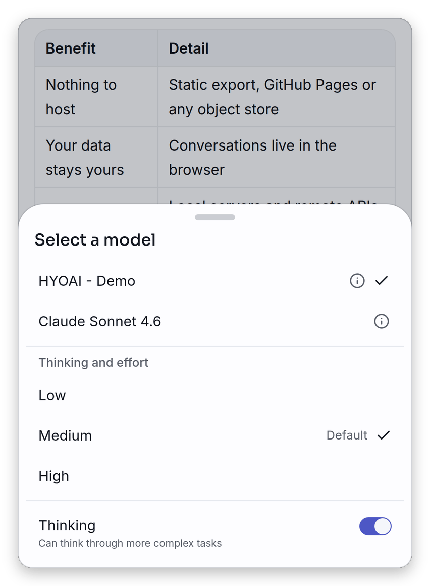
</picture>

- **Bottom drawers.** The model menu and the conversation menu open as bottom drawers instead of
  dropdowns on a device whose primary pointer is coarse or below the `md` breakpoint (a touch-screen
  laptop whose primary pointer is a mouse keeps the dropdown while the window is at least `md`
  wide); the header **More** menu is a drawer too, but exists only below `md`. A drawer has a drag
  handle, swipe down to dismiss, and padding for the device's safe area, so long menus stay within
  thumb reach. In the model drawer the reasoning levels and the **Thinking** switch are laid out
  flat rather than in a submenu, which would overflow the screen.
- **Message actions as a sheet.** The hover bar is hidden on touch devices. Press and hold a message
  (about half a second) to open a bottom sheet with the same actions in the same order, as
  full-width rows; the feedback thumbs open a comment field in the sheet and are submitted from
  inside it. The other actions run once the sheet has finished closing.
- **Sidebar.** Below the `md` breakpoint only, the conversation list opens as a left sheet from the
  menu button; at 768 px and above, including a landscape touch tablet, the sidebar stays docked.
  The rest follows the coarse pointer, whatever the width: the rows and buttons are larger, a row's
  **…** button is always visible, a long press on the row opens its menu, and the hover card is not
  used. The menu of a project is a drawer too, the **+** button of its header is left out (the menu
  has the same entry), and **Move to** drills into the list of projects inside the menu. The search
  field of the sidebar opens the [command palette](#command-palette).
- **Header.** A **Search** button opens the [command palette](#command-palette) on a coarse pointer, and
  the header buttons are larger. **Compare** is hidden below the `md` breakpoint (while compare is on, **Single
  conversation** is the first entry of **More**); the skin, theme and language switchers and **Copy
  link** move into **More**.
- **Composer.** Three separate signals apply. With a coarse pointer, whatever the width, the
  composer does not grab the keyboard on its own, **Send on Enter** shows as unavailable and the
  floating **Reply** button is not shown (use **Reply** in the sheet). Below 768 px, **Chat width**
  and the hint under the composer are unavailable. At 479 px and below, **Compact input** is
  unavailable. An unavailable setting reads "Not available on mobile" with a coarse pointer, and
  "Not available at this window width" otherwise.
- **Static export.** The media-query hook is SSR-safe: the server render and the first client render
  both use the desktop, fine-pointer variant, and the value only flips after hydration on a matching
  device, so the static export hydrates cleanly. The mobile sidebar sheet, the **More** menu and the
  message action sheet close when the window crosses the breakpoint, rather than being left on the
  wrong surface.

## Accessibility

- Icon-only controls carry `aria-label`s (**Toggle sidebar**, **Copy message**, **Remove
  attachment** and so on) and decorative glyphs are `aria-hidden`. Shortcut hints draw Cmd and Shift
  as icons (Ctrl stays text) but expose the full text, for example "Ctrl+Shift+O", through an
  `aria-label`.
- Drawers and dialogs keep a title, visually hidden when it is not shown: the message sheet is
  titled **Actions**, the command palette is titled "HYOAI" with the description "Search...".
- Menu focus returns to its trigger when a menu closes, or is handed off: dismissing the
  conversation menu (Escape or a click outside) or confirming a rename (Enter, or leaving the field)
  puts the focus back in the composer.
- The message list is a polite live region (`role="log"`), the state icons of a sidebar row (waiting
  for approval, generation complete) carry text labels, and toggles such as **Toggle sidebar** and
  **Compare** expose `aria-pressed`.
- The page's `lang` follows the interface language.
- Menus, dialogs, the message actions and the composer are keyboard-operable through the underlying
  Radix primitives. The card of the [context bar](#the-context-bar), with its **Compact
  conversation** and **Free storage** actions and its figures, opens by pointer or touch only.
