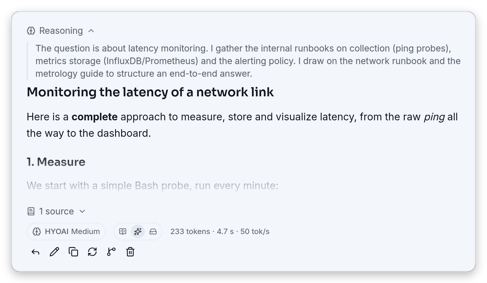
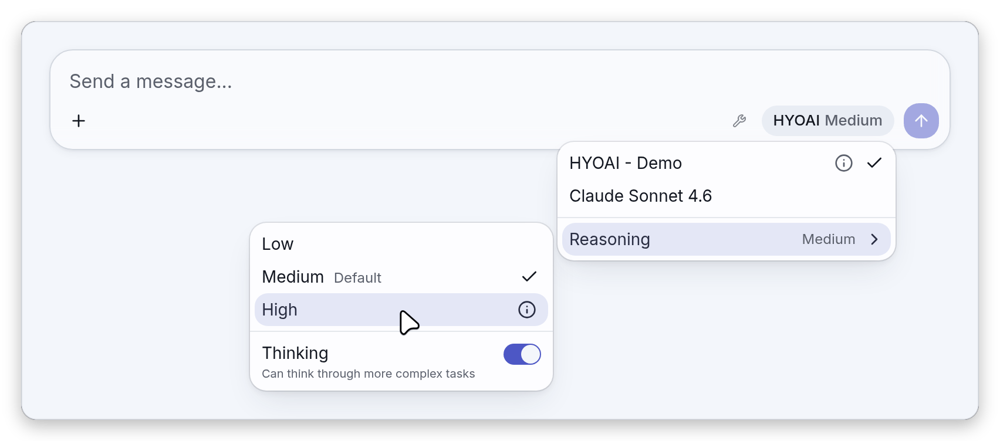
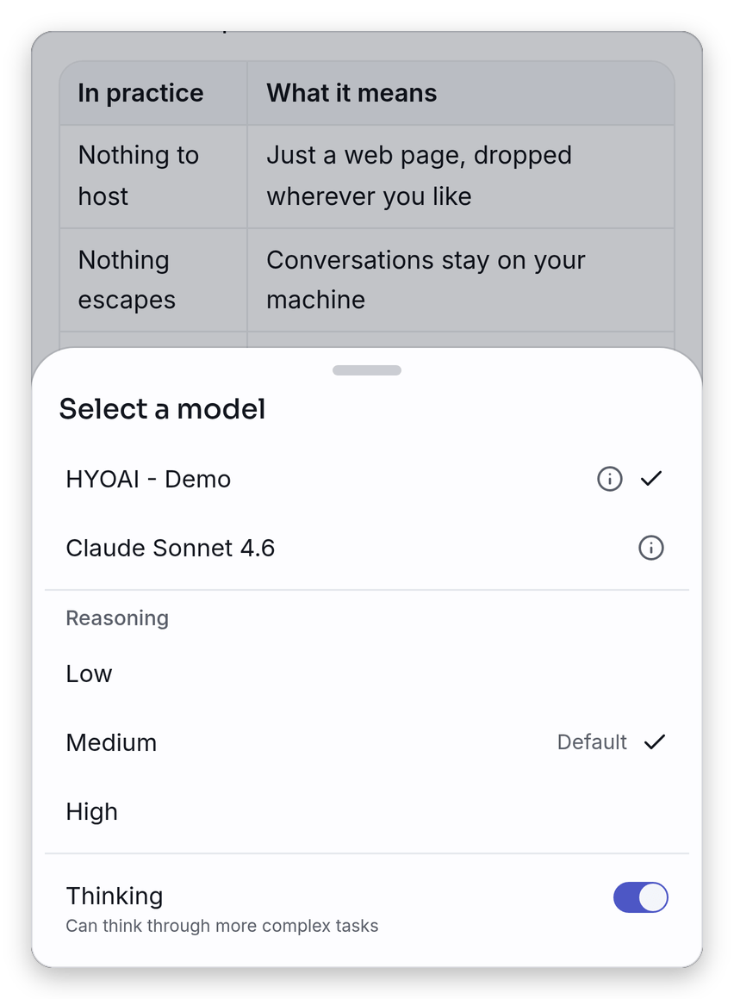
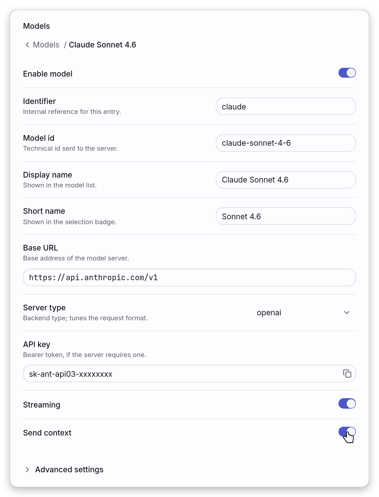

# Models

A model in HYOAI is an entry of `config.json`: an endpoint, a server type and a few options. This
page is the long form of the [Bring your own LLM](../README.md#bring-your-own-llm),
[Model configuration](../README.md#model-configuration-configjson) and
[Reasoning](../README.md#reasoning-thinking-and-effort) sections of the README. It covers running a
local model or reaching a remote API, every key of an entry, the reasoning controls, picking a model
from the composer, and adding or editing a model from the app itself.

**HYOAI ships no model.** You bring your own LLM: a **local** server you run yourself, a **remote**
API, or both, and you switch between them from the model menu. Tool calling and MCP servers are
configured per model too: see [tools.md](tools.md) and [mcp.md](mcp.md). Running the same prompt on
several models at once is covered in [compare.md](compare.md).

This page walks through, in order:

- [Local models](#local-models): Ollama, llama.cpp and vLLM.
- [Remote models](#remote-models): OpenRouter, OpenAI through a proxy and Anthropic.
- [Choosing the server type](#choosing-the-server-type).
- [The `config.json` reference](#the-configjson-reference): every key, base URLs, model lists and
  probing, entries that cannot be used.
- [Reasoning: `thinking` and `effort`](#reasoning-thinking-and-effort).
- [Picking a model and a reasoning level](#picking-a-model-and-a-reasoning-level): the desktop
  dropdown and the compact drawer.
- [Adding or editing a model in the app](#adding-or-editing-a-model-in-the-app): the **Models** and
  **Configuration** pages, the JSON preview, local overrides and the Reset dialog.

## Local models

Run a model on your own hardware. The browser talks directly to the server, so the server must allow
the origin the app is served from (CORS). The examples below use the dev server,
`http://127.0.0.1:4117`; the [CORS](../README.md#cors) section of the README lists the per-backend
origin flags and a CORS-free alternative with a reverse proxy.

The entries below go in `public/config.json`. To get started, copy `public/config.example.json` to
`public/config.json` (see [Quick start](../README.md#quick-start-the-app)): the Ollama, llama.cpp
and vLLM entries are already in it. The vLLM entry of the example ships with `"disabled": true`, so
remove that line (or set it to `false`) to use it.

### Ollama

The fastest path is **Ollama**, in two commands:

```bash
docker run -d --name ollama -v ollama:/root/.ollama -p 11434:11434 \
    -e OLLAMA_ORIGINS='http://127.0.0.1:4117' ollama/ollama
docker exec -it ollama ollama run llama3.2:1b   # small, CPU-friendly (alt: qwen2.5:0.5b)
```

Then add this to `public/config.json` (already present in `config.example.json`):

```json
{
    "id": "ollama",
    "name": "Ollama (local)",
    "baseUrl": "http://127.0.0.1:11434/v1",
    "type": "openai",
    "model": "llama3.2:1b",
    "streaming": true
}
```

`OLLAMA_ORIGINS` must allow the page origin (here the dev server, `http://127.0.0.1:4117`) so the
browser may call Ollama: use `*` for quick tests only.

Ollama is reached with `"type": "openai"`. That type does not send `tool_choice`, which Ollama may
reject; see [Choosing the server type](#choosing-the-server-type) and [tools.md](tools.md) for tool
calling on Ollama.

### llama.cpp

**llama.cpp** works the same way: run `llama-server` with a CORS origin, then point an entry at it
(no `model`, so every model the server lists becomes selectable):

```bash
llama-server -hf ggml-org/gpt-oss-20b-GGUF \
    --host 0.0.0.0 --port 8080 --http-cors-origin http://127.0.0.1:4117
```

```json
{
    "id": "llamacpp",
    "name": "Local llama.cpp",
    "baseUrl": "http://127.0.0.1:8080",
    "type": "llama.cpp",
    "streaming": true
}
```

By default only the `llama.cpp` type reads the server's `GET /props` (any entry can turn it on with
`runtimeProps`): context size, image and audio support, the chat template and the details shown in
the model information dialog. See [Model lists and probing](#model-lists-and-probing).

To let this model call tools, start `llama-server` with `--jinja` too: see
[Turning tools on for a model](tools.md#turning-tools-on-for-a-model).

### vLLM

**vLLM** likewise: serve a model with the front-end origin allowed:

```bash
vllm serve Qwen/Qwen2.5-7B-Instruct \
    --host 0.0.0.0 --port 8000 --allowed-origins '["http://127.0.0.1:4117"]'
```

```json
{
    "id": "vllm",
    "name": "vLLM server",
    "baseUrl": "http://127.0.0.1:8000/v1",
    "type": "vllm",
    "model": "Qwen/Qwen2.5-7B-Instruct"
}
```

To let this model call tools, vLLM also needs
`--enable-auto-tool-choice --tool-call-parser <parser>` and `"tools": true` on the entry: see
[Turning tools on for a model](tools.md#turning-tools-on-for-a-model).

All three are pre-wired in `config.example.json`; the [CORS](../README.md#cors) section of the
README lists the per-backend origin flags.

## Remote models

Point HYOAI at a hosted API instead. Browsers can only call APIs that send CORS headers.

### OpenRouter

**[OpenRouter](https://openrouter.ai)** sends CORS headers, so it works directly from a static
deployment:

```json
{
    "id": "openrouter",
    "name": "OpenRouter",
    "baseUrl": "https://openrouter.ai/api/v1",
    "type": "openai",
    "model": "openai/gpt-4o-mini",
    "apiKey": "sk-or-xxxxxxxx",
    "streaming": true
}
```

The `apiKey` is sent as `Authorization: Bearer <key>` on every call to the endpoint. The example
file marks this entry with `"modalities": { "image": true }` so image attachments are offered: for
an entry that does not read `/props`, attachment capabilities stay off until the entry declares them
(see the `modalities` row of the [key table](#keys-of-a-models-entry)).

### OpenAI

The **OpenAI** API does not allow direct browser calls (no CORS); reach it through a same-origin
reverse proxy (a relative `baseUrl`, see [CORS](../README.md#cors)) or a small local proxy. Note
that any `apiKey` in `config.json` ships to the browser, so only use keys you are comfortable
exposing on that origin, or front the endpoint with a proxy that injects the key.

With a reverse proxy that serves the app and exposes the endpoint under the same origin, no CORS
configuration is needed and the entry uses a relative `baseUrl`, as the last entry of
`config.example.json` does:

```json
{
    "id": "proxy",
    "name": "Same-origin reverse proxy (no CORS)",
    "baseUrl": "/llm",
    "type": "llama.cpp",
    "sendContext": true
}
```

A `./llm` value resolves against the page directory, which is useful when the app is served under a
sub-path. The proxy can hold the credentials so that no key reaches the browser. Use the `type` that
matches the server behind the proxy (`openai` for the OpenAI API).

### Anthropic

**Anthropic** can be reached directly from the browser by declaring its opt-in through the per-model
`headers` field:

```json
{
    "id": "claude",
    "name": "Claude (Anthropic)",
    "baseUrl": "https://api.anthropic.com/v1",
    "type": "openai",
    "model": "claude-sonnet-4-6",
    "apiKey": "sk-ant-xxxxxxxx",
    "headers": { "anthropic-dangerous-direct-browser-access": "true" }
}
```

The same header can be typed in the app, in the **Headers (JSON)** field of the entry's advanced
settings (see [Adding or editing a model in the app](#adding-or-editing-a-model-in-the-app)).

## Choosing the server type

`type` selects the transport and drives a few defaults. Three types ship with the app, all speaking
the OpenAI-compatible protocol (`POST /v1/chat/completions`); a plugin can add more (see
[Plugins](../README.md#plugins) and [plugins/README.md](../plugins/README.md)). When `type` is
absent (or not a non-empty string) it defaults to `vllm`; a type that no installed plugin serves is
kept, but the entry is disabled (see [An entry that cannot be used](#an-entry-that-cannot-be-used)).

| What                                                                                                                           | `llama.cpp`                                 | `vllm`                                 | `openai` |
| ------------------------------------------------------------------------------------------------------------------------------ | ------------------------------------------- | -------------------------------------- | -------- |
| Lists models through `GET /v1/models`, so `model` may be left out                                                              | yes                                         | yes                                    | yes      |
| By default, reads `GET /props` (`runtimeProps`): context size, modalities, chat template, model info                           | yes                                         | no                                     | no       |
| Probes the context window through `/get_model_info`, `/get_server_info` and `/props`, for an entry that does not read `/props` | only if `runtimeProps` is turned off        | yes                                    | yes      |
| Sizes chunks through `POST /tokenize` (only when **Enable chunking** is on and the input exceeds the context window)           | yes                                         | yes                                    | no       |
| Can offer tools                                                                                                                | yes                                         | yes                                    | yes      |
| Sends `tool_choice` (`supportsToolChoice`)                                                                                     | yes                                         | yes                                    | no       |
| Sampling fields added to the common ones                                                                                       | `top_k`, `min_p`, `repeat_penalty`, `dry_*` | `top_k`, `min_p`, `repetition_penalty` | none     |

The `/props` and `tool_choice` rows give the default of each type: an entry can override them with
`runtimeProps` and `supportsToolChoice`, so an `openai` or `vllm` entry with `runtimeProps: true`
reads `/props` and skips the context probe, and a `llama.cpp` entry with `runtimeProps: false` uses
the probe instead.

Every type sends `temperature`, `top_p`, `max_tokens`, `presence_penalty` and `frequency_penalty`.
An empty sampling field in the app is not sent at all, so the endpoint applies its own defaults.
None of the built-in types shows the reasoning toggle by default: declare it with a `thinking`
config (see [Reasoning](#reasoning-thinking-and-effort)).

## The `config.json` reference

`config.json` is the source of truth for the model list: on startup the application loads a
`config.json` file served next to it (in dev: `public/config.json`; in prod: dropped at the site
root, editable without a rebuild). Each entry describes a model and the endpoint serving it. The
in-app **Models** and **Configuration** pages (Settings) edit the same fields as local overrides, stored in `localStorage`
on top of the deployed file and revertable from the Reset dialog.

`public/config.json` is gitignored (it holds deployment-specific endpoints): copy
`public/config.example.json` to `public/config.json` to get started. The example covers the Ollama
and OpenRouter recipes above plus the different `type`s, a minimal entry (booleans have defaults), a
disabled entry, an API key, and a relative URL behind a reverse proxy.

A missing `config.json` is a supported state: the model list is then empty, and models can still be
added from the **Models** page, which starts from an empty configuration.

### Root keys

| Key            | Type     | Description                                                                                                                                                                                                                                                                                                                                                                                                                                                                                                                                                                                                                                                                        |
| -------------- | -------- | ---------------------------------------------------------------------------------------------------------------------------------------------------------------------------------------------------------------------------------------------------------------------------------------------------------------------------------------------------------------------------------------------------------------------------------------------------------------------------------------------------------------------------------------------------------------------------------------------------------------------------------------------------------------------------------- |
| `models`       | object[] | The model entries, described below; the order of the list is the order of the model menu                                                                                                                                                                                                                                                                                                                                                                                                                                                                                                                                                                                           |
| `appName`      | string   | Optional. The deployment name shown on the empty chat screen (`Chat with <appName> models`); when omitted it falls back to a generic localized word (`AI` / `IA`)                                                                                                                                                                                                                                                                                                                                                                                                                                                                                                                  |
| `defaultModel` | string   | Optional. The `id` of the entry selected when the browser has no remembered choice. Used only if that entry exists and is not disabled; otherwise the first enabled entry of the list is selected                                                                                                                                                                                                                                                                                                                                                                                                                                                                                  |
| `thinking`     | object   | Optional. The default reasoning toggle for every model, see [Reasoning](#reasoning-thinking-and-effort)                                                                                                                                                                                                                                                                                                                                                                                                                                                                                                                                                                            |
| `effort`       | object   | Optional. The default effort levels for every model, see [Reasoning](#reasoning-thinking-and-effort)                                                                                                                                                                                                                                                                                                                                                                                                                                                                                                                                                                               |
| `mcp`          | object   | The catalog of MCP servers, see [mcp.md](mcp.md)                                                                                                                                                                                                                                                                                                                                                                                                                                                                                                                                                                                                                                   |
| `notice`       | object   | Optional. A strip above the app, such as "this is a demo" or an announcement: `text` (and an optional shorter `short` for narrow screens) maps a language code to its message; `level` is `"info"` (default, a quiet strip) or `"warning"` (amber); `until` is the last day it is shown, as `YYYY-MM-DD` (to the end of that day) or a full date-time, and the strip then disappears by itself; `dismissible` (default `true`) lets the reader close it, and it stays closed on that browser until its `text` or `short` changes. The text of the interface language is shown, else `en`, else the first one written. Not shown in an [embed](embed.md#what-the-widget-leaves-out) |
| `placeholders` | object   | Optional. Placeholders the empty message box shows one after the other, rolling from one to the next like a drum every few seconds: a map from a language code to a list of texts, such as `{ "en": ["Translate a text..."] }`. The list of the interface language is used, else `en`, else the first one written. Without the key, or for a reader who asks the system for reduced motion, the box keeps its usual static placeholder                                                                                                                                                                                                                                             |
| `integrations` | object[] | Optional UI actions wired to HTTP endpoints, see [Integrations](../README.md#integrations)                                                                                                                                                                                                                                                                                                                                                                                                                                                                                                                                                                                         |
| `embedOrigins` | string[] | Origins allowed to drive the embeddable widget, see [embed.md](embed.md)                                                                                                                                                                                                                                                                                                                                                                                                                                                                                                                                                                                                           |

### Keys of a `models` entry

| Key                  | Type                                               | Description                                                                                                                                                                                                                                                              |
| -------------------- | -------------------------------------------------- | ------------------------------------------------------------------------------------------------------------------------------------------------------------------------------------------------------------------------------------------------------------------------ |
| `id`                 | string (required)                                  | Stable identifier, referenced by `defaultModel` and local preferences                                                                                                                                                                                                    |
| `name`               | string                                             | Name shown in the selector (default: `id`)                                                                                                                                                                                                                               |
| `shortName`          | string                                             | Short name shown in the composer's model button. When absent, the button shows the base name of the upstream model id (`Qwen3.6` for `Qwen3.6-35B-A3B-UD-Q4_K_M.gguf`), or `name` when no model is resolved yet                                                          |
| `baseUrl`            | string (required)                                  | Endpoint base URL, with or without `/v1`; absolute, or relative to the site (`/llm`, `./llm`)                                                                                                                                                                            |
| `model`              | string                                             | Pins the upstream model sent to the API; when absent, every model listed by the endpoint's `GET /v1/models` becomes selectable (llama.cpp, llama-swap)                                                                                                                   |
| `type`               | `vllm` \| `llama.cpp` \| `openai` \| a plugin type | Selects the transport: OpenAI-compatible (`vllm`/`llama.cpp`/`openai`) or a type added by an installed [plugin](../README.md#plugins); also drives the sampling-parameter mapping (default: `vllm`). An entry whose type no installed plugin serves is kept but disabled |
| `apiKey`             | string                                             | Optional; sent as `Authorization: Bearer` when present                                                                                                                                                                                                                   |
| `headers`            | object of strings                                  | Custom request headers added to every call to the endpoint, merged after the `apiKey` bearer (see below)                                                                                                                                                                 |
| `streaming`          | boolean                                            | `true`: token-by-token SSE; `false`: single JSON response (default: `true`)                                                                                                                                                                                              |
| `sendContext`        | boolean                                            | `true`: full branch history; `false`: last message only (default: `true`)                                                                                                                                                                                                |
| `disabled`           | boolean                                            | `true`: keep the entry in the file but do not offer it in the model selector, where it shows greyed out and cannot be picked (default: `false`)                                                                                                                          |
| `modalities`         | `{ image?, audio? }`                               | Attachment capabilities: `true` enables that attachment menu entry, `false` always disables it, even if a probed endpoint advertises it. Off by default unless the endpoint is probed (`runtimeProps`, e.g. llama.cpp `/props`) and advertises it; overridable           |
| `thinking`           | `{ on?, off?, disabled? }`                         | The reasoning toggle of this entry, which replaces the top-level `thinking` as a whole. See [Reasoning](#reasoning-thinking-and-effort)                                                                                                                                  |
| `effort`             | `{ default?, levels }`                             | The effort levels of this entry, which replace the top-level `effort` as a whole. See [Reasoning](#reasoning-thinking-and-effort)                                                                                                                                        |
| `supportsThinking`   | boolean                                            | Whether the reasoning toggle is offered. Defaults from `type` and from the presence of a `thinking` config, overridable                                                                                                                                                  |
| `tools`              | boolean                                            | Tool calling for this entry; off unless the config says `true`, or the entry reads `/props` (`runtimeProps`) and the server reports a chat template that handles tools. `false` forces it off. See [Tool calling](tools.md)                                              |
| `parallelToolCalls`  | boolean                                            | Lets the model call several tools in one step (sent as `parallel_tool_calls`; default: not sent)                                                                                                                                                                         |
| `recoverToolCalls`   | boolean                                            | Off unless `true`. Runs a tool call the model wrote as text instead of the structured channel, after your approval. See [Tool calling](tools.md)                                                                                                                         |
| `mcpServers`         | string[]                                           | Which servers of the [MCP catalog](mcp.md) this entry may use: absent means every enabled server, a list means only those, `[]` means none. Only matters when tools are on for the entry                                                                                 |
| `supportsToolChoice` | boolean                                            | Whether the server accepts the `tool_choice` field. Defaults from `type` (for the built-in types: `false` for `openai`, which covers Ollama, and `true` for `llama.cpp` and `vllm`; a plugin type declares its own), overridable                                         |
| `runtimeProps`       | boolean                                            | Whether the endpoint exposes a llama.cpp-style `GET /props` (context size, modalities, model info). Defaults from `type` (for the built-in types: `true` for `llama.cpp` only; a plugin type declares its own), overridable                                              |

A list that is not an array of strings counts as `[]` for `mcpServers`, never as "all".

#### Base URL

Config files carry both `http://host:port` and `http://host:port/v1/`: HYOAI removes trailing
slashes and a trailing `/v1`, then appends the API paths itself (`/v1/chat/completions`,
`/v1/models`, `/props`). A relative `baseUrl` is resolved by the browser against the page, which is
what makes the reverse-proxy setup of the [CORS](../README.md#cors) section work.

#### Request headers

An optional `headers` object adds custom request headers to every call to the endpoint (merged after
the `apiKey` bearer): use it for provider opt-ins such as Anthropic's
`anthropic-dangerous-direct-browser-access`. The same headers are sent when the app lists models and
probes the server, not only on chat requests.

#### What is remembered

For the single chat, the choice of entry and picked model is remembered in localStorage (compare
panes keep theirs in the compare layout, see [compare.md](compare.md)); the file remains the source
of truth for the list. The Thinking switch and the effort level are app settings, stored with the
other settings. At startup the selected entry is the remembered one when it still exists and is
enabled, then `defaultModel`, then the first enabled entry.

### Model lists and probing

Discovered lists refresh at startup and whenever the model selector opens. Entries with
`runtimeProps` are also probed through `GET /props` for their context size, modalities (image and
audio attachments are gated on them) and the model information dialog: the active entry at startup,
the others when they are picked, when their information dialog opens or when a compare pane
attaches. Other entries, such as vLLM or SGLang servers, are probed at the same moments for their
context size through `GET /get_model_info`, `GET /get_server_info` and `GET /props`, each request
being cut off after five seconds.

Details that follow from the code:

- Only entries without a pinned `model` have a list to discover. A pinned entry is used as is, and
  its single row in the menu carries its `name`.
- The model list and `GET /props` requests are cut off after ten seconds, so a host that never
  answers shows as unreachable instead of loading forever.
- An endpoint that answers `GET /v1/models` with no model at all is flagged like an unreachable one,
  with the error `no model exposed by the endpoint`. With **Automatically disable unavailable
  models** on (the default), its row is greyed out as **Unavailable** with the reason
  `The server does not answer. The model is available again as soon as it is reachable.`; the error
  string itself shows in the tooltip of the red triangle when that setting is off (see
  [Picking a model and a reasoning level](#picking-a-model-and-a-reasoning-level)).
- Picking a model reads its properties again (`GET /props`, or the context probe for an entry that
  does not read `/props`), because a proxy may load another model behind the same address. The model
  list itself is refreshed each time the menu opens; a pick fetches it only when it is not loaded
  yet.
- The probes send the same `apiKey` bearer and `headers` as the chat requests.

### An entry that cannot be used

An entry that cannot work is kept in the list but never offered: its row in the model menu is greyed
out and cannot be picked, and says why (as a tooltip in the desktop dropdown, inline in the compact
drawer, see [Picking a model and a reasoning level](#picking-a-model-and-a-reasoning-level)).

| Case                                                  | What the model menu says                                                    | Fix                                                                                      |
| ----------------------------------------------------- | --------------------------------------------------------------------------- | ---------------------------------------------------------------------------------------- |
| `"disabled": true`                                    | `Model disabled`                                                            | Set it back to `false`, or use the power button of the entry in the app                  |
| A `type` that no installed plugin serves              | `No installed plugin handles the type "{type}".`                            | Install the plugin (see [plugins/README.md](../plugins/README.md)), or change the `type` |
| A type that does not list its models, with no `model` | `This server type does not list its models: set the entry's "model" field.` | Set `model`. Applies to plugin types: the three built-in types list models               |

A disabled entry is never selected on its own: the startup choice skips it, and a compare pane
pinned to a model that has become disabled shows it as unavailable rather than answering with
another one. An endpoint that is merely unreachable is a different state, described in
[Model availability](compare.md#model-availability): with **Automatically disable unavailable
models** on (the default), the model is greyed as **Unavailable** with a retry button until the
server answers again; with it off, the model stays selectable and, on a single-row entry, carries a
red triangle instead.

## Reasoning: `thinking` and `effort`

A model that exposes a reasoning knob (Qwen3, gpt-oss, ...) can declare how to drive it from the
model menu. Both keys live either at the top level (applied to every model) or on a `models` entry
(which overrides the top-level default), and both merge a backend-specific fragment into the request
body, so the same UI adapts to any server. The effort levels appear only where `effort` is declared
with at least one level; the Thinking switch appears where `supportsThinking` resolves to true (by
default when a `thinking` config with an `on` or `off` side is present, see below). Each compare
pane keeps its own choice (otherwise the global setting applies; see [compare.md](compare.md)).

An entry's own `thinking` or `effort` replaces the top-level one as a whole: the `on` and `off`
fragments, or the `levels`, are not merged key by key with the global ones.

### `thinking`: an on/off toggle

`thinking` is an on/off toggle. Its `on`/`off` fragments are sent when the **Thinking** switch of
the model menu is on or off; a missing side sends nothing, leaving the model's own default:

```json
{
    "thinking": {
        "on": { "chat_template_kwargs": { "enable_thinking": true } },
        "off": { "chat_template_kwargs": { "enable_thinking": false } }
    }
}
```

The switch is offered when the entry's `supportsThinking` resolves to true. Unless the entry sets it
explicitly, it is true when the entry (or the top level) has a `thinking` config with an `on` or an
`off` side, or when its server type reasons by default (a plugin type can declare that; the built-in
ones do not). An entry with effort levels shows only the levels when neither it nor the top level
carries a `thinking` config, and an entry with a toggle but no levels shows only the switch. In
`config.example.json`, the root `thinking` block applies to every entry, so the `llamacpp` entry,
which adds effort levels, shows both the levels and the **Thinking** switch. On a fresh install the
switch is on.

A model that does not reason can opt out of the global `thinking` with `"thinking": { "disabled": true }`
on its own entry. It then has no **Thinking** switch and neither fragment is sent, not even the
global one. `disabled` wins over `supportsThinking` and over any `on` or `off` written next to it, it
only applies to the entry that carries it, and the effort levels are not affected.

The fragment is chosen from the stored Thinking state (the global setting, or the pane's own choice
in compare mode) whether or not the switch is shown for that entry: an entry that has a `thinking`
config but whose switch is hidden (`supportsThinking: false`) still receives its `on` fragment while
the state is on, which is the default, or its `off` fragment, when it has one, once thinking has
been switched off on another model. Use `disabled` to stop that.

### `effort`: a level picker

`effort` is a level picker. `levels` is an ordered list shown as a submenu; the active level's
`body` is merged into the request and `default` is the id used until the user picks another:

```json
{
    "effort": {
        "default": "medium",
        "levels": [
            { "id": "low", "label": "Low", "body": { "reasoning_effort": "low" } },
            { "id": "high", "label": "High", "body": { "reasoning_effort": "high" } }
        ]
    }
}
```

Each level has an `id`, a `label` shown in the menu and an optional `body`. The active level is the
picked one when it matches a level of the model, otherwise the `default`, otherwise the first level;
on a fresh install nothing is picked yet, so the `default` applies. A level without a `body` sends
its `id` as `reasoning_effort`, unless the request already carries a `reasoning_effort`, for example
from the `thinking` fragment.

### Typical knobs

Typical knobs: `chat_template_kwargs` with `enable_thinking` (Qwen3), `reasoning_effort` (gpt-oss),
or `reasoning_budget` (`0` disables thinking on some llama.cpp Qwen3 builds).

### How the request is built

The `thinking` fragment (`on` or `off`, following the Thinking state) is merged into the request
body first, then the body of the active effort level. Merging is recursive: two fragments that both
touch `chat_template_kwargs` combine into one object, and any other value is replaced by the later
one.

The reasoning text the server streams back is read from `reasoning_content` (or `reasoning`) and
shown in a collapsible block above the answer; see [What an answer shows](#what-an-answer-shows).

### Keeping the reasoning of earlier turns

The reasoning of earlier turns is never sent back by default. To send it back as `reasoning_content`
to a model whose chat template supports it, opt in with `chat_template_kwargs.preserve_thinking` set
to the boolean `true`, in the `on` fragment or in the `body` of an effort level. The saved reasoning
then counts toward the context estimate, and it goes along with the tool calls of the assistant
messages that made them:

```json
{
    "thinking": {
        "on": {
            "chat_template_kwargs": { "enable_thinking": true, "preserve_thinking": true }
        }
    }
}
```

Only an explicit boolean `true` counts as the opt-in, and it is read from the merged request body,
so it applies when the Thinking state is on (for an `on` fragment) or when the matching effort level
is active.

The opt-in also applies when **Send context** is off. Only the current turn is sent then, which in a
tool flow means the question and every step that followed it, and the reasoning of those steps goes
along with them. See [tools.md](tools.md#reasoning-during-a-flow) for how it behaves between steps.

### What an answer shows

While the model is reasoning and has not written any answer text yet, the block above the answer
reads **Thinking** and is open. As soon as the answer text starts to stream, it reads **Reasoning**
and collapses, unless the **Expand reasoning** option of Settings → Appearance is on ("Keep the
thinking block open once the answer is done."). Under the answer, the model chip carries a brain
icon when the model offers the Thinking switch and it was on for that answer, the model's short name
(the entry's **Short name**, else the base name of the upstream model id) and the label of the
effort level used, when the model declares levels. Next to the chip come the token, time and speed
figures, unless **Message statistics** is turned off in Settings → Appearance.

<picture>
    <source media="(prefers-color-scheme: dark)" srcset="images/dark/thinking.png">
    
</picture>

The screenshot shows the Reasoning block expanded with the model's reasoning text, then the answer,
a **1 source** row, and the chip **HYOAI Medium** (the short name of the model and the label of the
effort level) followed by the token, time and speed figures.

## Picking a model and a reasoning level

The model button sits at the right of the composer, next to the send button. It shows the short name
of the active model (the entry's **Short name**, else the base name of the upstream model id),
followed by the label of the active effort level when the model declares levels. When no entry is
usable (none configured, or all disabled), it reads **Select a model**; an entry whose model is not
resolved yet shows its `name`. In an embed with `lock=1` the button is hidden (see
[embed.md](embed.md)).

### The desktop dropdown

In the desktop layout (a window at least 768 px wide whose primary pointer is not coarse), clicking
the button opens the model menu next to it, as a dropdown; the other case is described under
[The compact drawer](#the-compact-drawer). In the screenshot the button reads **HYOAI Medium**: the
short name of the active model and the label of its active effort level.

<picture>
    <source media="(prefers-color-scheme: dark)" srcset="images/dark/selection.png">
    
</picture>

- **Models.** One row per entry; a check mark marks the active one. An entry without a pinned
  `model` that lists several models shows one row per model, grouped under the entry's name and
  labelled with the model ids. The lists refresh each time the menu opens. Picking a row makes it
  the active model, and the choice is remembered.
- **Information.** In the composer's menu, the info icon of a row (visible on the active row, and on
  the highlighted one) opens **Model Information**: the entry's name, identifier, model id (when
  known), endpoint and server type, an **API key** row (**Configured**) when a key is set, the
  streaming and send-context flags, the modalities when the entry has any, and the thinking support,
  runtime props and tool calling flags, then the runtime values the server reported (context size,
  model size, parameters, chat template, ...), as far as the server provides them.
- **Unreachable endpoint.** By default an unreachable model is greyed out as **Unavailable** with a
  retry button (see **Greyed rows** below). A single-row entry shows a red triangle instead when
  **Automatically disable unavailable models** is off (Settings → **Models**, **Model availability**),
  or, for an entry without a pinned `model`, when a refresh of its model list failed while the
  models fetched before are still kept. On hover the triangle shows
  `Model unreachable: check that its endpoint is running and that CORS allows this origin.` with the
  error or the reason below it: the raw error of the failed model-list request or, for a server
  found down by the availability check, the sentence
  `The server does not answer. The model is available again as soon as it is reachable.` (or
  `The server did not start answering in time.` after a timeout).
- **Greyed rows.** Disabled entries, entries with an unsupported type and unavailable models
  (unreachable ones only while automatic disabling is on) appear greyed out and cannot be picked
  (see [An entry that cannot be used](#an-entry-that-cannot-be-used)).
- **Reasoning.** When the active model declares effort levels or offers the Thinking switch, a
  **Reasoning** row follows a separator, with the active level on its right when there are levels.
  It opens a submenu to the side: the levels as a radio group when the model declares effort levels
  (the entry's `default` level is tagged **Default**), then, when it also offers the Thinking
  switch, a separator and the **Thinking** switch ("Can think through more complex tasks"). A model
  that has only one of the two shows only that one, so there is no separator between them. The info
  icon next to the last level explains that "Higher effort means more thorough but slower answers".
  Toggling Thinking leaves the menu open. A model that has neither control has no Reasoning row.

The Thinking switch and the effort level are global settings in the single chat: they follow you
when you change model, and a level the new model does not have falls back to that model's default,
then to its first level. In compare mode each pane has its own model button and its own reasoning
choice, and a pane that has not chosen follows the global setting.

### The compact drawer

In the compact layout, that is when the window is narrower than 768 px (the `md` breakpoint) or the
device's primary pointer is coarse (a touch-first device, even a wide one), the same menu opens as a
bottom drawer instead of a dropdown, so that long lists stay within reach of a thumb. A narrow
desktop window therefore gets the drawer too, while a touch-screen laptop whose primary pointer is a
mouse keeps the dropdown.

<picture>
    <source media="(prefers-color-scheme: dark)" srcset="images/dark/responsive.png">
    
</picture>

- The drawer has a drag handle, is headed **Select a model**, and is dismissed by swiping it down.
  Rows are full-width touch targets, and the bottom padding follows the device's safe area.
- Tapping a model selects it and closes the drawer.
- In the composer's menu the info icon is always visible on every selectable row, as there is no
  hover.
- A disabled entry shows its reason inline instead of in a tooltip, and an unavailable model shows
  its reason on a line under its name, with the retry button on the name line. A row that carries
  the red triangle (under the conditions listed for the desktop dropdown) expands its error under
  the row when the triangle is tapped.
- The reasoning controls are flattened into the drawer rather than placed in a submenu, which would
  overflow the screen: a **Reasoning** label, the levels when the model declares effort levels (the
  active one checked, the default one tagged **Default**), then, when it also offers the Thinking
  switch, a separator and the **Thinking** row, whose whole line toggles the switch. A model that
  has only one of the two shows only that one, so there is no separator between them. Choosing a
  level or toggling the switch does not close the drawer.

## Adding or editing a model in the app

You do not need to touch the server's files to add a model: **Settings → Models** and **Settings →
Configuration** edit the same fields as `config.json`. Open Settings from the header (or from the
command palette) and pick the **Models** page, or the **Configuration** page for everything that is
not a model. Neither page is [available in an embed](embed.md#what-the-widget-leaves-out).

What you change there is saved in this browser as a local override on top of the deployed file, and
applied immediately: about 600 ms after your last edit the model list is rebuilt, with no page
reload. The deployed `config.json` is left untouched.

### The form

The configuration is split over two pages. **Models** opens on the model availability settings
(see [Model availability](compare.md#model-availability)), then lists the models, one row per entry
with its name, its type and host, an on/off switch and a chevron that opens the detail of the model,
and ends with an **Add a model** button.

**Configuration** opens on a short description, then holds the other fields, in this order:

1. **Application name** (`appName`) and **Default model** (`defaultModel`, a choice among the
   entries that have an identifier, or **None**). Emptying **Application name** or choosing **None**
   does not clear a value set in the deployed file (see [Local overrides](#local-overrides)).
2. **Global thinking** (**On (JSON)** and **Off (JSON)**) and **Global effort** (**Default level**,
   **Add a level**, and one card per level with **Identifier**, **Label** and **Request body
   (JSON)**): the top-level `thinking` and `effort` of [Reasoning](#reasoning-thinking-and-effort).
3. **Integrations**, with **Add an integration** (see [Integrations](../README.md#integrations)).
4. The **Generated JSON** preview, with a **Copy** button, and the **Reset…** button.

MCP servers are not edited here but in Settings → MCP servers (see [mcp.md](mcp.md)); the model
detail only sets which servers a model uses. The root keys that no page edits, such as `notice`,
`placeholders` and `embedOrigins` ([embed.md](embed.md)), are kept as they are in the generated JSON,
after the keys of the form.

### Adding a model

Click **Add a model**, at the end of the **Models** page: a blank entry is added at the top of the
list and opens its detail, headed **New model** until it has an identifier. It starts as a `llama.cpp` entry with **Streaming** and **Send context** on and
everything else empty, off or on **Auto** (note that a `type` missing from a hand-written
`config.json` defaults to `vllm`, not to `llama.cpp`).

<picture>
    <source media="(prefers-color-scheme: dark)" srcset="images/dark/config.png">
    
</picture>

The detail of a model shows the entry as a form. The screenshot shows a `claude` entry modelled on the Anthropic recipe above, with a different
display name and a short name added; the **Advanced settings** row, below the switches, is shown
folded. Each field maps to a key of the [entry table](#keys-of-a-models-entry). The text fields and
the server type list carry a short hint under their label; the two switches have none:

| Form field       | Key           | Hint and notes                                                                                                                 |
| ---------------- | ------------- | ------------------------------------------------------------------------------------------------------------------------------ |
| **Identifier**   | `id`          | "Internal reference for this entry." Required                                                                                  |
| **Model id**     | `model`       | "Technical id sent to the server." Left empty, the placeholder reads "Empty: discover via /v1/models"                          |
| **Display name** | `name`        | "Shown in the model list."                                                                                                     |
| **Short name**   | `shortName`   | "Shown in the selection badge."                                                                                                |
| **Base URL**     | `baseUrl`     | "Base address of the model server." Required                                                                                   |
| **Server type**  | `type`        | "Backend type; tunes the request format." A list of the installed types: the built-in ones plus those of the installed plugins |
| **API key**      | `apiKey`      | "Bearer token, if the server requires one." The field shows the key as typed, and has a copy button (**Copy the API key**)     |
| **Streaming**    | `streaming`   | Switch                                                                                                                         |
| **Send context** | `sendContext` | Switch                                                                                                                         |

An entry is applied only once the configuration is valid, which requires an identifier and a base
URL for every card: until then the new entry is just a draft in the form. If the entry's type is not
served by any installed plugin, the **Server type** list keeps it and labels it
`{type} (not installed)`, with `{type}` replaced by the type; the entry is then kept but disabled.

Once saved, the new model is in the model menu straight away, and `defaultModel` can point to it.

### Advanced settings

In the detail of a model, under the switches, the collapsible **Advanced settings** section unfolds the less common keys.

| Form field                             | Key                  | Notes                                                                                                                                                       |
| -------------------------------------- | -------------------- | ----------------------------------------------------------------------------------------------------------------------------------------------------------- |
| **Headers (JSON)**                     | `headers`            | A JSON object of strings, for example the Anthropic opt-in of the recipe above                                                                              |
| **Thinking (JSON)**                    | `thinking`           | The `on` and `off` fragments of this entry, or `disabled`                                                                                                   |
| **Effort (JSON)**                      | `effort`             | The `default` and `levels` of this entry                                                                                                                    |
| **Modalities (JSON)**                  | `modalities`         | For example `{ "image": true }`                                                                                                                             |
| **Supports thinking**                  | `supportsThinking`   | **Auto**, **Yes** or **No**                                                                                                                                 |
| **Runtime props**                      | `runtimeProps`       | **Auto**, **Yes** or **No**                                                                                                                                 |
| **Tool calling**                       | `tools`              | **Auto**, **Yes** or **No**. Hint: "Auto: on only when llama.cpp's chat template supports tools. vLLM needs --enable-auto-tool-choice --tool-call-parser."  |
| **Parallel tool calls**                | `parallelToolCalls`  | **Auto**, **Yes** or **No**                                                                                                                                 |
| **Send tool_choice**                   | `supportsToolChoice` | **Auto**, **Yes** or **No**. Hint: "Off for servers that reject the field (e.g. Ollama)."                                                                   |
| **Recover tool calls written as text** | `recoverToolCalls`   | Switch. Hint: "For servers whose parser lets a call leak into the answer. A complete call at the end of the text runs like any other, after your approval." |
| **MCP servers**                        | `mcpServers`         | "Which servers of the catalog this model may use."                                                                                                          |

For the three-way fields, **Auto** leaves the key out of the entry, so the default described for
that key in the [key table](#keys-of-a-models-entry) applies: it follows the `type` for **Supports
thinking**, **Runtime props** and **Send tool_choice**, the llama.cpp chat template for **Tool
calling**, and **Parallel tool calls** is simply not sent. **Yes** and **No** write `true` and
`false`.

The **MCP servers** field has an **Every enabled server** switch, on by default, which leaves
`mcpServers` out. Turning it off lists the servers of the catalog as checkboxes, all ticked at
first; the ticked ones become the list, and unticking all of them gives `[]`. A server the entry
names but that is no longer in the catalog stays listed as `{id} (not in the catalog)` (with `{id}`
replaced by its identifier) so it can be unticked, and when **Tool calling** is set to **No** the
field notes "Tool calling is off for this model." While **Every enabled server** is on and no server
exists yet, the field says "No server is set up yet. Add one in the MCP servers page." See
[mcp.md](mcp.md).

A text field that is not valid JSON does not break the rest of the form: the preview is replaced by
the message `Invalid JSON in field {field}.`, where `{field}` is the path of the offending field
(for example `models[0].headers`), and the draft is not applied until the text is fixed.

### The model controls

The list shows a **Disabled** badge on a disabled entry. The detail of a model has its controls
around the fields:

- The **Enable model** switch, at the top, toggles `disabled`; the switch of the row in the list
  does the same. A disabled entry stays in the file and in the form, but is greyed out in the model
  menu and cannot be picked; see [An entry that cannot be used](#an-entry-that-cannot-be-used).
- **Move model up** and **Move model down**, at the bottom, reorder the list. The order is the order
  of the model menu, and decides the first enabled entry when nothing else picks one.
- **Remove model** removes the entry from the list.

### The JSON preview

At the bottom of the **Configuration** page, **Generated JSON** shows the configuration the form currently builds, as it would be
written in `config.json` (4-space indentation; optional fields that are empty, switched off or on
**Auto** are left out, while `id`, `baseUrl`, `type`, `streaming` and `sendContext` are always
written). **Copy** puts that JSON on the clipboard ("Configuration copied to clipboard."), ready to
paste into the real `config.json`: this is the way to promote an experiment made in the browser into
the deployment. The JSON holds every root key of the configuration, including the ones no page
edits (see [The form](#the-form)), so it can replace the deployed file as it is. The preview and the copy show a model's
`apiKey` as typed; only the values of MCP headers are masked in the preview, and the copy gives the
real configuration.

### Local overrides

The form does not store a whole copy of `config.json`. It stores a differential override, in the
browser's `localStorage` (key `lc:config`), that holds only what differs from the deployed file:

- entries are matched by `id`: a new `id` is an addition, a known `id` with other values is a
  modification, and an entry of the file that you removed is recorded as a removal;
- a reorder is recorded as the new order of the model identifiers;
- the application name, the default model, the global `thinking` and the global `effort` (its
  default level and its levels) are stored only when they differ;
- effort levels, integrations and MCP servers follow the same rule, matched by their `id`, with the
  same added, modified and removed states.

A value can replace the deployed one but cannot clear it: emptying **Application name**, choosing
**None** for **Default model**, emptying both **On (JSON)** and **Off (JSON)** of the global
thinking, or emptying **Default level** leaves the deployed value in force, and only editing the
deployed `config.json` removes the key.

What you leave equal to the file stays dynamic: when the deployed file changes, those parts follow
it. At startup, anything in the override that the file now says too is dropped, so the badge and the
reset list always agree with the file. If the file cannot be read, the local overrides still apply
over an empty configuration.

While the **Configuration** page is open and an override exists, a badge appears at the right of the
Settings header. It reads **Override active**, and **Override inactive** when the configuration is
invalid and was not applied. Its colour follows the health of the configuration: green for
`Configuration valid and applied.`, amber for
`Configuration applied, but a model is unreachable: {models}` (when an entry without a pinned
`model` could not list its models, `{models}` being the names of those entries) and red for
`Invalid configuration, not applied: {detail}` (giving the reason). Clicking it opens a read-only
summary headed by that message, then everything the override changes, grouped by category, with a
**Reset…** shortcut. The model, effort level, integration and MCP server lines (and the **Restore**
lines) are tagged **added**, **modified** or **removed**; the **App name**, **Default model**,
**Thinking**, **Model order** and **Default effort** lines carry no tag.

### The Reset dialog

**Reset…** at the bottom of the **Configuration** page (disabled while there is no override) opens the **Reset
settings** dialog: "Pick which overrides to reset back to the deployed config.json. Unchecked ones
are kept." The dialog says "No override to reset." when it has nothing to list, for example while a
JSON field of the form is invalid.

- Every override is listed with a checkbox, grouped by category (**General**, **Models**,
  **Effort**, **Integrations**, **MCP servers**; a category with no line is not shown). The lines
  read for example **App name**, **Default model**, **Thinking**, **Model order**, **Default
  effort**, `Model: {name}`, `Effort level: {name}`, `Integration: {name}` and `MCP server: {name}`,
  with `{name}` replaced by the entry's name (or label), falling back to its identifier; an
  integration has no name, so its line shows the identifier. Only the last four are tagged
  **added**, **modified** or **removed**; the **App name**, **Default model**, **Thinking**, **Model
  order** and **Default effort** lines carry no tag.
- An entry of the file that you removed appears as `Restore: {name}`, with `{name}` its identifier,
  tagged **removed**: ticking it brings the entry back.
- All checkboxes start unticked, and the first line selects or clears everything (for example **2/5
  selected**).
- The red `Reset ({count})` button, where `{count}` is the number of ticked lines and which is
  disabled until something is ticked, resets just the selected lines, and a toast confirms
  "Configuration reset." The unticked overrides are kept, and the form reloads from the result.

Resetting every line removes the override altogether: the app is then back on the deployed
`config.json`.

### What the form does not change

The override lives in this browser only, under this origin. It does not change the deployed file,
does not follow you to another browser, and is not part of the conversation and settings exports. A
key typed into an **API key** field is stored in that override in clear text, just as an `apiKey` in
`config.json` ships to the browser: see the [OpenAI](#openai) note above.
