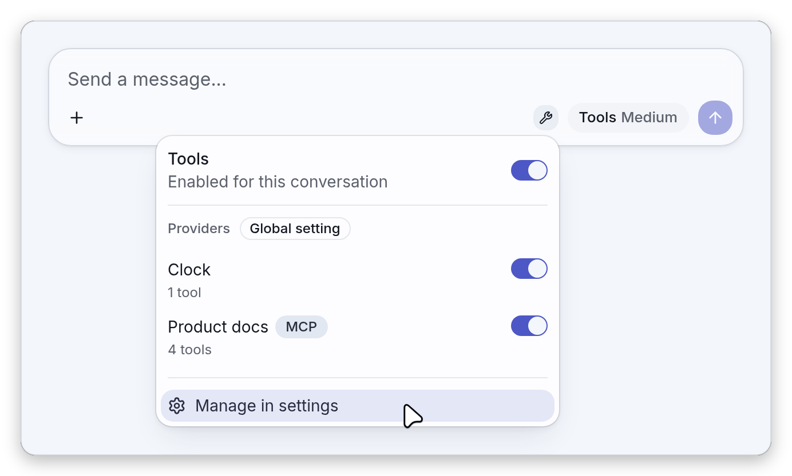
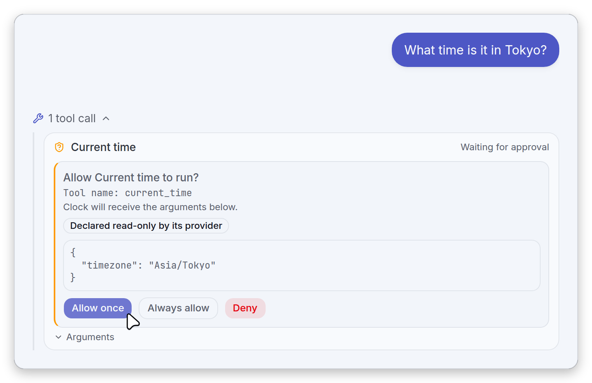
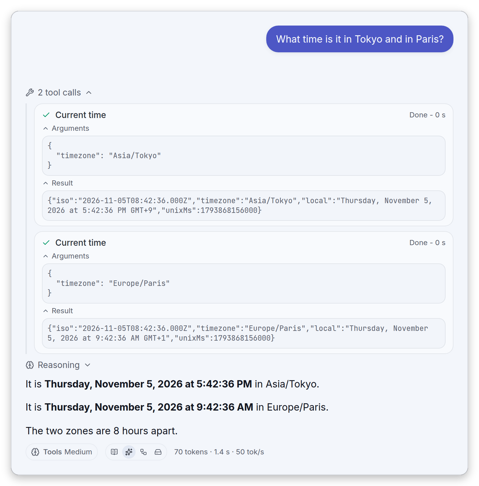
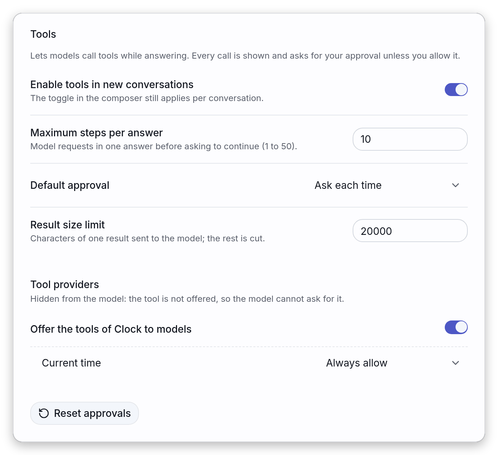

# Tool calling

HYOAI lets a model call tools while it answers. A tool is a function a provider exposes (the app
ships a harmless `clock` tool that returns the time in an IANA time zone;
[plugins](../README.md#plugins) can add others). Every call is shown with its full arguments and, by
default, waits for your decision before it runs.

This page explains how a flow works, what the interface shows at each point, how to make a server
and a model take tools, and what the security defaults are. The README keeps the
[summary](../README.md#tool-calling); [MCP servers](mcp.md), which give the models more tools, have
their own page.

## How a flow works

The model can call tools while it answers. Tools are off by default: turn them on per conversation
from the wrench button in the composer, whose panel also lists the providers and how many tools each
offers, or for new conversations in Settings → Tools. The wrench is greyed out when the model cannot
take tools. A conversation that used tools and has them switched off shows a notice above the
composer with a button to switch them back on, when the current model can take tools again.

For each step the model asks for a call, the app shows the tool and its full arguments, waits for
your decision (allow once, always allow this tool, or deny), runs it, and sends the result back so
the model can answer or call again. Calls run one after the other, an answer stops after 10 steps by
default (then **Continue** or **Answer without tools**), and a stopped or reloaded flow can be
continued the same way. The calls show as cards above the answer, each with its arguments and
result; calls and results are saved with the conversation, and regenerating, branching and deleting
act on the whole flow.

In more detail, one answer goes like this:

1. When the answer starts, the app lists the tools of every enabled provider once and sends them
   with the request. A tool whose approval is set to "Hidden from the model" is not offered. A provider that
   fails to list its tools, or does not within 10 seconds, is left out of that answer and reported
   with a notification ("Tools from {provider} are unavailable for this answer."). For an MCP
   server, the app remembers a failed listing for 30 seconds and does not report the same failure
   again during that time. The model sees each tool under the provider id and the tool name joined
   with an underscore, such as `clock_current_time`; a character other than a letter, a digit, `_`
   or `-` is replaced by `_`, a name over 64 characters is shortened, and two tools that end up with
   the same name get a `_2` suffix on the second.
2. The model writes, or asks for one or more calls.
3. For each call, in order, the app checks the approval of that tool. When it asks, a card waits for
   your decision. An approved call runs under a 60 second limit and its result is cut to the result
   size limit. A call for an unknown tool, or whose arguments are not a JSON object, is not run and
   asks for no approval: it gets an error result instead (see
   [When a call goes wrong](#when-a-call-goes-wrong)).
4. The results go back to the model, and the cycle starts again, until the model answers without a
   call (or its answer is cut by the token limit), you press Stop, the step limit is reached, or a
   step fails (see [Errors on a step](#errors-on-a-step)).

### Reasoning during a flow

A model that reasons between steps has the reasoning of each step saved on that step's message, and
it shows in the folded "Reasoning" row. It is not sent back to the model by default. With the
`preserve_thinking` opt-in of [models.md](models.md#keeping-the-reasoning-of-earlier-turns), the
reasoning of every earlier step goes back with its call, so the model finds its own thoughts after
each result. This holds in three situations:

- when the calls are sent natively, the reasoning travels on the same message as the call;
- when **Send context** is off for the model, only the current turn is sent and it includes the
  reasoning of the steps of the flow;
- when the calls are shown to the model as text (tools switched off, or a model that cannot take
  them), a step that wrote no text but did reason is still sent, as an assistant message with its
  reasoning and no text. A step with neither is left out, as before.

## Turning tools on for a model

The server has to support it, and some need a flag:

- **llama.cpp**: start `llama-server` with `--jinja`. Without it the server refuses the tools and
  the error says so. With `runtimeProps`, the app reads the chat template from `GET /props` and
  turns tools on by itself when the template handles them; set `"tools": false` on the entry when
  that detection is wrong.
- **vLLM**: start it with `--enable-auto-tool-choice --tool-call-parser <parser>` (for example
  `hermes`), and set `"tools": true` on the entry.
- **Ollama and other OpenAI-compatible servers**: use `"type": "openai"` and `"tools": true`. These
  servers may reject `tool_choice`, which is why `supportsToolChoice` is off for that type.
- A model whose chat template does not support tools keeps working: when the request offers no
  tools, the results of earlier calls stay in the context as text added to the message they answer
  (or as a message of their own when the model wrote text before the call or the question carries
  attachments), and the calls themselves are not written out, so the model does not imitate them.

Four keys of a `models` entry in `config.json` drive this (the full table is in
[Keys of a `models` entry](models.md#keys-of-a-models-entry)):

| Key                  | Effect                                                                                                                                |
| -------------------- | ------------------------------------------------------------------------------------------------------------------------------------- |
| `tools`              | Off unless the config says `true` or a llama.cpp server reports a chat template that handles tools. `false` forces it off             |
| `parallelToolCalls`  | Lets the model call several tools in one step (sent as `parallel_tool_calls`; default: not sent)                                      |
| `supportsToolChoice` | Whether the server accepts the `tool_choice` field. Defaults from `type` (`false` for `openai`, which covers Ollama), overridable     |
| `recoverToolCalls`   | Off unless `true`. Runs a tool call the model wrote as text instead of the structured channel, through the usual approval (see below) |

The same options are in Settings → Models, under ["Advanced settings"](models.md#advanced-settings)
of a model: "Tool calling" (Auto means on only when llama.cpp's chat template supports tools; vLLM
needs `--enable-auto-tool-choice --tool-call-parser`), "Parallel tool calls", "Send tool_choice"
(off for servers that reject the field, such as Ollama) and "Recover tool calls written as text".
The [Model Information](models.md#the-desktop-dropdown) dialog has a "Tool calling" row that says
"Yes", "Yes (detected from the chat template)" or "No", with the same check as the wrench, so it
tells why the wrench stays greyed out. A fifth key, `mcpServers`, scopes which MCP servers a model
may use: see [mcp.md](mcp.md).

## In the conversation

### The wrench and its panel

The wrench button sits on the right of the composer, before the model selector. It tells the state
of tools at a glance:

- tinted: tools are on for this conversation;
- an amber dot on it: a call is waiting for your approval;
- greyed out, with the tooltip "This model does not support tools.": the model cannot take tools. On
  a touch screen there is no tooltip: open [Model Information](models.md#the-desktop-dropdown) and
  read its "Tool calling" row;
- absent: tools are never offered here, which is the case in an
  [embed](embed.md#what-the-widget-leaves-out).

Clicking it opens the panel.

<picture>
    <source media="(prefers-color-scheme: dark)" srcset="images/dark/tool-panel.png">
    
</picture>

The panel has two levels, and the difference matters:

- **The switch at the top, "Tools"**, is for the open conversation only. It reads "Enabled for this
  conversation" or "Disabled for this conversation". A conversation whose switch was never touched
  follows Settings → Tools, "Enable tools in new conversations"; once you flip the switch, the
  conversation remembers its own choice.
- **The providers below, tagged "Global setting"**, are not per conversation. Each row shows the
  provider, how many tools it lists ("1 tool", "4 tools", followed by "· 1 hidden" when some are set to
  "Hidden from the model" and so are not offered), or why it cannot ("The tools could not
  be listed"), and a switch, which is the same setting as "Offer the tools of {provider} to models"
  in Settings → Tools and applies to every conversation. An MCP server is tagged "MCP" and carries
  its connection state. The line under its name is the first of these that applies: the reason of a
  failure next to a status label such as "CORS blocked" (or, for a connected server whose tool list
  was malformed, "The server is connected, but it did not list its tools correctly."), then "Off",
  "Not offered to this model", "Connecting…" and "The tools could not be listed". A connected server
  that is scoped to the model and listed its tools correctly shows its tool count like any other
  provider. A "Retry" button shows when the connection failed, or when the server is connected but
  did not list its tools correctly; any other listing failure, such as a timeout, has no button (see
  [The wrench panel](mcp.md#the-wrench-panel)).

While a call waits for you, the panel also says so ("A call is waiting for your approval in the
conversation."). "Manage in settings" at the bottom opens Settings → Tools.

When a conversation already used tools, they are off and the current model can take them, a notice
appears above the composer ("This conversation used tools, which are off for now.") with an "Enable"
button, so the model does not answer as if it had no tools without you noticing. With a model that
cannot take tools, the wrench is greyed out and the notice is not shown.

In [compare mode](compare.md) each pane has its own wrench and its own conversation switch. The
notice belongs to the composer of a single conversation: a compare pane shows only its wrench
(greyed out or not) and its switch.

To try it with nothing to install, turn tools on for a model that takes them and ask for the time in
another city: the built-in `clock` provider offers one tool, "Current time", which takes an optional
IANA time zone and defaults to your own.

### Approving a call

Unless you allowed the tool, a call stops at an approval card inside the flow, under the call it
concerns.

<picture>
    <source media="(prefers-color-scheme: dark)" srcset="images/dark/tool-approval.png">
    
</picture>

The card shows what is sent and to whom:

- the question "Allow {tool} to run?" with the name of the tool;
- "Tool name: {name}", the provider's own name for it, when it differs from the name shown;
- "{provider} will receive the arguments below." and the arguments as pretty-printed JSON, or
  "{provider} will receive no arguments." when there are none;
- a "Declared read-only by its provider" badge when the provider says so. It is only displayed: it
  never skips the approval.

Then three buttons:

| Button           | What happens                                                                                                        |
| ---------------- | ------------------------------------------------------------------------------------------------------------------- |
| **Allow once**   | This call runs. The next call of the same tool asks again                                                           |
| **Always allow** | This call runs, and that one tool is set to "Always allow" in Settings → Tools, where you can change it back        |
| **Deny**         | The call does not run. The model gets a result saying you denied it and must not retry, and the card shows "Denied" |

Nothing in the card is focused on its own, so a keystroke meant for the composer never approves a
call. If you change the approval of that tool in Settings while the card is waiting, the card
settles by itself ("Always allow" runs it, "Hidden from the model" denies it); allowing a tool "Always allow" in
one compare pane likewise releases the same tool waiting in another pane.

A call waiting for you is signalled in several places, so a flow running in the background can be
spotted: the amber dot on the wrench, the notice in its panel, the card itself (the trace opens by
itself and stays open while a call waits), a shield icon on the conversation row in the sidebar
("Waiting for your approval"), and in compare mode a shield icon on the pane ("A tool call needs
your approval in this pane"). With a mouse, the hover card of the conversation in the sidebar also
says "Running a tool…" while a call runs; on a touch screen there is no hover card, and only the
shield icon tells that a call waits.

### Several calls in one step

A model can ask for several calls in one step, and each one gets its own card. They do not run side
by side: the app takes them in order, each waiting for its own approval when it asks. At most 16
calls run per step; the others get an error result that tells the model so. The `parallelToolCalls`
option of the entry (see above) controls whether the request lets the model make several calls in
one step.

### Reading a finished flow

Above the answer, the calls of the flow are grouped under a foldable line, "1 tool call" or "N tool
calls". It opens by itself while the answer is produced, then folds once the answer is done, unless
"Expand search and tool activity" is on in Settings → Appearance.

<picture>
    <source media="(prefers-color-scheme: dark)" srcset="images/dark/tool-flow.png">
    
</picture>

In the picture, the trace and the "Arguments" and "Result" blocks of both calls were unfolded by
hand. The folded "Reasoning" row between the trace and the answer is the reasoning of the model,
which the message shows when there is some.

Each call is a card:

- a status icon, the name of the tool, the state of the call and, for a call that ran, how long it
  took, such as "Done - 0 s". The states are "Waiting for approval", "Running…", "Done", "Failed",
  "Denied", "Cancelled" and "Not run" (a call that never started because the flow stopped);
- two foldable blocks, "Arguments" and "Result", closed by default. They show verbatim text, never
  Markdown, and a result that was cut says "Truncated: {omitted} characters were not sent to the
  model". A call with nothing to send reads "No arguments";
- while the model is still writing a call, a card "Preparing {name}…" stands in for it.

The text the model wrote before a call is shown above the first call of that message. The answer the
flow ended with is a message under the trace, with its actions and footer. The footer has a "Steps
(time per step)" view that lists the duration of each model request ("Step 1", "Step 2", ...) and of
each tool call that ran (a call that was denied, or never reached, has no duration); it belongs to
the [message statistics](features.md#per-message-stats), which "Message statistics" in Settings →
Appearance switches on and off. The sources the tools returned, when they return any, are gathered on
that final answer.

Regenerating the answer re-runs the whole flow, deleting it removes the whole flow, and the branch
indicator of the answer switches between flows as a whole. The steps of a flow, and the answer it
ends with, cannot be edited: "Edit message" is not offered on them.

### Stop, Continue and the step limit

The Stop button of the composer works at every point of a flow: while the model writes, while a card
waits for you and while a call runs. A call that was running is still recorded, as "Cancelled",
because it may already have had effects, and the calls that had not started stay without a result.

A flow left with calls that have no result has no answer yet, and shows a bar under the trace of its
calls instead. The bar shows once nothing else is running, and only on the flow that ends the
displayed branch: it is hidden while a request runs and when you browse another branch. It says
"Stopped after {steps} steps." when the flow has at least as many steps as the current "Maximum
steps per answer" setting (the count includes the steps before an earlier Continue), and "Some tool
calls did not run." when it has fewer, which is typical after a stop or after a reload in the middle
of a flow. A stop on a flow that already reached the limit, after a Continue for example, shows the
first message. Its two buttons are:

- **Continue** runs the open calls (they are approved like any other) and lets the model go on, with
  a fresh step budget. It only runs the calls while tools are on and offered for the conversation (a
  model that can take them, at least one tool left): with tools off, or a model that cannot take
  them, the open calls are cancelled (they show as "Cancelled") and the model answers without tools,
  as with the other button;
- **Answer without tools** skips the open calls (they show as "Cancelled") and asks the model for a
  final answer with tools turned off for that request: on an OpenAI-compatible server `tool_choice`
  is sent as `none`, or, when the entry does not accept `tool_choice`, the request simply leaves the
  tools out.

The step limit is the "Maximum steps per answer" setting, 10 by default. A step is one request to
the model, so with the default an answer can chain ten requests; when the tenth ends on calls, those
calls are not run and the bar offers to continue.

### When a call goes wrong

A call that cannot run is never silent, and the model is told so it can correct itself. The card
shows "Failed" and the model receives the reason as the result: an unknown tool name, arguments that
are not a JSON object, an error reported by the tool, or a call that did not answer within 60
seconds.

A call whose arguments are not a JSON object is not run and no approval is asked; its card shows
"Failed", and its "Arguments" block shows what the model sent, text that is not valid JSON exactly
as it came.

## Settings → Tools

The Tools page of the settings holds the global settings of the tool loop: the defaults for new
conversations, the limits, the providers and the approval of each tool.

<picture>
    <source media="(prefers-color-scheme: dark)" srcset="images/dark/tool-settings.png">
    
</picture>

In this picture, tools are enabled for new conversations and "Current time" is set to "Always
allow": neither is the default, as the table below shows.

| Setting                           | Default       | Effect                                                                                                                                                                                                        |
| --------------------------------- | ------------- | ------------------------------------------------------------------------------------------------------------------------------------------------------------------------------------------------------------- |
| Enable tools in new conversations | off           | Conversations without a choice of their own have tools on. "The toggle in the composer still applies per conversation."                                                                                       |
| Maximum steps per answer          | 10            | Model requests in one answer before asking to continue, from 1 to 50                                                                                                                                          |
| Default approval                  | Ask each time | What a tool without a decision of its own does: "Ask each time" or "Always allow". The second shows a warning ("Tools will run without asking. A tool result can contain instructions that steer the model.") |
| Result size limit                 | 20000         | Characters of one result sent to the model, from 1000 to 200000; the rest is cut. A value outside the range is brought back into it                                                                           |

Under "Tool providers", each provider has its switch ("Offer the tools of {provider} to models", the
same global setting as in the panel of the wrench) and, for each of its tools, an approval:

- "Ask each time": the tool asks before every call;
- "Always allow": the tool runs without asking, which is what the Always allow button of a card
  sets;
- "Hidden from the model": the tool is not offered to the models at all, so they cannot ask for it.
  This is not the same as "Deny" on an approval card, which refuses a call the model already asked
  for.

The built-in `clock` provider is always in the list. A provider that fails to list its tools reads
"The tools of this provider could not be listed." The MCP servers, with the
approval of each of their tools, have their own page, **MCP servers**, covered in [mcp.md](mcp.md).

"Reset approvals" at the bottom clears every per-tool decision, "Always allow" and "Hidden from the model" alike,
so each tool follows "Default approval" again. The button confirms with "Every tool asks again."

## Errors on a step

A step that ends in a way the app cannot use is reported as an error on the message, never left
silent: the server closed the stream before its finish reason, the token limit cut a tool call while
it was written (the half call is dropped, not run), the server announced a call it never sent, or
the model wrote nothing after the tool results, or only reasoned. Regenerate the answer to try
again. A stream cut
before its finish reason is reported the same way when no tool is involved, and a summary cut that
way is thrown away instead of replacing the history.

The message on the answer says which case it is:

| Case                                                 | Message                                                                                                                                                            |
| ---------------------------------------------------- | ------------------------------------------------------------------------------------------------------------------------------------------------------------------ |
| The stream closed before its finish reason           | "The server closed the connection before the answer was complete. Regenerate the answer."                                                                          |
| The token limit cut a tool call while it was written | "The answer hit the token limit while the model was writing a tool call, so the call was dropped. Raise the maximum number of tokens and regenerate the answer."   |
| The server announced a call it never sent            | "The server announced a tool call but did not send it. Regenerate the answer, or check the tool call parser of the server."                                        |
| The model wrote nothing after the tool results       | "The model ended its turn without writing an answer after the tool results. Regenerate the answer."                                                                |
| The model only reasoned after the tool results       | "After the tool results the model only reasoned and wrote no answer. Regenerate the answer, or raise the maximum number of tokens if the reasoning uses them all." |

When the server rejects the tools themselves (an HTTP error whose message points at the tools), the
error reads "The server rejected the tools ({message}). Start llama.cpp with --jinja or vLLM with
--enable-auto-tool-choice, or set "tools" to false on this entry."

## Recovering calls written as text

Some servers have a chat parser that fails to catch a call and let it leak into the answer as markup
(the Hermes `tool_call` format, ending the text). Set `"recoverToolCalls": true` on the entry to
recover it: when a step made no structured call, ended normally (not cut by the token limit) and is
not an "Answer without tools" request, a complete block at the very end of the text that names a
tool of the flow is taken out of the text and run as that call. It goes through the same approval as
every other call, so a tool set to "Always allow" runs without a card. A block that is incomplete,
not at the end, or for an unknown tool is left as text. The values of the block are text, so they
are typed by the tool's input schema (`"5"` becomes `5` for an integer, `true` for a boolean,
`["a"]` for an array), and a call without parameters is recovered only for a tool that requires
none. The option is off by default and, like the rest of the tool support, a model setting you opt
into.

## Security defaults

- Every tool asks before it runs. "Always allow" applies to one tool, never to a whole provider, and
  Settings → Tools lists the decisions and can reset them. Setting the default to "always allow" is
  a deliberate choice and shows a warning. Approvals are never imported from an export.
- A result is capped at 20,000 characters, shown as plain text (never rendered as Markdown or HTML),
  and a call is cut after 60 seconds. Nothing the model writes after a tool result on the same
  branch, and no summary, loads a remote image (the image appears as a link, "Image not loaded:
  {url}"), so an injected instruction cannot send data out through an image address.
- Tools are never offered in an embed. A tool provider is code running in the page: see
  [Plugins](../README.md#plugins).

The 20,000 characters are the default of the "Result size limit" setting described above. A provider
written as a plugin is trusted code with the access of the page; its contract, including how its
tools are declared, is in [plugins/README.md](../plugins/README.md).

## Export

An [export](features.md#storage-export-and-import) in the HYOAI format that contains tool calls
imports into this app without loss. The llama.cpp webui format keeps the calls and their results,
but every result comes back as "Done", without its duration, title, provider or approval, and a
result that was "Failed", "Denied" or "Cancelled" loses that status. The OpenAI (JSONL) and Markdown
exports cannot be imported. Older builds of the app, and the llama.cpp web interface, may drop or
flatten them.

## MCP servers

An MCP server gives the models more tools, with the same approvals as any other provider. Adding
one, its connection states and its scope per model are covered in [mcp.md](mcp.md).
